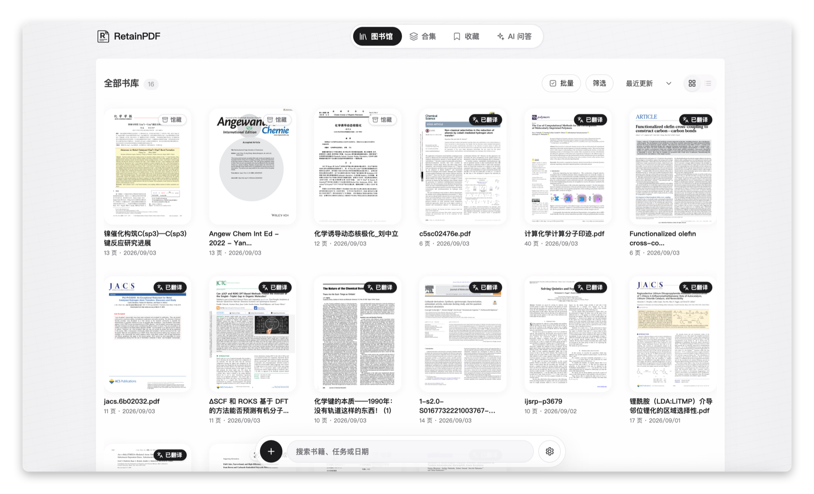
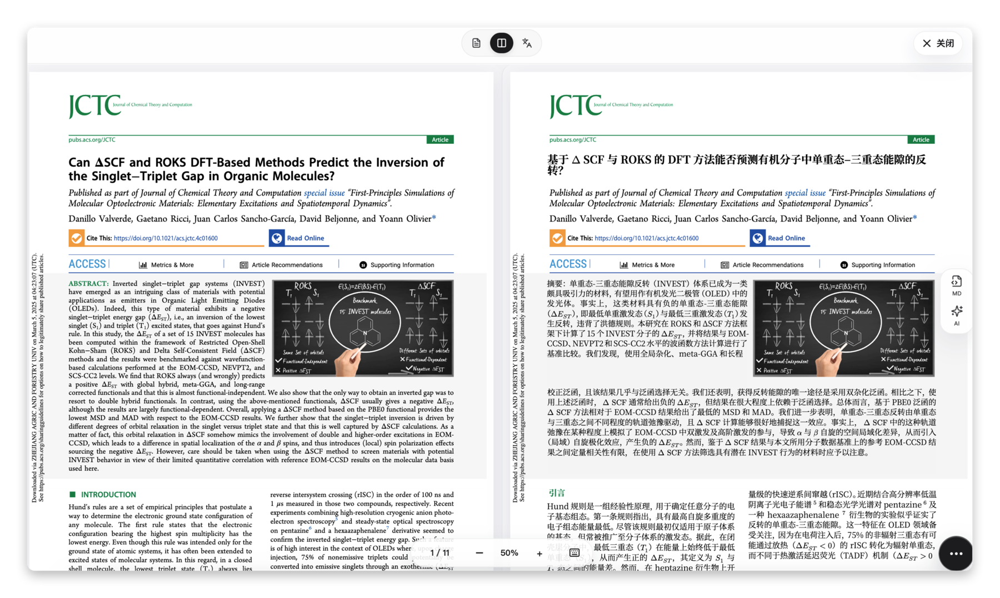
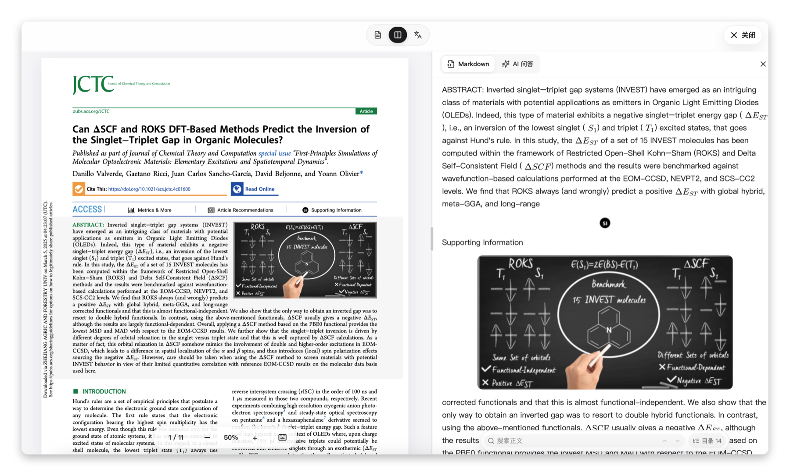
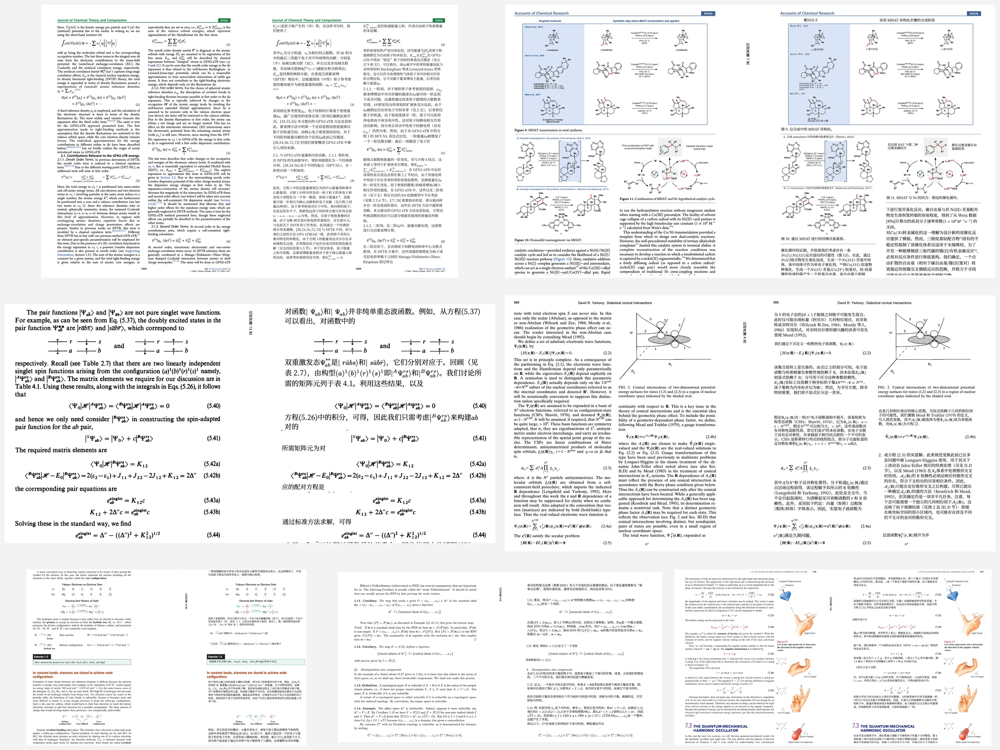
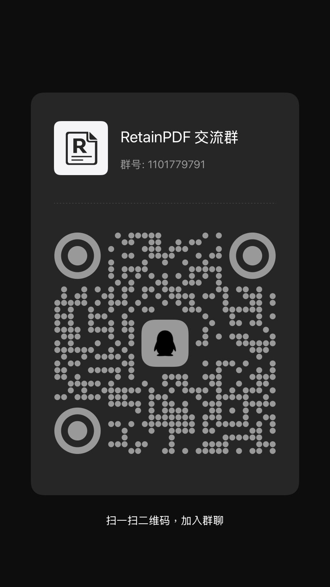

# RetainPDF: Layout-Preserving PDF Translation

<p align="center">
  <a href="README.md">中文</a> · <a href="README.en.md">English</a> · <a href="README.vi.md">Tiếng Việt</a>
</p>

<p align="center">
  
</p>

<p align="center">
  <a href="https://github.com/wxyhgk/retain-pdf/releases/latest"></a>
  <a href="https://github.com/wxyhgk/retain-pdf/releases"></a>
  <a href="LICENSE"></a>
  <a href="https://github.com/wxyhgk/retain-pdf/actions/workflows/tests.yml"></a>
  <a href="https://github.com/wxyhgk/retain-pdf/stargazers"></a>
</p>

RetainPDF is currently the only open-source project built for layout-preserving translation of image-based and scanned PDFs, with translation and typesetting quality that matches or even surpasses comparable commercial products. The code, API, and deployment stack are fully open, with support for self-hosting and further development.

## Highlights

- **Agent translation at publisher level**: reads the whole book first to fix terms and style, then translates page by page and reviews every paragraph—consistent terminology across the book and publisher-level translation quality. See [Agent translation](#agent-translation-publisher-level-quality) below.
- **Layout preserved**: an in-house typography algorithm keeps complex formulas, multi-column papers, figures, headers and footers in place.
- **Inline formulas, far ahead**: formulas, surrounding text and inline layout stay stable after translation—something other open-source PDF translators do not currently achieve.
- **Scanned PDFs too**: image-based and scanned PDFs go through OCR first, whether or not they have a text layer.
- **Whole sentences, not boxes**: cross-column and cross-page passages, broken sentences and continued paragraphs are stitched back before translation, so context is never cut.
- **Code stays code**: code blocks, formulas and proper nouns are protected by rules, and glossaries pin down how terms are translated.

## Agent translation: publisher-level quality

Standard translation goes paragraph by paragraph—fast and cheap. **Agent translation works on a book the way a publisher's translator and editor do**, and reaches publisher-level translation quality:

| Step | What happens |
| --- | --- |
| Read the whole book | Before translating, it reads the entire book, identifies the field, and sets a glossary, translation guidelines and style rules |
| Translate page by page | Follows the agreed terms and style, so each term has one translation and the voice stays consistent |
| Review every paragraph | Checks each paragraph for omissions, mistranslations and inconsistent terms, and retranslates the ones that fail |
| Editorial room | While it runs, the book's 「进度」 (progress) tab shows what the agent is reading, which terms it fixed and what review found |

Afterwards the book's 「术语」 (terms) tab lists its field, terms and style rules, and you can save them as your own glossary for the next book.
Agent translation is slower and costs more than standard translation; use it for books you will read closely or put to use. Switch 「普通」 to 「Agent」 when adding a PDF—see [adding a PDF (Chinese)](frontend/web/guide/ingest.md).

Core capability comparison:

| Project | Scanned PDFs | Complex inline formulas | Protect code from translation | Table control | Custom translation strategy | Layout preservation | PDF size optimization | API automation |
| --- | --- | --- | --- | --- | --- | --- | --- | --- |
| PDFMathTranslate | ❌ | ❌ | ❌ | Limited | Limited | Average | Average | ✅ |
| PolyglotPDF | ❌ | ❌ | ❌ | Limited | Limited | Average | Average | ✅ |
| Doc2X | ✅ | ✅ | ❌ | Moderate | Limited | Strong | Limited | ❌ Not public |
| RetainPDF | ✅ | ✅ Strong preservation | ✅ | ✅ Optional | ✅ Rule-based | Strong | ✅ Continuously improved | ✅ |

## Features

| Feature | What it does |
| --- | --- |
| [Library](frontend/web/guide/library.md) | Shelf for papers and books; filter, sort, and full-text search inside books |
| [Collections](frontend/web/guide/collections.md) | Group books; one book can live in several collections |
| [Translate](frontend/web/guide/ingest.md) | Drop in a PDF and translate; or translate a few pages, OCR only, or just save it |
| [Agent translation](frontend/web/guide/ingest.md) | Reads the whole book first to fix terms and style, then translates and reviews page by page |
| [Side-by-side reading](frontend/web/guide/reader.md) | Source and translation side by side, with search, bookmarks, pen and a Markdown view |
| [Edit translations](frontend/web/guide/reader.md) | Hover a paragraph to edit it, re-typeset, and roll back from revision history |
| [Glossaries](frontend/web/guide/glossaries.md) | Keep terms translated your way; import from CSV / Excel |
| [Usage and cost](frontend/web/guide/usage.md) | Tokens and estimated cost per book, with an estimate before you translate |
| [Sync](frontend/web/guide/sync.md) | Sync the library and reading progress across computers via a cloud folder or WebDAV |
| [Backups](frontend/web/guide/backup.md) | Daily automatic backups of the library; restore to an earlier day |
| [LAN sharing](frontend/web/guide/lan-share.md) | Scan a QR code on your phone or tablet to read, upload and translate in the browser; keys stay on the computer |
| [Command line](frontend/web/guide/settings.md) | Check status, back up, sync and configure providers with `retainpdf` |
| [User guide](frontend/web/guide/README.md) | Open it any time from 「使用说明」 at the bottom of the app (Chinese) |

## Supported services

- OCR: PaddleOCR, MinerU, GLM-OCR (Zhipu)
- Translation models: DeepSeek, Qwen (Bailian), Zhipu, OpenAI, Anthropic, OpenCode Go, and any custom endpoint compatible with the OpenAI or Anthropic format

How to get keys and where to enter them: [API settings (Chinese)](frontend/web/guide/credentials.md).

## Product

### Library

Manage papers, books, and scanned documents in one library, with translation status, collections, and favorites.

<p align="center">
  
</p>

### Side-by-side reading

Compare the source and translated PDFs on the same page to verify formulas, figures, citations, and layout.

<p align="center">
  
</p>

### Markdown reading

Read PDF and Markdown side by side while preserving formulas and images.

<p align="center">
  
</p>

## Translation examples

Source-to-translation examples for scientific papers, scanned PDFs, formula-heavy documents, and books:

<p align="center">
  
</p>

<p align="center"><sub>Row 1: scientific papers · Row 2: scanned and formula-heavy documents · Row 3: books and textbooks</sub></p>

## Quick start

### Desktop

Download from [GitHub Releases](https://github.com/wxyhgk/retain-pdf/releases/latest):

| System | Download | Notes |
| --- | --- | --- |
| macOS | `RetainPDF-Mac-<version>.dmg` | Apple silicon only (M1 and later); signed and notarized by Apple |
| Windows | `RetainPDF-Windows-<version>-Setup.exe` | If you see “Windows protected your PC”, click “More info” → “Run anyway” |
| Linux | `RetainPDF-Linux-<version>.deb` | `sudo apt install ./RetainPDF-Linux-<version>.deb` |

On first launch the app opens the API settings; fill in your OCR and translation keys and you're ready. Step by step: [user guide (Chinese)](frontend/web/guide/README.md).

### Docker

```bash
git clone https://github.com/wxyhgk/retain-pdf.git
cd retain-pdf/ops/deployment/docker/delivery
docker compose up -d
```

Open <http://127.0.0.1:40001>. To update:

```bash
docker compose pull
docker compose up -d
```

See the [Docker deployment guide](ops/deployment/docker/delivery/README.md) for more options, including the multi-user edition (accounts, per-page quotas) in its 「多用户模式」 section.

## Community

QQ group: `1101779791`

<p align="center">
  
</p>

## Development

See the [contribution guide](CONTRIBUTING.md), [project documentation](docs/README.md), and [backend guide](backend/README.md).

## License

This project is distributed under the MIT License. See [LICENSE](LICENSE) for the full text.
