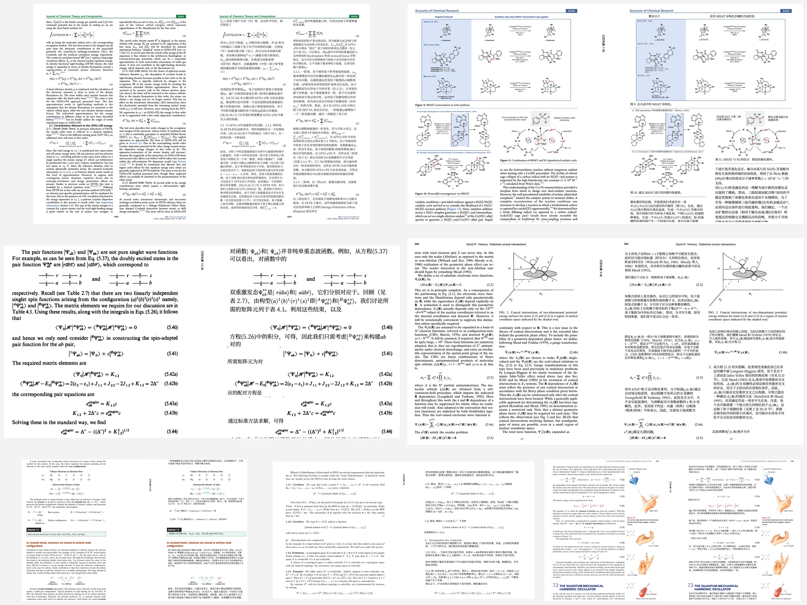

# RetainPDF：PDF 保留排版翻译工具

<p align="center">
  <a href="README.md">中文</a> · <a href="README.en.md">English</a> · <a href="README.vi.md">Tiếng Việt</a>
</p>

<p align="center">
  
</p>

<p align="center">
  <a href="https://github.com/wxyhgk/retain-pdf/releases/latest"></a>
  <a href="https://github.com/wxyhgk/retain-pdf/releases"></a>
  <a href="LICENSE"></a>
  <a href="https://github.com/wxyhgk/retain-pdf/actions/workflows/tests.yml"></a>
  <a href="https://github.com/wxyhgk/retain-pdf/stargazers"></a>
</p>

开源的 PDF 保留排版翻译工具，扫描版、图片型 PDF 也能翻。桌面版开箱即用，也可以 Docker 自部署。

- **保留排版**：公式、多栏、图表、页眉页脚留在原位，行内公式翻译后照样稳定。
- **扫描件也能翻**：先 OCR 再翻译，不挑原文件有没有文字层。
- **按完整的话翻**：跨栏、跨页的段落先拼回来再翻，代码、公式、专有名词不误翻，术语表定译法。
- **Agent 精翻**：先通读全书定术语和文风，再逐页翻译、逐段审校，全书译法一致；慢一些、贵一些，适合要认真读的书。

<p align="center">
  
</p>

<p align="center">
  
</p>

## 下载

到 [Releases](https://github.com/wxyhgk/retain-pdf/releases/latest) 下载：

| 系统 | 文件 | 说明 |
| --- | --- | --- |
| macOS | `RetainPDF-Mac-<版本>.dmg` | Apple 芯片（M1 及以后），已签名公证 |
| Windows | `RetainPDF-Windows-<版本>-Setup.exe` | 提示「Windows 已保护你的电脑」时点「更多信息」→「仍要运行」 |
| Linux | `RetainPDF-Linux-<版本>.deb` | `sudo apt install ./RetainPDF-Linux-<版本>.deb` |

第一次打开会弹出接口设置，填好 OCR 和翻译的 Key 就能用。支持 PaddleOCR、MinerU、GLM-OCR，以及 DeepSeek、Qwen、智谱、OpenAI、Anthropic、OpenCode Go 和兼容 OpenAI / Anthropic 格式的接口（[怎么申请](frontend/web/guide/credentials.md)）。

Docker 部署：

```bash
git clone https://github.com/wxyhgk/retain-pdf.git
cd retain-pdf/ops/deployment/docker/delivery
docker compose up -d   # 打开 http://127.0.0.1:40001
```

更多见 [Docker 部署说明](ops/deployment/docker/delivery/README.md)。

## 文档

- [使用说明书](frontend/web/guide/README.md)：图书馆、翻译、对照阅读、术语表、同步、备份、局域网共享……软件里点底部「使用说明」也能看
- 开发：[贡献指南](CONTRIBUTING.md) · [项目文档](docs/README.md) · [后端说明](backend/README.md)

## 交流

QQ 群：`1101779791`

<p align="center">
  
</p>

## License

MIT，见 [LICENSE](LICENSE)。
