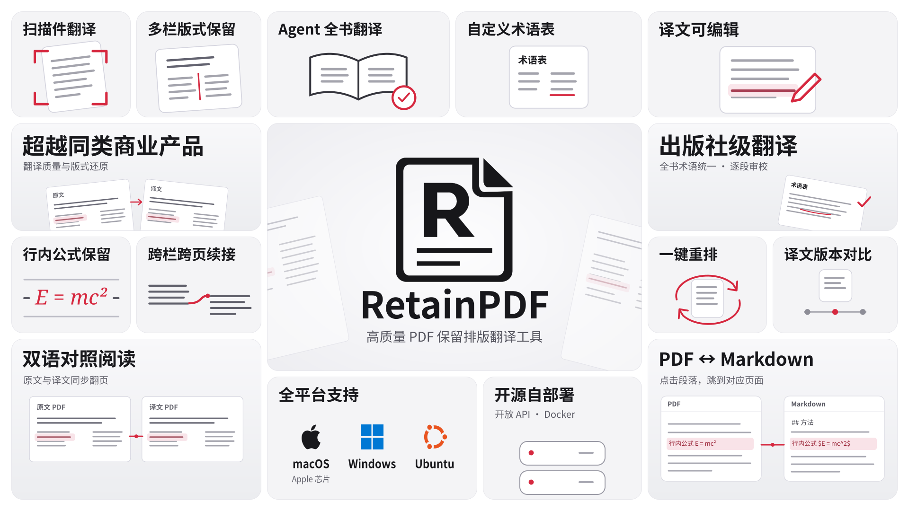

# RetainPDF：PDF 保留排版翻译工具

<p align="center">
  <a href="README.md">中文</a> · <a href="README.en.md">English</a> · <a href="README.vi.md">Tiếng Việt</a>
</p>

<p align="center">
  
</p>

核心能力对比：

| 项目 | 扫描型 PDF | 复杂行内公式 | 代码不误翻 | 表格控制 | 自定义翻译策略 | 排版保留 | PDF 压缩优化 | API 自动化 |
| --- | --- | --- | --- | --- | --- | --- | --- | --- |
| PDFMathTranslate | ❌ | ❌ | ❌ | 弱 | 弱 | 一般 | 一般 | ✅ |
| PolyglotPDF | ❌ | ❌ | ❌ | 弱 | 弱 | 一般 | 一般 | ✅ |
| Doc2X | ✅ | ✅ | ❌ | 中 | 弱 | 强 | 弱 | ❌ 不开放 |
| RetainPDF | ✅ | ✅ 强保留 | ✅ | ✅ 可开关 | ✅ 可按规则配置 | 强 | ✅ 持续优化 | ✅ |

## 产品界面

### 图书馆

在一个书架中管理论文、图书和扫描文档，集中查看翻译状态、合集与收藏。

<p align="center">
  
</p>

### 原文与译文对照阅读

原 PDF 与译文 PDF 同页并排展示，便于核对公式、图表、引用和版面位置。

<p align="center">
  
</p>

### Markdown 阅读

PDF 与 Markdown 同屏阅读，保留公式和图片。

<p align="center">
  
</p>

## 翻译效果

SCI 论文、图片型 / 扫描版 PDF 与图书教材的原文—译文对照样例：

<p align="center">
  
</p>

<p align="center"><sub>第一行：SCI 论文 · 第二行：扫描与公式密集文档 · 第三行：图书教材</sub></p>

## 快速开始

### 桌面端

从 [GitHub Releases](https://github.com/wxyhgk/retain-pdf/releases/latest) 下载对应版本：

- Windows：`Setup.exe`（提示「Windows 已保护你的电脑」时点「更多信息」→「仍要运行」）
- macOS：`.dmg`（Apple 芯片，已签名公证）
- Linux：`.deb`（`sudo apt install ./RetainPDF-Linux-<版本>.deb`）

第一次打开会弹出接口设置，填好 OCR 和翻译的 Key 就能开始，一步步怎么做见 [使用说明书](frontend/web/guide/README.md)。

### Docker 部署

```bash
git clone https://github.com/wxyhgk/retain-pdf.git
cd retain-pdf/ops/deployment/docker/delivery
docker compose up -d
```

启动后访问 <http://127.0.0.1:40001>。更新服务：

```bash
docker compose pull
docker compose up -d
```

更多配置见 [Docker 部署说明](ops/deployment/docker/delivery/README.md)。

## 交流

QQ 交流群：`1101779791`

<p align="center">
  
</p>

## 开发

参阅 [贡献指南](CONTRIBUTING.md)、[项目文档](docs/README.md)和[后端说明](backend/README.md)。

## License

This project is distributed under the MIT License. See [LICENSE](LICENSE) for the full text.
