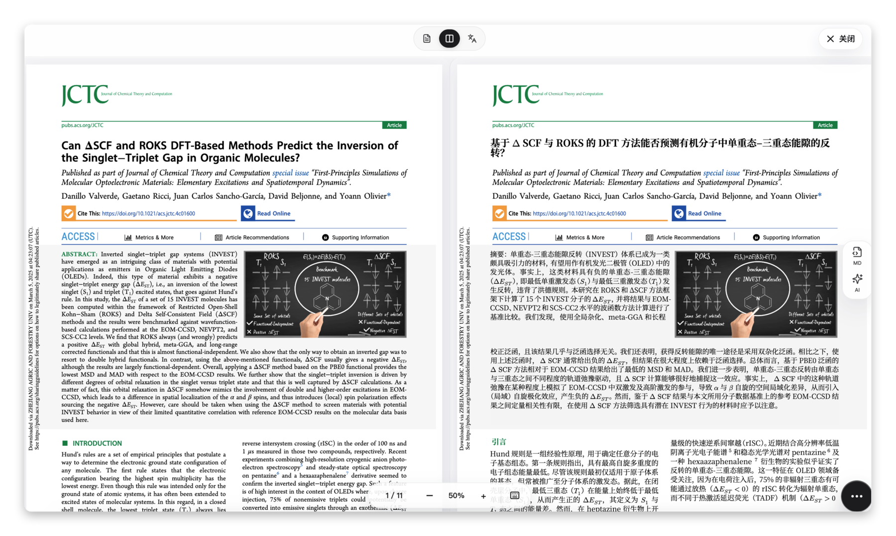
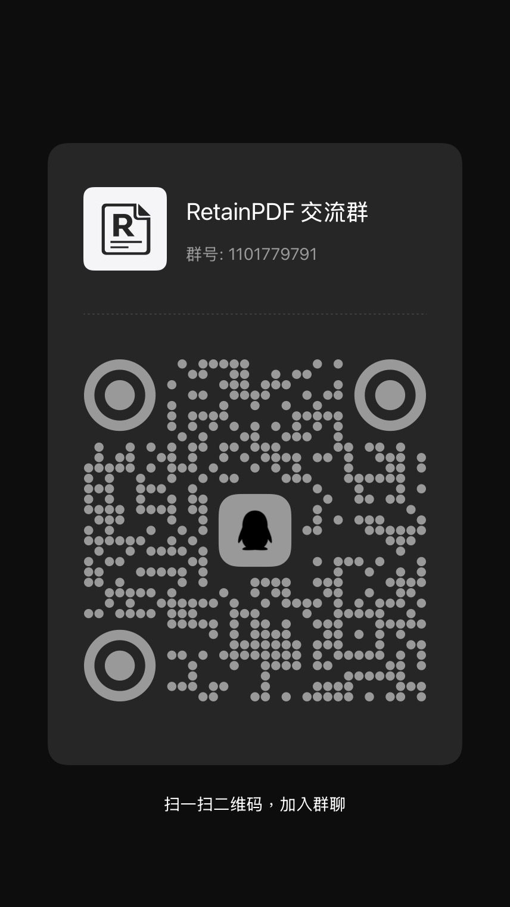

# RetainPDF：PDF 保留排版翻译工具

<p align="center">
  <a href="README.md">中文</a> · <a href="README.en.md">English</a> · <a href="README.vi.md">Tiếng Việt</a>
</p>

<p align="center">
  
</p>

<p align="center">
  <a href="https://github.com/wxyhgk/retain-pdf/releases/latest"></a>
  <a href="https://github.com/wxyhgk/retain-pdf/releases"></a>
  <a href="LICENSE"></a>
  <a href="https://github.com/wxyhgk/retain-pdf/actions/workflows/tests.yml"></a>
  <a href="https://github.com/wxyhgk/retain-pdf/stargazers"></a>
</p>

<p align="center">
  
  
  
  
</p>

RetainPDF 是目前唯一面向图片型 / 扫描版 PDF、支持保留排版翻译的开源项目，翻译与排版效果对标甚至超过同类商业产品。代码、API 与部署方式全部开放，支持自部署和二次开发。

## ✨ 亮点

- 🤖 **Agent 翻译，达到出版社水平**：先通读全书定好术语和文风，再逐页翻译、逐段审校，全书译法一致，译文质量达到出版社的翻译水平。详见下方 [Agent 翻译](#-agent-翻译出版社水平的译文)。
- 📐 **保留排版**：自研字体排版算法，复杂公式、多栏论文、图表、页眉页脚都留在原位。
- 🧮 **行内公式断层领先**：翻译后仍能稳定保留公式本体、前后文关系与行内排版，这是其他开源 PDF 翻译项目目前做不到的。
- 🖨️ **扫描件也能翻**：图片型 / 扫描版 PDF 先 OCR 再翻译，不挑原文件有没有文字层。
- 🔗 **先拼回完整的话再翻**：针对跨栏、跨页、断句和段落续接专门处理，不逐框翻译，上下文不割裂。
- 🛡️ **代码不误翻**：代码块、公式、专有名词按规则保护，还能用术语表定好译法。

## 🤖 Agent 翻译：出版社水平的译文

普通翻译逐段直译，快、省钱；**Agent 翻译像出版社的译者和编辑一样做一本书**，译文质量达到出版社的翻译水平：

| | 步骤 | 做了什么 |
| :---: | --- | --- |
| 📖 | 通读全书 | 翻译前先读完整本，判断领域，定下术语表、翻译指引和文风规则 |
| ✍️ | 逐页翻译 | 按定好的术语和文风翻，全书同一个词只有一种译法，前后文风统一 |
| 🔍 | 逐段审校 | 检查每段译文的漏译、误译和术语不一致，有问题就重翻那一段 |
| 🏢 | 编辑部 | 翻译时在书的「进度」页能看到 agent 正在读哪、定了哪些术语、审校出了什么问题 |

翻完后，书的「术语」页列出这本书的领域、术语和风格规则，可以一键存成自己的术语表，下一本书接着用。
Agent 翻译比普通翻译慢、费用也更高，适合要认真读、要拿去用的书。添加 PDF 时把「普通」切到「Agent」就行，见 [添加 PDF](frontend/web/guide/ingest.md)。

核心能力对比：

| 项目 | 扫描型 PDF | 复杂行内公式 | 代码不误翻 | 表格控制 | 自定义翻译策略 | 排版保留 | PDF 压缩优化 | API 自动化 |
| --- | --- | --- | --- | --- | --- | --- | --- | --- |
| PDFMathTranslate | ❌ | ❌ | ❌ | 弱 | 弱 | 一般 | 一般 | ✅ |
| PolyglotPDF | ❌ | ❌ | ❌ | 弱 | 弱 | 一般 | 一般 | ✅ |
| Doc2X | ✅ | ✅ | ❌ | 中 | 弱 | 强 | 弱 | ❌ 不开放 |
| RetainPDF | ✅ | ✅ 强保留 | ✅ | ✅ 可开关 | ✅ 可按规则配置 | 强 | ✅ 持续优化 | ✅ |

## 🧩 功能一览

| | 功能 | 说明 |
| :---: | --- | --- |
|  | [图书馆](frontend/web/guide/library.md) | 书架管理论文和图书，按状态筛选、排序，全文搜索书里的句子 |
|  | [合集](frontend/web/guide/collections.md) | 把书分组，一本书可以放进好几个合集 |
|  | [翻译](frontend/web/guide/ingest.md) | 拖进 PDF 一键翻译；可以只翻几页、只做 OCR、只收藏 |
|  | [Agent 精翻](frontend/web/guide/ingest.md) | 先通读全书定好术语和文风，再逐页翻译并审校 |
|  | [对照阅读](frontend/web/guide/reader.md) | 原文译文并排，搜索、书签、画笔、Markdown 文字版 |
|  | [直接改译文](frontend/web/guide/reader.md) | 鼠标停在一段上就能改，改完重新排版，修订历史可回退 |
|  | [术语表](frontend/web/guide/glossaries.md) | 专有名词按你定的译法翻，支持导入 CSV / Excel |
|  | [用量和花费](frontend/web/guide/usage.md) | 每本书花了多少 token、大概多少钱，翻译前就能看到预估 |
|  | [同步](frontend/web/guide/sync.md) | 通过网盘文件夹或 WebDAV 在几台电脑之间同步书库和阅读进度 |
|  | [备份](frontend/web/guide/backup.md) | 书库每天自动备份，可以恢复到之前的某一天 |
|  | [局域网共享](frontend/web/guide/lan-share.md) | 手机、平板扫码就能用浏览器看书、上传、翻译，Key 不出电脑 |
|  | [命令行](frontend/web/guide/settings.md) | 在终端里用 `retainpdf` 查看状态、备份、同步、配置接口 |
|  | [使用说明书](frontend/web/guide/README.md) | 软件里点底部「使用说明」随时能看 |

## 🔌 支持的服务

**OCR 识别**

  

**翻译模型**

      

怎么申请、填在哪，见 [接口设置](frontend/web/guide/credentials.md)。

## 🖼️ 产品界面

### 图书馆

在一个书架中管理论文、图书和扫描文档，集中查看翻译状态、合集与收藏。

<p align="center">
  
</p>

### 原文与译文对照阅读

原 PDF 与译文 PDF 同页并排展示，便于核对公式、图表、引用和版面位置。

<p align="center">
  
</p>

### Markdown 阅读

PDF 与 Markdown 同屏阅读，保留公式和图片。

<p align="center">
  
</p>

## 📚 翻译效果

SCI 论文、图片型 / 扫描版 PDF 与图书教材的原文—译文对照样例：

<p align="center">
  
</p>

<p align="center"><sub>第一行：SCI 论文 · 第二行：扫描与公式密集文档 · 第三行：图书教材</sub></p>

## 🚀 快速开始

### 桌面版

到 [GitHub Releases](https://github.com/wxyhgk/retain-pdf/releases/latest) 下载：

| 系统 | 下载 | 说明 |
| --- | --- | --- |
| 🍎 macOS | `RetainPDF-Mac-<版本>.dmg` | 只支持 Apple 芯片（M1 及以后）；已经过苹果签名和公证 |
| 🪟 Windows | `RetainPDF-Windows-<版本>-Setup.exe` | 提示「Windows 已保护你的电脑」时点「更多信息」→「仍要运行」 |
| 🐧 Linux | `RetainPDF-Linux-<版本>.deb` | `sudo apt install ./RetainPDF-Linux-<版本>.deb` |

装好打开后，第一次会弹出接口设置，填好 OCR 和翻译的 Key 就能开始。一步步怎么做，见 📖 [使用说明书](frontend/web/guide/README.md)。

### 🐳 Docker 部署

```bash
git clone https://github.com/wxyhgk/retain-pdf.git
cd retain-pdf/ops/deployment/docker/delivery
docker compose up -d
```

启动后访问 <http://127.0.0.1:40001>。更新服务：

```bash
docker compose pull
docker compose up -d
```

更多配置见 [Docker 部署说明](ops/deployment/docker/delivery/README.md)；多账号登录、按页计费的多用户版（商业版）部署见其中的「多用户模式」一节。

## 💬 交流

QQ 交流群：`1101779791`

<p align="center">
  
</p>

## 🛠️ 开发

参阅 [贡献指南](CONTRIBUTING.md)、[项目文档](docs/README.md)和[后端说明](backend/README.md)。

## 📄 License

This project is distributed under the MIT License. See [LICENSE](LICENSE) for the full text.
