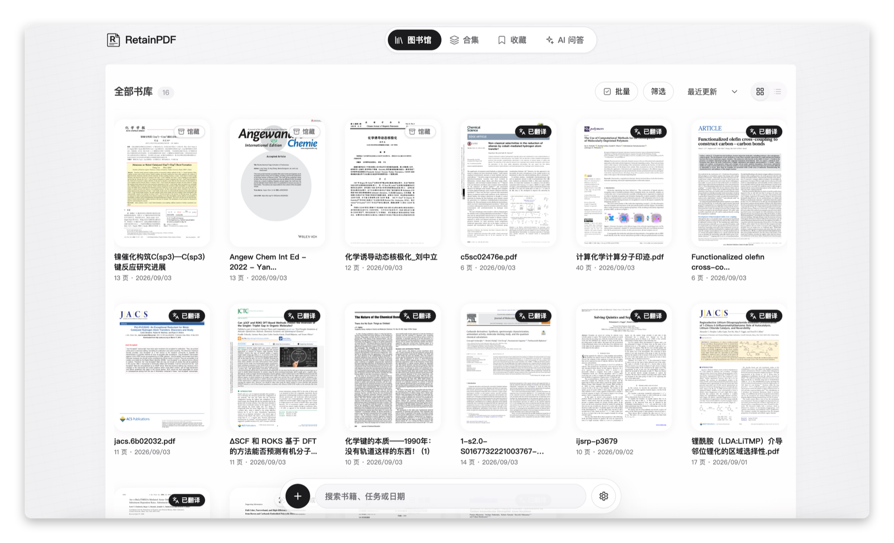
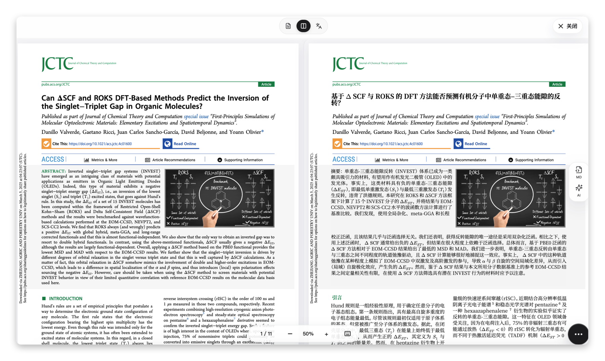
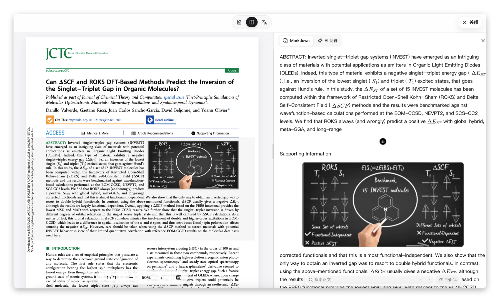
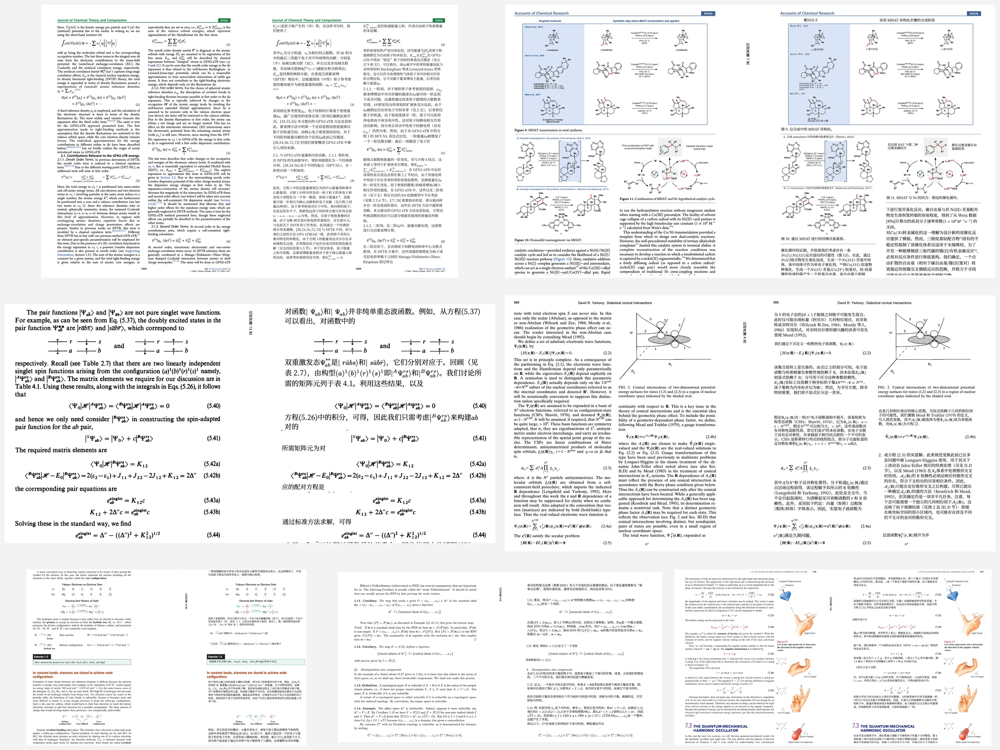
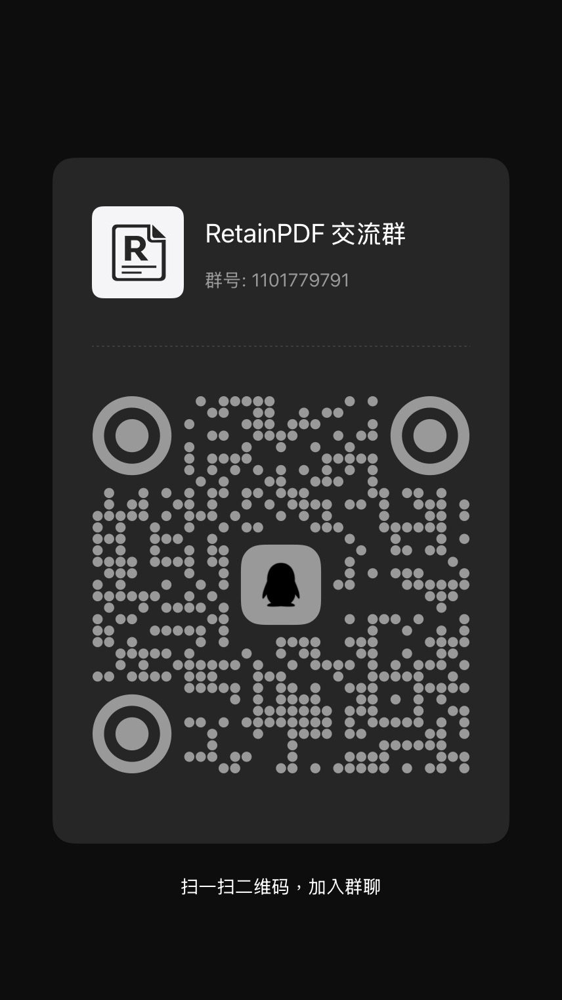

# RetainPDF: Công cụ dịch PDF giữ nguyên bố cục

<p align="center">
  <a href="README.md">中文</a> · <a href="README.en.md">English</a> · <a href="README.vi.md">Tiếng Việt</a>
</p>

<p align="center">
  
</p>

<p align="center">
  <a href="https://github.com/wxyhgk/retain-pdf/releases/latest"></a>
  <a href="https://github.com/wxyhgk/retain-pdf/releases"></a>
  <a href="LICENSE"></a>
  <a href="https://github.com/wxyhgk/retain-pdf/actions/workflows/tests.yml"></a>
  <a href="https://github.com/wxyhgk/retain-pdf/stargazers"></a>
</p>

RetainPDF hiện là dự án mã nguồn mở duy nhất dành cho việc dịch PDF dạng ảnh và bản quét mà vẫn giữ nguyên bố cục, với chất lượng dịch thuật và sắp chữ ngang bằng, thậm chí vượt qua các sản phẩm thương mại cùng loại. Mã nguồn, API và phương thức triển khai đều hoàn toàn mở, hỗ trợ tự triển khai và phát triển mở rộng.

## Điểm nổi bật

- **Dịch bằng Agent đạt chuẩn nhà xuất bản**: đọc toàn bộ sách trước để thống nhất thuật ngữ và văn phong, rồi dịch từng trang và rà soát từng đoạn—thuật ngữ nhất quán trong cả cuốn, chất lượng bản dịch đạt chuẩn nhà xuất bản. Xem [Dịch bằng Agent](#dịch-bằng-agent-chất-lượng-chuẩn-nhà-xuất-bản) bên dưới.
- **Giữ nguyên bố cục**: thuật toán sắp chữ tự phát triển giữ công thức phức tạp, bài báo nhiều cột, hình ảnh, đầu trang và chân trang đúng vị trí.
- **Công thức nội dòng vượt trội**: công thức, văn bản xung quanh và bố cục nội dòng vẫn ổn định sau khi dịch—điều các dự án mã nguồn mở khác hiện chưa làm được.
- **Dịch cả bản quét**: PDF dạng ảnh và bản quét được OCR trước, có lớp văn bản hay không đều được.
- **Ghép lại câu hoàn chỉnh rồi mới dịch**: nội dung qua nhiều cột, nhiều trang, câu bị ngắt và đoạn nối tiếp được ghép lại trước khi dịch, không mất ngữ cảnh.
- **Không dịch nhầm mã nguồn**: khối mã, công thức và tên riêng được bảo vệ theo quy tắc, bảng thuật ngữ cố định cách dịch.

## Dịch bằng Agent: chất lượng chuẩn nhà xuất bản

Dịch thường đi từng đoạn—nhanh và rẻ. **Dịch bằng Agent làm việc với cả cuốn sách như dịch giả và biên tập viên của nhà xuất bản**, đạt chất lượng bản dịch chuẩn nhà xuất bản:

| Bước | Việc được làm |
| --- | --- |
| Đọc toàn bộ sách | Trước khi dịch, đọc hết cuốn sách, xác định lĩnh vực, lập bảng thuật ngữ, hướng dẫn dịch và quy tắc văn phong |
| Dịch từng trang | Theo thuật ngữ và văn phong đã định, mỗi thuật ngữ chỉ có một cách dịch, giọng văn thống nhất |
| Rà soát từng đoạn | Kiểm tra bỏ sót, dịch sai và thuật ngữ không nhất quán, đoạn nào chưa đạt thì dịch lại |
| Phòng biên tập | Trong lúc chạy, tab 「进度」 (tiến độ) của sách cho thấy agent đang đọc đến đâu, đã định thuật ngữ nào và rà soát phát hiện gì |

Sau khi dịch, tab 「术语」 (thuật ngữ) liệt kê lĩnh vực, thuật ngữ và quy tắc văn phong của cuốn sách; có thể lưu thành bảng thuật ngữ riêng để dùng cho cuốn tiếp theo.
Dịch bằng Agent chậm hơn và tốn phí hơn dịch thường; phù hợp với sách cần đọc kỹ hoặc dùng cho công việc. Khi thêm PDF, chuyển 「普通」 sang 「Agent」—xem [thêm PDF (tiếng Trung)](frontend/web/guide/ingest.md).

So sánh năng lực cốt lõi:

| Dự án | PDF quét | Công thức nội dòng phức tạp | Không dịch nhầm mã nguồn | Kiểm soát bảng | Chiến lược dịch tùy chỉnh | Giữ bố cục | Tối ưu dung lượng PDF | Tự động hóa qua API |
| --- | --- | --- | --- | --- | --- | --- | --- | --- |
| PDFMathTranslate | ❌ | ❌ | ❌ | Hạn chế | Hạn chế | Trung bình | Trung bình | ✅ |
| PolyglotPDF | ❌ | ❌ | ❌ | Hạn chế | Hạn chế | Trung bình | Trung bình | ✅ |
| Doc2X | ✅ | ✅ | ❌ | Khá | Hạn chế | Tốt | Hạn chế | ❌ Không công khai |
| RetainPDF | ✅ | ✅ Bảo toàn vượt trội | ✅ | ✅ Tùy chọn | ✅ Theo quy tắc | Tốt | ✅ Liên tục cải thiện | ✅ |

## Tính năng

| Tính năng | Mô tả |
| --- | --- |
| [Thư viện](frontend/web/guide/library.md) | Kệ sách cho bài báo và sách; lọc, sắp xếp, tìm toàn văn bên trong sách |
| [Bộ sưu tập](frontend/web/guide/collections.md) | Nhóm sách; một cuốn có thể nằm trong nhiều bộ sưu tập |
| [Dịch](frontend/web/guide/ingest.md) | Kéo PDF vào là dịch; hoặc chỉ dịch vài trang, chỉ OCR, hoặc chỉ lưu lại |
| [Dịch bằng Agent](frontend/web/guide/ingest.md) | Đọc toàn bộ sách trước để thống nhất thuật ngữ và văn phong, rồi dịch và rà soát từng trang |
| [Đọc đối chiếu](frontend/web/guide/reader.md) | Bản gốc và bản dịch cạnh nhau, có tìm kiếm, dấu trang, bút vẽ và bản Markdown |
| [Sửa bản dịch](frontend/web/guide/reader.md) | Rê chuột lên một đoạn để sửa, sắp chữ lại, và quay về phiên bản cũ trong lịch sử |
| [Bảng thuật ngữ](frontend/web/guide/glossaries.md) | Dịch thuật ngữ theo cách bạn chọn; nhập từ CSV / Excel |
| [Mức dùng và chi phí](frontend/web/guide/usage.md) | Token và chi phí ước tính của từng cuốn, xem ước tính trước khi dịch |
| [Đồng bộ](frontend/web/guide/sync.md) | Đồng bộ thư viện và tiến độ đọc giữa các máy qua thư mục đám mây hoặc WebDAV |
| [Sao lưu](frontend/web/guide/backup.md) | Tự động sao lưu thư viện mỗi ngày; khôi phục về một ngày trước đó |
| [Chia sẻ mạng LAN](frontend/web/guide/lan-share.md) | Quét mã QR trên điện thoại, máy tính bảng để đọc, tải lên và dịch trong trình duyệt; key vẫn ở trên máy tính |
| [Dòng lệnh](frontend/web/guide/settings.md) | Xem trạng thái, sao lưu, đồng bộ và cấu hình dịch vụ bằng `retainpdf` |
| [Hướng dẫn sử dụng](frontend/web/guide/README.md) | Mở bất cứ lúc nào từ 「使用说明」 ở cuối ứng dụng (tiếng Trung) |

## Dịch vụ được hỗ trợ

- OCR: PaddleOCR, MinerU, GLM-OCR (Zhipu)
- Mô hình dịch: DeepSeek, Qwen (Bailian), Zhipu, OpenAI, Anthropic, OpenCode Go và mọi endpoint tùy chỉnh tương thích định dạng OpenAI hoặc Anthropic

Cách lấy key và điền ở đâu: [cài đặt API (tiếng Trung)](frontend/web/guide/credentials.md).

## Giao diện sản phẩm

### Thư viện

Quản lý bài báo, sách và tài liệu quét trong cùng một thư viện; theo dõi trạng thái dịch, bộ sưu tập và mục yêu thích.

<p align="center">
  
</p>

### Đọc đối chiếu

Hiển thị PDF gốc và bản dịch cạnh nhau để kiểm tra công thức, hình ảnh, trích dẫn và vị trí bố cục.

<p align="center">
  
</p>

### Đọc Markdown

Đọc PDF và Markdown cạnh nhau, đồng thời giữ nguyên công thức và hình ảnh.

<p align="center">
  
</p>

## Ví dụ bản dịch

Các ví dụ đối chiếu bản gốc và bản dịch cho bài báo khoa học, PDF quét, tài liệu có nhiều công thức và sách:

<p align="center">
  
</p>

<p align="center"><sub>Hàng 1: bài báo khoa học · Hàng 2: tài liệu quét và nhiều công thức · Hàng 3: sách và giáo trình</sub></p>

## Bắt đầu nhanh

### Ứng dụng desktop

Tải từ [GitHub Releases](https://github.com/wxyhgk/retain-pdf/releases/latest):

| Hệ điều hành | Tải về | Ghi chú |
| --- | --- | --- |
| macOS | `RetainPDF-Mac-<phiên-bản>.dmg` | Chỉ hỗ trợ chip Apple (M1 trở lên); đã được Apple ký và công chứng |
| Windows | `RetainPDF-Windows-<phiên-bản>-Setup.exe` | Nếu thấy “Windows đã bảo vệ máy tính của bạn”, bấm “Thông tin thêm” → “Vẫn chạy” |
| Linux | `RetainPDF-Linux-<phiên-bản>.deb` | `sudo apt install ./RetainPDF-Linux-<phiên-bản>.deb` |

Lần đầu mở, ứng dụng sẽ hiện phần cài đặt API; điền key OCR và key dịch là có thể bắt đầu. Từng bước: [hướng dẫn sử dụng (tiếng Trung)](frontend/web/guide/README.md).

### Docker

```bash
git clone https://github.com/wxyhgk/retain-pdf.git
cd retain-pdf/ops/deployment/docker/delivery
docker compose up -d
```

Sau khi khởi động, mở <http://127.0.0.1:40001>. Để cập nhật:

```bash
docker compose pull
docker compose up -d
```

Xem [hướng dẫn triển khai Docker](ops/deployment/docker/delivery/README.md) để biết thêm tùy chọn, bao gồm phiên bản nhiều người dùng (tài khoản, hạn mức theo trang) trong mục 「多用户模式」.

## Cộng đồng

Nhóm QQ: `1101779791`

<p align="center">
  
</p>

## Phát triển

Xem [hướng dẫn đóng góp](CONTRIBUTING.md), [tài liệu dự án](docs/README.md) và [hướng dẫn backend](backend/README.md).

## Giấy phép

Dự án được phát hành theo giấy phép MIT. Xem toàn bộ nội dung tại [LICENSE](LICENSE).
