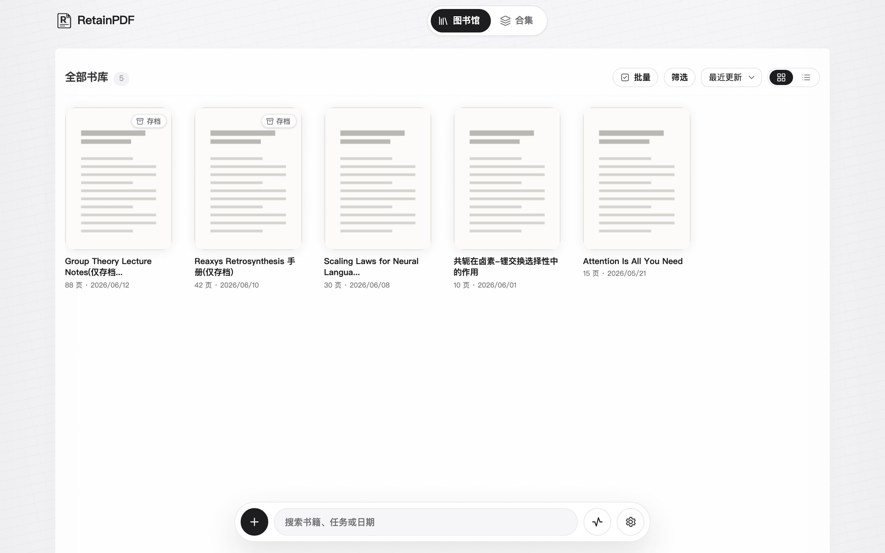

# 1. 安装和第一次打开

RetainPDF 有两种用法：

- **桌面版**：下载安装就能用，适合自己一台电脑上用。本说明书主要按桌面版写。
- **Docker 网页版**：装在服务器或 NAS 上，用浏览器打开。界面和桌面版一样，装法见本章最后一节。

## 下载

到 [GitHub Releases](https://github.com/wxyhgk/retain-pdf/releases) 下载最新版本（版本号是发布日期，比如 `v2026.11.22`）：

| 系统 | 下载哪个文件 | 说明 |
| --- | --- | --- |
| macOS | `RetainPDF-Mac-<版本>.dmg` | 只支持 Apple 芯片（M1 及以后）的 Mac |
| Windows | `RetainPDF-Windows-<版本>-Setup.exe` | 64 位 Windows 10 / 11 |
| Linux | `RetainPDF-Linux-<版本>.deb` | Debian、Ubuntu 及其衍生版 |

## 安装

### macOS

1. 双击下载的 `.dmg`，把 RetainPDF 拖进「应用程序」文件夹。
2. 从「应用程序」或启动台打开 RetainPDF。

安装包经过苹果签名和公证，正常不会出现「已损坏」或「无法验证开发者」的提示。

### Windows

1. 双击 `Setup.exe`，按提示选择安装位置，完成安装。
2. 如果弹出「Windows 已保护你的电脑」，点「更多信息」，再点「仍要运行」。安装程序目前没有微软的代码签名，所以会有这个提示。

### Linux

在下载目录里运行：

```bash
sudo apt install ./RetainPDF-Linux-<版本>.deb
```

装好后在应用菜单里找 RetainPDF。

## 第一次打开

1. 打开后要等几秒，软件在后台启动自己的翻译服务。
2. 第一次打开会直接弹出 **设置 → 接口设置**，让你填 OCR 和翻译用的 Key。按 [第 2 章](02-填写接口.md) 填好，点「保存并启动」。
3. 暂时不想填也可以关掉设置。没填 Key 时照样能把 PDF 加进书架，只是不能识别和翻译；等真正要翻译时，软件会再把你带回接口设置。

填好以后看到的就是图书馆：



- 上方「图书馆」「合集」切换书架和合集。
- 底部一排从左到右是：**＋** 添加 PDF、搜索框、任务中心、设置。

## 更新

- **macOS、Windows**：软件会自己检查新版本并在后台下载，下好后提示「新版本已下载，重启即可更新」，重启一下就是新版本。
  想手动查，在 **设置 → 更新** 里点「检查更新」。
- **Linux**：不会自动更新。到 Releases 下载新的 `.deb`，照安装那一步再装一遍，书库和设置都会保留。

## Docker 网页版

在装了 Docker 的机器上运行：

```bash
git clone https://github.com/wxyhgk/retain-pdf.git
cd retain-pdf/ops/deployment/docker/delivery
docker compose up -d
```

然后用浏览器打开 `http://127.0.0.1:40001`。之后的用法和桌面版一样，从 [第 2 章](02-填写接口.md) 开始填 Key。

> 注意：能打开 `40001` 端口的人就能用你填的 Key。默认只有这台机器自己能访问；要给别的电脑用，先看
> [Docker 部署说明](../../ops/deployment/docker/delivery/README.md) 里关于端口的部分。
