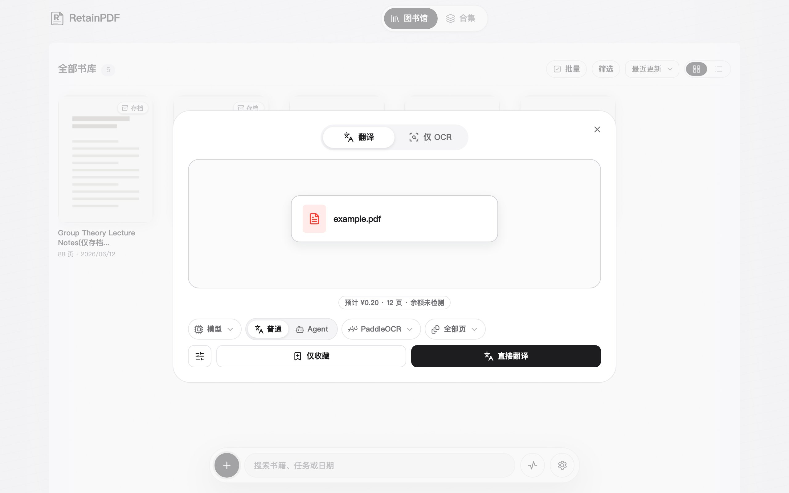
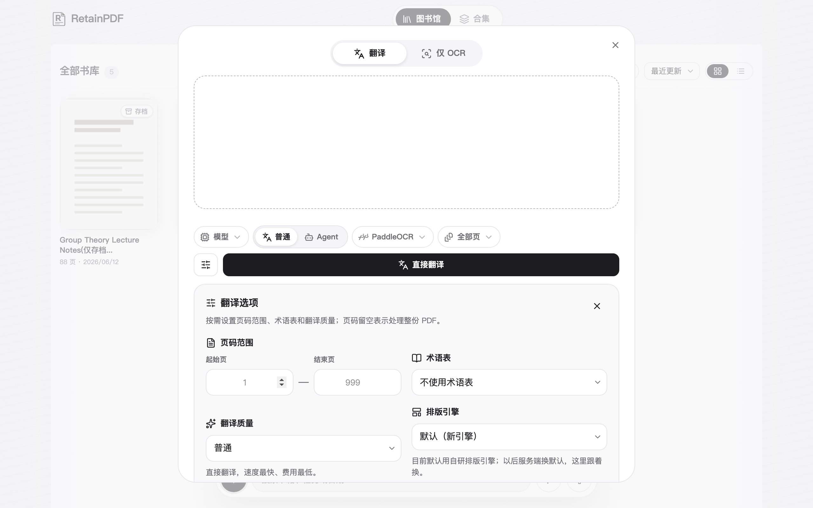
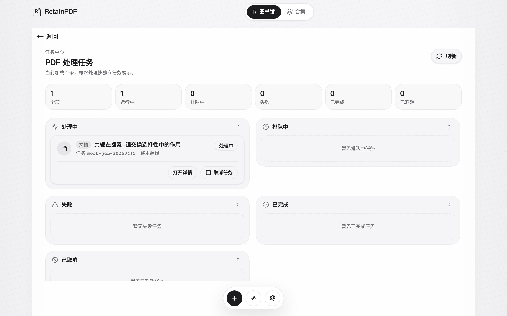
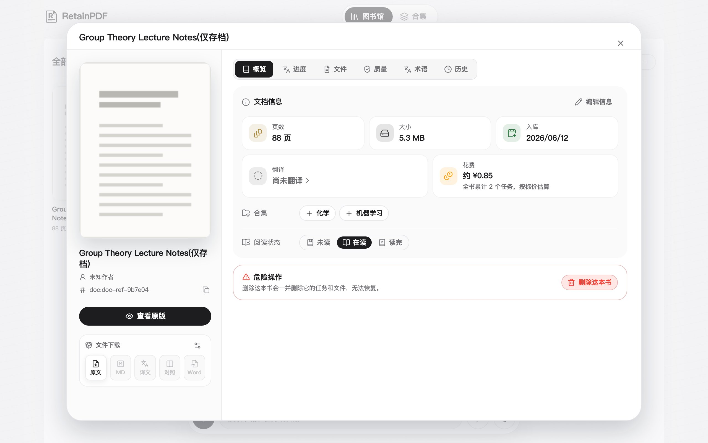

# 3. 翻译第一本书

开始前先按 [第 2 章](02-填写接口.md) 填好 OCR 和翻译的 Key。

## 添加 PDF

1. 点底部栏最左边的 **＋**。
2. 点虚线框选文件，或者直接把 PDF 拖进去。一次可以选好几本。
3. 文件传好后，框下面会显示预计花费、页数，以及余额（如果检测过）。
4. 点 **直接翻译**。

顶部的两个切换：

- **翻译**：识别后翻译成中文，生成译文 PDF。
- **仅 OCR**：只识别、不翻译。适合本来就是中文的扫描件，识别后可以搜索、复制文字，也能看 Markdown。

暂时不想翻译，点 **仅收藏**，书会进书架，以后再在书的详情里翻译。

### 这次用什么翻译

框下面一排按钮管这一次的设置，不填就用设置里的默认值：

- **模型**：这次用哪个模型翻译。可选的模型来自 **设置 → 接口设置** 里存的模型。
- **普通 / Agent**：
  - **普通**：直接翻译，最快、最省钱。
  - **Agent**：先通读全文定好术语，再逐页翻译并审校。质量明显更好，但慢很多，花费也高得多。开头通读要一会儿，进度会先停在 0。
- **OCR**：这次用哪家 OCR，默认是设置里选的那家。
- **页码**：默认全部页，也可以只翻其中几页，先用几页试试效果很划算。

### 更多选项

点左下角的调节按钮，展开 **翻译选项**：

- **页码范围**：起始页和结束页，留空就是整本。
- **术语表**：选一份自己的术语表，让专有名词按你定的译法翻。
- **翻译质量**：
  - 普通：直接翻译，最快、最省钱。
  - 统一术语：先通读全书定好术语和文风再翻译，全书译法更一致，模型费用多大约 0.4 倍。
  - 精翻（翻译 agent）：和上面的「Agent」是同一个设置。
- **排版引擎**：默认用新引擎，一般不用改。新引擎排不好时会自动退回旧的 Typst。
- **翻译表格（试验）**：正文翻完后再逐张翻表格。只翻有文字层的表；译文能在阅读页看到，译文 PDF 里的表格还是原文。

一次选了好几本时，每本都整本翻译，这些选项对每本都一样。

## 看进度

提交一本书后，会自动打开这本书的详情，停在 **进度** 页。一次提交好几本时不会打开详情，在书架上看每本的进度。

进度分五步：**文档准备 → OCR 识别 → 文本翻译 → 版面重建 → 完成**。每一步显示「处理中」「已完成」「失败」等状态。

翻译过程中可以：

- 点 **实时译文**，不用等全部完成，在阅读页逐页看已经翻好的部分（见 [第 4 章](04-阅读.md#翻译中看实时译文)）。
- 点取消按钮停下。已经完成的步骤会保留，之后可以从停下的地方继续。

关掉详情也没关系，任务会在后台接着跑，书架上的封面中间会转圈。

### 任务中心

底部栏的脉冲图标是 **任务中心**，列出所有处理中、排队中、失败、已完成和已取消的任务：

- **打开详情**：打开这本书的详情，停在进度页。
- **取消任务**：任务还在跑时才有。
- **重试**：任务失败时才有，从断点接着做。

### 跑完了会提醒

任务跑完时，软件会提醒你：

- 你正看着软件时，在页面里弹一条提示，成功的带「去阅读」按钮，失败的带「查看」按钮。
- 软件在后台时，弹系统通知。

第一次提交任务时，会问你要不要开系统通知。以后要改，到 **设置 → 通知**。

## 书的详情

在书架上点一本书，打开它的详情：

左边：

- **对照阅读**、**查看原版**：打开阅读页，见 [第 4 章](04-阅读.md)。
- **文件下载**：

  | 按钮 | 下载什么 |
  | --- | --- |
  | 原文 | 原始 PDF |
  | MD | 一个 zip，里面有原文、译文、双语三份 Markdown 和图片 |
  | 译文 | 译文 PDF |
  | 对照 | 原文和译文左右对照的 PDF |
  | Word | Word 文档 |

  还没生成的文件是灰的。「文件下载」旁边的齿轮管 Word 里背景图的清晰度，不影响文字。

右边几页：

- **概览**：页数、大小、入库日期、翻译状态、花费，可以把书加进合集、标记阅读状态（未读 / 在读 / 读完），最下面能删除这本书。
  这本书翻译过两次以上时，还有 **译文版本**，可以选读哪一份。
- **进度**：上面讲的进度，以及重新翻译、出错后继续。
- **文件**：这本书的所有文件，按原始文件、OCR 结果、译文、报告分组，每个都能查看、下载。
- **质量**：翻译后的自动检查。哪些段落有问题、哪些块排不下、哪些块没翻成，每条都能直接点「改这段译文」修改。
  改完点「重新排版」，译文 PDF 才会更新。
- **术语**：这本书里认出的术语和译法。点「存为我的术语表」，以后翻译别的书时可以选用。
- **历史**：每一次处理的记录：做了什么、哪几页、用了多久、用的什么模型，失败的还有原因。

## 花了多少钱

**概览** 里的 **花费** 是这本书所有翻译加起来的估算，比如「约 ¥0.85」。

- 按服务商公开的标价估算，美元按固定汇率换成人民币，不算折扣、包月和代金券。
- 实际扣费以服务商账单为准。
- 某次请求查不到价时不计入，旁边会有个小叹号。
- 单次任务的用量在 **进度 → 本次用量** 里看。

## 出错了怎么办

任务失败时，**进度** 页会显示一张错误说明卡片，写着出了什么问题，标出「重试多半有用」或「重试解决不了」。

**重试一般有用的**：服务商临时出错、超时、限流、网络连不上、生成 PDF 时失败。点状态行上的继续按钮就行：

| 按钮 | 意思 |
| --- | --- |
| 从渲染继续 | 翻译已经做完，只重新生成 PDF，不花钱 |
| 从翻译继续 | 只翻还没翻完的部分 |
| 从断点继续 | 从停下的地方接着做 |
| 从 OCR 重新开始 / 重新 OCR | OCR 没做成，从头识别 |

**重试解决不了的**：

| 错误 | 怎么办 |
| --- | --- |
| 凭据被拒 | Key 不对或过期了。点卡片上的「去设置换 Key」，换好后再继续 |
| 余额不足 | 到服务商网站充值，再继续 |
| 文件本身有问题 | PDF 可能损坏了，换一份文件再试 |

卡片上还有「复制诊断信息」。自己解决不了时，把它发给开发者。

## 重新翻译

对一本书的译文不满意，可以换个模型或方式再翻一次：

1. 打开书的详情，进 **进度** 页。
2. 点「文本翻译」那一步上的 ↻ 按钮，选 **重新翻译**。
3. 选翻译方式（普通 / 统一术语 / 精翻）和模型。设置里存了多个模型时，旁边会写估价，比如「约 ¥2–3」。
4. 点「开始」。

新译文翻完后，默认阅读最新的那份。旧的那份不会删，可以在阅读页「对比版本」里对比，或在 **概览 → 译文版本** 里换回来。

同一个位置还有：

- **重新渲染**：译文不变，只重新生成 PDF，不花钱。可以换排版引擎。
- **重新 OCR**：重新识别。识别完要再重新翻译，新的识别结果才会用上。

只加进书架、还没翻译的书，书架上会标「存档」。打开详情进 **进度** 页，点 **翻译整本**；只想翻几页就先打开「指定页码」。
