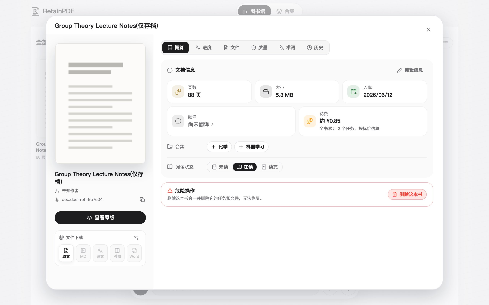

# 书的详情

在书架上点一本书，打开它的详情。刚提交的书会自动打开，停在「进度」页。

## 左边

- **对照阅读**：原文和译文并排看，见 [阅读](reader.md)。只做了 OCR 的书叫「查看 OCR」，还没处理过的书叫「读原文」。
- **查看原版**：只看原始 PDF。
- **文件下载**：

  | 按钮 | 下载什么 |
  | --- | --- |
  | 原文 | 原始 PDF |
  | MD | 一个 zip，里面有原文、译文、双语三份 Markdown 和图片 |
  | 译文 | 译文 PDF |
  | 对照 | 原文和译文左右对照的 PDF |
  | Word | Word 文档 |

  还没生成的文件是灰的。「文件下载」旁边的齿轮是导出设置，管 Word 里背景图的清晰度（标准 / 清晰 / 最高），不影响文字。

## 概览

- 页数、大小、入库日期。
- **翻译**：当前状态，点它跳到「进度」页。
- **花费**：这本书所有翻译加起来的估算，比如「约 ¥0.85」。按服务商公开的标价估算，实际扣费以服务商账单为准，算法见 [用量](usage.md)。
- **合集**：把书加进 [合集](collections.md)。
- **阅读状态**：未读 / 在读 / 读完。
- **译文版本**：这本书翻译过两次以上时才有。
  - 「自动（最新）」：每页读最新翻好的译文，新译文翻完自动换上。
  - 选某一份：以后固定读它。之后再翻出新版本只会提示「有新版本」，点「换到最新」才换。
  - 「改名、隐藏」：版本不能删，只能隐藏。
- **删除这本书**：连同它的任务和文件一起删掉，不能恢复。

## 进度

处理分五步：**文档准备 → OCR 识别 → 文本翻译 → 版面重建 → 完成**，每一步显示「处理中」「已完成」「失败」等状态。复用了以前的 OCR 结果时，第二步显示「OCR 复用」。

翻译过程中可以：

- 点 **实时译文**，不用等全部完成，在阅读页逐页看已经翻好的部分，见 [阅读](reader.md#翻译中看实时译文)。
- 点取消按钮停下。已经完成的步骤会保留，之后可以从停下的地方继续。

下面的「进度细节」里有错误、活动和 **本次用量**（这次任务用了多少 token、花了多少钱）。用 Agent 翻译时还有「编辑部」，能看到 agent 的工作过程。

## 文件

这本书的所有文件，按原始文件、OCR 与结构化、翻译与阅读、诊断与报告分组，每个都能查看、下载。「调试文件」只在排查问题时用得上。

## 质量

翻译后的自动检查，有问题时标题旁写「N 处要看」：

- **自动检查**：译文里的问题，分严重、一般、轻微。
- **精修**：精修采纳了几处、没采纳几处。
- **排版**：有没有排不下、字缩得太小、公式没排出来的块。
- **漏翻**：有几块没翻成。

每一行都能展开看明细。每条问题都有「改这段译文」，在弹出的窗口里可以手改，也可以点「重翻这一段」。改完点 **重新排版**，译文 PDF 才会更新。

在阅读页里看同样的问题更直观，见 [阅读](reader.md) 的「待处理」。

## 术语

这本书里认出的领域、术语和译法、译法冲突、风格规则。每个术语标着处理方式：锁定译法、保留原文、自由翻译或通用词。

点 **存为我的术语表**，把这本书的术语存成自己的 [术语表](glossaries.md)，以后翻译别的书时可以选用。

没有术语时，用「统一术语」或「精翻」重新翻译一次就会生成。

## 历史

每一次处理的记录：做了什么、哪几页、用了多久、用的什么模型，失败的还有原因（可以展开看原始错误）。

## 出错了怎么办

任务失败时，「进度」页会显示一张错误说明卡片，写着出了什么问题，并标出「重试多半有用」还是「重试解决不了」。

**重试一般有用的**：服务商临时出错、超时、限流、网络连不上、生成 PDF 时失败。点状态行上的继续按钮：

| 按钮 | 意思 |
| --- | --- |
| 从渲染继续 | 翻译已经做完，只重新生成 PDF，不花钱 |
| 从翻译继续 | 只翻还没翻完的部分 |
| 从断点继续 | 从停下的地方接着做 |
| 从 OCR 重新开始 / 重新 OCR | OCR 没做成，从头识别 |

不能接着做时，按钮旁会写原因，比如这个模型接口不支持接着做、可能重复计费。

**重试解决不了的**：

| 错误 | 怎么办 |
| --- | --- |
| 凭据被拒 | Key 不对或过期了。点卡片上的「去设置换 Key」，换好后再继续 |
| 余额或额度不足 | 到服务商网站充值或换套餐，再继续 |
| 文件本身有问题 | PDF 可能损坏了，换一份文件再试 |

卡片上还有「复制诊断信息」。自己解决不了时，把它发给开发者。

OCR 服务那边结果不明确时，会让你选怎么恢复：绑定那边已经做完的任务，或者重新提交一次 OCR（可能重复计费）。

## 重新翻译

对译文不满意，可以换个模型或方式再翻一次：

1. 进「进度」页，点「文本翻译」那一步上的 ↻ 按钮，选 **重新翻译**。
2. 选翻译方式（沿用原来的 / 普通 / 统一术语 / 精翻）和模型。[接口设置](credentials.md#模型) 里存了多个模型时，旁边会写估价，比如「约 ¥2–3」，还会标出「原来用的」和「最省」。
3. 点「开始」。

新译文翻完后，旧的那份不会删，可以在阅读页「对比版本」里对比，或在「概览 → 译文版本」里换回来。

同一个位置还有：

- **重新渲染**：译文不变，只重新生成 PDF，不花钱，可以换排版引擎。
- **重新 OCR**：重新识别。识别完要再重新翻译，新的识别结果才会用上。
- **从头翻译**：任务停下时才有，从头再翻一遍整本，费用重新算。

## 翻译存档的书

只加进书架、还没处理过的书，书架上标「存档」。打开详情进「进度」页，点 **翻译整本**；只想翻几页，先打开「指定页码」。也可以点「只做 OCR」。
