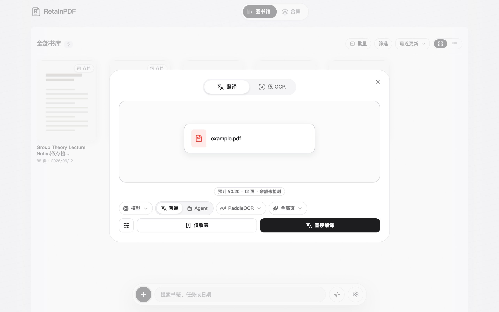
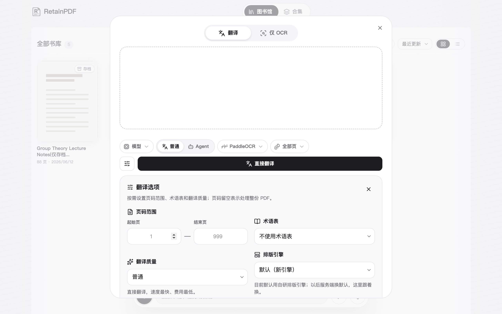

# 添加 PDF

把 PDF 加进书架，并决定要不要马上识别、翻译。开始前先在 [接口设置](credentials.md) 里填好 OCR 和翻译的 Key；没填也能加进书架，只是不能识别和翻译。

## 选文件

1. 点底部栏最左边的 **＋**。
2. 点虚线框选文件，或者直接把 PDF 拖进去。一次可以选好几本。
3. 文件传好后，框下面会显示预计花费、页数，以及余额（如果检测过）。
4. 点 **直接翻译**。

顶部的两个切换：

- **翻译**：识别后翻译成中文，生成译文 PDF。
- **仅 OCR**：只识别、不翻译。适合本来就是中文的扫描件，识别后可以搜索、复制文字，也能看 Markdown。

暂时不想处理，点 **仅收藏**：书会进书架，标上「存档」，以后在 [书的详情](book-detail.md#翻译存档的书) 里再翻译。

一本书最多多少页看选的 OCR：PaddleOCR 999 页，MinerU 600 页，GLM-OCR 不限。

## 这次用什么翻译

框下面一排按钮管这一次的设置，不动就用设置里的默认值：

- **模型**：这次用哪个模型翻译。可选的是 [接口设置](credentials.md#模型) 里存的模型。
- **普通 / Agent**：
  - **普通**：直接翻译，最快、最省钱。
  - **Agent**：先通读全文定好术语，再逐页翻译并审校。质量明显更好，但慢很多，花费也高得多。开头通读要一会儿，进度会先停在 0。
- **OCR**：这次用哪家 OCR，默认是设置里选的那家。
- **页码**：默认全部页，也可以只翻其中几页。先用几页试试效果很划算。

## 更多选项

点左下角的调节按钮，展开 **翻译选项**：

- **页码范围**：起始页和结束页，留空就是整本。
- **术语表**：选一份 [术语表](glossaries.md)，让专有名词按你定的译法翻。
- **翻译质量**：
  - 普通：直接翻译，最快、最省钱。
  - 统一术语：先通读全书定好术语和文风再翻译，全书译法更一致，模型费用多大约 0.4 倍。
  - 精翻（翻译 agent）：和上面的「Agent」是同一个设置。
- **排版引擎**：默认用新引擎，一般不用改。新引擎排不好时会自动退回旧的 Typst。
- **翻译表格（试验）**：正文翻完后再逐张翻表格。只翻有文字层的表；译文能在阅读页看到，译文 PDF 里的表格还是原文。会多花一些费用，[用量](usage.md) 里记在「表格翻译」。

一次选了好几本时，每本都整本处理，这些选项对每本都一样。

## 提交以后

- 提交一本：自动打开这本书的 [详情](book-detail.md)，停在「进度」页。
- 提交好几本：只提示「已提交 N 本」，在书架上看每本的进度，或打开 [任务中心](task-center.md)。

关掉窗口也没关系，任务会在后台接着跑，跑完会 [提醒你](notify.md)。
