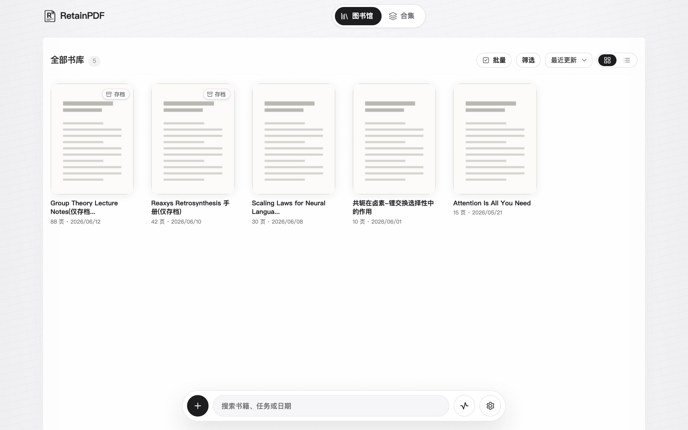

# 图书馆

打开软件看到的就是图书馆，所有加进来的书都在这里。

## 书的卡片

点一张卡片，打开这本书的 [详情](book-detail.md)。

卡片右上角的标记：

| 标记 | 意思 |
| --- | --- |
| 存档 | 只加进了书架，还没识别、翻译过 |
| OCR 完成 | 只做了识别，没翻译 |
| 失败 | 最近一次处理失败了 |
| 更新失败 | 重新翻译失败了，旧的译文还能读 |
| 已取消 | 处理被你取消了 |

翻译成功的书不挂标记。正在处理的书，封面中间会转圈。

## 工具栏

书架右上角从左到右：

- **批量**：进入多选，点卡片就是勾选。可以「全选已加载」，把选中的书「加入合集」或「删除」，点「取消」退出。
- **筛选**：按处理状态只看一部分书：全部 / 仅收藏 / 仅 OCR / 已翻译 / 处理中 / 失败。「仅收藏」就是标着「存档」的书。
- **排序**：最近更新 / 最近上传 / 最近阅读 / 标题。
- **网格 / 列表**：卡片排成封面网格，或者排成一行一本的列表。

## 搜索

底部栏中间的搜索框可以搜书名、文件名、任务和日期。输入后：

- 书架只留下匹配的书。
- 上方弹出检索面板，分两部分：
  - 「全文命中」：书的正文里有这个词的地方，标着第几页，点一条直接在阅读页打开。
  - 「文档」：书名、文件名匹配的书，点一下打开阅读；旁边的阅读状态点一下就能切换（未读 / 在读 / 读完）。
- 面板里可以按阅读状态再筛一遍。

## 合集

书架顶部切到「合集」，可以把书分组，见 [合集](collections.md)。
