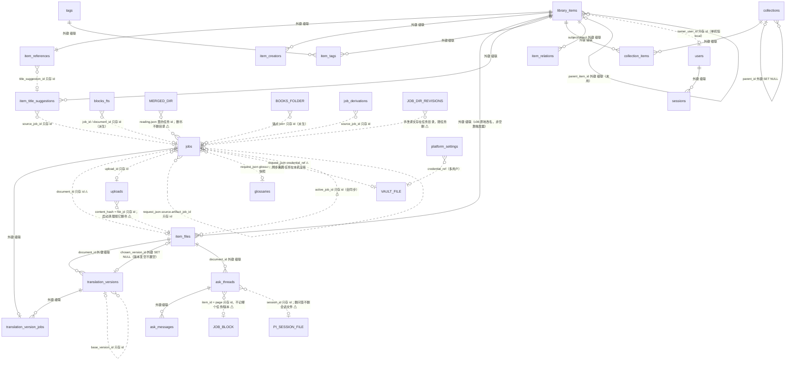

# 状态梳理：书库和用户数据（2026-11-26）

> 附录，属于 [后端状态管理设计](./20261126-后端状态管理设计.md)。范围：书库条目、译文版本、问答记录、术语表、凭据、备份和同步。
> 原文是 2026-11-26 一路子代理的只读梳理，快照 076ec527a；这里只删了本机路径、统一了标题，结论没改。
> **每条问题的核实状态、严重程度和归到路线图哪一步，以主文件的「问题清单」为准**；本文里的「复现 / 读码 / 推测」是梳理时的自评。
> 本文问题 1（启动时硬删没有上传记录的书）梳理之后已经修了：本地 main 223267ee8 改成只统计、不删。下文照原样保留当时的描述。
> 文中「上一份」指 [翻译状态审查](../translation-state/20261126-翻译状态审查.md)。

原标题：用户数据状态梳理：书库、阅读、问答、术语表、凭据、设置、账号、备份（2026-11-26）

只读审查，快照 `retain-pdf-audit` @ 076ec527a。接着翻译状态审查（[翻译状态审查](../translation-state/20261126-翻译状态审查.md)），
那里写过的（块状态、断点、指纹、Windows 写盘）不重复。证据等级沿用那份：**复现** / **读码** / **推测**。

下文路径省掉前缀：`db/` = `database/retainpdf-db/src/db/`，`lib/` = `backend/packages/retainpdf-library/src/`，
`prov/` = `backend/packages/retainpdf-providers/src/`，`jobs/` = `backend/packages/retainpdf-jobs/src/`，`data/` = `backend/packages/retainpdf-data/src/`。

## 先说结论

1. **最大的风险是一条「启动清理」**：`db.init()` 每次都把「没有上传记录的书」连同它下面所有本机用户数据硬删，删除还会经同步发到所有设备。
   开着同步时，书和它的上传是两个独立的同步实体，书先到、上传在等文件时重启，就会触发。已在真库代码上复现前两段（见问题 1）。
2. 「一本书」的身份靠一串**同值的字符串**撑着：`library_items.item_id` = `item_files.file_id` = `uploads.content_hash` = `jobs.document_id`
   = 接口里的 `document_id`。其中书→上传、书→任务两条**没有外键**，完整性靠启动回填和清理来「对账」，对账又会删用户数据。
3. 用户写的东西散在三种地方：数据库（书目、标签、合集、问答、译文版本选择）、**任务目录**（手改译文 `revisions.v1.jsonl`）、
   **数据目录里的私有文件**（凭据库、pi 的会话）。只有第一种有备份、外键和级联；后两种跟着「能重跑的任务」或者根本没人管。
4. 「读的是哪份译文」这件事，问答锚点没记、同步不带（译文版本只在本机），换版本、重翻、多设备以后引用会悄悄错位。
5. 多用户代码在单机模式下大部分是惰性的，但归属触发器、幂等记录、AI 专用密钥这几处每次请求都在跑（见第 7 节）。

---

## 1. 状态清单

「崩溃」一列：进程在写的过程中死掉、或者正常重启以后是什么样。

### 1.1 书库条目（v36/v37）

| 状态 | 存哪 | 真相 / 派生 | 谁写 | 谁读 | 生命周期 | 引用 | 删除时级联 | 崩溃、重启 |
|---|---|---|---|---|---|---|---|---|
| 书（条目） | `library_items` 行；`item_id` = PDF 内容 sha256（多用户是带账号的 sha256） | 真相 | 上传建：`db/uploads.rs:50-61` → `db/documents/crud.rs:224-258`（同一事务）；同步写入 `db/sync.rs:1143-1210` | 视图 `library_documents`、同步 | 建：上传；改：只改 `updated_at`；删：`db/documents/crud.rs:683-689`（删书、启动清理、同步删除） | 主键；`parent_item_id` 自引用外键（还没人用） | 级联删书目、作者、文件、书名建议、标签关系、合集成员、条目关联；经文件再级联译文版本、问答 | 建在一个事务里，安全。**启动清理会删**（问题 1） |
| 书目（书名、年份、DOI…） | `item_references` 1:1 | 真相 | 建：`crud.rs:246-249`（书名=文件名）；用户改：`crud.rs:380-395`（锁住）；书名建议：`db/document_metadata_suggestions.rs:149-205` | 视图、书文件夹、任务列表的书名 `crud.rs:264-286` | 跟着条目 | 外键 → `library_items` | 随条目 | 安全 |
| 书名来源、锁、采用的建议 | `item_references.title_source/title_locked/title_suggestion_id` | 真相 | 同上 | 书名建议判能不能自动改 `lib/metadata_suggestions.rs:480-483` | 同上 | `title_suggestion_id` **只存 id**，无外键 | 无 | 安全 |
| 作者 | `item_creators` | 真相 | 书名建议应用、同步 | 视图 `authors_json` | 同上 | 外键 | 随条目 | 安全 |
| 书名建议 | `item_title_suggestions` | 真相（候选） | `db/document_metadata_suggestions.rs:65` | 书名建议接口 | 建：用户点；不单独删 | 外键 → 条目；`source_job_id` **只存 id** | 随条目；任务删了建议还在 | 安全 |
| PDF 文件记录 | `item_files`（`file_id` = 书编号） | 真相（文件元数据）+ 几列派生 | `crud.rs:250-256`；重复上传只刷新 `crud.rs:233-238` | 视图、阅读、问答外键 | 删：随条目 | 外键 → 条目（可空列 + 两个触发器保证非空） | 级联译文版本、问答 | 安全 |
| 阅读状态 | `item_files.reading_status` | 真相 | `crud.rs:396-401`（PATCH） | 列表筛选 | — | — | 随文件 | 安全；**会同步** |
| 最后打开时间 | `item_files.last_opened_at` | — | **没人写** | 接口照读，恒为 null | — | — | — | 死列（问题 8） |
| 书卡指针 | `item_files.active_job_id` | **派生**（由任务现算的结果存了一份） | 提交时 `jobs/lifecycle/launcher.rs:177`；失败回退 `crud.rs:644-659`；删任务后修 `crud.rs:630-634`；启动修 `crud.rs:71-86` | 书卡、视图 | 随任务变 | **只存 id**，无外键 | 无（删任务后靠修复函数） | 提交写入是「尽力而为」，失败只记日志；启动 `repair_wrong_document_cards` 兜底；**会同步**，对方可能还没有这个任务 |
| 页数 | `item_files.page_count` | 半派生（上传时的页数，任务成功时刷新 `crud.rs:672-677`） | 上传、任务 | 列表；阅读和覆盖实际用 PDF 页数 `lib/merge/page_count.rs` | — | — | — | 安全 |
| 上传记录 | `uploads`（`content_hash` 对上书） | 真相（原文 PDF 的位置） | `db/uploads.rs:39-61` | 找原文 `crud.rs:444-480`、书列表过滤 `crud.rs:121-123`（没有上传的书**不出现在列表里**） | 同一 PDF 可多条；删书全删；超时未用的回收 `db/retention.rs:144-190` | `content_hash` → 书**只存 id**，无外键 | 删书时由代码删 `crud.rs:612-617` | 书和上传是**两个同步实体**，可以只到一半（问题 1） |
| 标签 | `tags`；编号 = `tag-` + 名字 sha256 前 16 位 | 真相 | `db/tags.rs:80-131` | 书列表、书文件夹 | 改名后编号不变（占着旧名字算出的编号） | 主键 | `item_tags` 级联 | 安全；同名两台设备是同一个 |
| 书上的标签 | `item_tags` | 真相 | `db/tags.rs:136-160` | 列表筛选 | — | 外键 → 条目、标签 | 双向级联 | 同步时标签还没到，整本书的改动停在等待区 |
| 合集 | `collections`（可嵌套） | 真相 | `db/collections.rs:13-100` | 列表 | 删：`lib/collections.rs:71-86`，顺带删 `data/collections/<id>/` | `parent_id` 外键 SET NULL | 成员级联；子合集变顶层 | 安全 |
| 合集成员 | `collection_items` | 真相 | `db/collections.rs:104-135` | 列表筛选 | — | 外键 → 合集、条目 | 双向级联 | 单独同步实体，父行没到就停在等待区 |
| 条目关联 | `item_relations` | 真相 | 还没有接口 | 无 | — | 双外键 | 级联 | — |
| 回收站 | `library_items.deleted_at` | — | **没人写**、视图**不过滤** | — | — | — | — | 新版本设备写了它，旧版本照样显示（5b 已知） |

### 1.2 阅读、译文版本、派生缓存

| 状态 | 存哪 | 真相 / 派生 | 谁写 | 谁读 | 生命周期 | 引用 | 删除时级联 | 崩溃、重启 |
|---|---|---|---|---|---|---|---|---|
| 译文版本 | `translation_versions` | 真相（「哪些任务算一份译文」） | 建：`db/translation_versions.rs:50-59`，由 `jobs/lifecycle/launcher.rs:199-241` 决定建不建 | 阅读、版本列表、全文索引、书文件夹 | 改名、隐藏 `translation_versions.rs:128-144`；不单独删 | `document_id` 外键 → 文件；`base_version_id` **只存 id** | 随书删；任务删光后成空版本（列表不显示，行还在） | 建版本和挂任务是两次连接，中间崩溃留空版本；挂版本在任务落库**之后、事务外**，失败只记日志 |
| 版本里的任务 | `translation_version_jobs` | 真相 | `translation_versions.rs:62-69` | 同上 | — | 外键 → 任务、版本 | 双向级联 | 同上 |
| 当前版本 | `item_files.chosen_version_id`（空 = 自动） | 真相（用户选择） | `translation_versions.rs:180-187`；隐藏时清 `:140` | `lib/reading.rs:78-113` | — | 外键 SET NULL | 版本行删了置空；**版本变空时不置空**，阅读悄悄退回自动 `reading.rs:100-108` | 只在本机、不同步（`db/sync.rs:73-80`） |
| 合并阅读目录 | `data/documents/<书>/merged/<指纹16>/`，`reading.json` 记参与任务 | 派生缓存 | `lib/merge/build.rs:180-190` | 虚拟任务 `merged-<书>-<指纹>`：`retainpdf-api-base/src/job_loading/merged.rs:103-140` | 同一本书再生成时清掉 1 天没用过的 `build.rs:342-360` | 目录名带书编号；`reading.json` 里任务**只存 id** | **删书不删**（问题 4） | 写到一半的临时目录 1 小时后清 |
| 封面、缩略图、页预览 | `data/documents/<书>/cover.jpg…`、`pages/` | 派生缓存 | `retainpdf-files/src/derived_artifacts*.rs` | 书库、阅读 | 页预览定期清 `derived_artifacts/retention.rs:175-190`；封面不清 | 目录名 = 书编号 | **删书不删** | 无 |
| 全文索引 | `blocks_fts`（`document_id`、`job_id`、页、块） | 派生 | 任务完成、启动补 `db/documents/backfill.rs:59-70`、后台对账 `lib/library_refresh.rs:65-84` | 搜索 | 按当前版本重建 | 全部**只存 id** | 删书、删任务时代码删 `crud.rs:694-699` | 后台对账的上一轮戳记在内存，重启后第一轮只记不建（问题 9） |
| 书文件夹 | `data/books/<书名>-<编号8>/`（Markdown + `meta.json`） | 派生 | `lib/book_export/`，后台对账刷新 | 本机 agent、用户 | 书名一改目录换名 | 锚点 `job=<任务> item_id page` | 书删了对账时删目录 | 戳记在 `meta.json`，重启能续 |
| 后台对账戳记 | 内存 `LibraryRefresher.content/folders` `lib/library_refresh.rs:33-39` | 派生 | 对账循环 | 对账循环 | 进程生命周期 | — | — | **重启即丢** |
| 「书库变了」信号 | 进程内通知 `data/library_signal.rs:17-22` | — | 改版本、改译文 | 对账循环 | — | — | — | 只在 API 进程；jobsd 不通知，靠 60 秒轮询 |
| 手改译文 | **任务目录** `translated/revisions.v1.jsonl` + 页文件 + 断点；`pipeline_units`（translate 阶段）登记 | 真相（用户写的） | Python `translation-revise`，Rust 入口 `jobs/translations/revision.rs` | 渲染、版本列表「改过几处」`revision.rs:469-487`、戳记 `db/documents/change_stamps.rs:39-43` | 跟着任务 | 按 `item_id` | **删任务、删书一起删**；不进数据库备份 | 意图记录可恢复写回（见上一份审查）；数据库恢复只回滚 `pipeline_units`，文件不回滚（问题 7） |

### 1.3 问答记录（v39）和本机 agent

| 状态 | 存哪 | 真相 / 派生 | 谁写 | 谁读 | 生命周期 | 引用 | 删除时级联 | 崩溃、重启 |
|---|---|---|---|---|---|---|---|---|
| 一次提问 | `ask_threads`（锚点拆成列：栏、页、块、选中的字、原文译文快照、章节、页内坐标） | 真相 | `db/ask_threads.rs:146-187`；校验和上限 `lib/ask_threads.rs:18-150` | 列表、读一次 | 建、改 agent/会话、整份换问答、删 `db/ask_threads.rs:225-259` | `document_id` 外键 → 文件；`item_id`、`session_id` **只存 id**；**不记读的是哪个任务 / 版本** | 删书级联；删任务、换版本不动 | 安全；**不同步** |
| 问答正文 | `ask_messages`（`position` 顺序） | 真相 | `db/ask_threads.rs:126-136`（先删后插） | 读一次 | 整份覆盖，**无版本号守卫** | 外键 → 提问 | 级联 | 同一事务，安全 |
| 本机 agent 会话（pi） | `data/ask-pi/sessions/`（pi 自己的会话文件，含全文对话） | 第二份对话记录 | pi 进程 `prov/acp/pi.rs:250-280` | pi `session/load`（以后） | **永不清理** | `ask_threads.session_id` 指它 | 删问答、删书都不删（问题 6） | 落盘，重启还在 |
| 自带 Python agent 会话 | 进程内 `self.sessions` `backend/ask-agent/retainpdf_ask_agent/server.py:157`，`loadSession: false` | — | agent 进程 | agent | 连接结束即丢 | 记下的 `session_id` 之后无意义 | — | **重启即丢** |
| 每次连接的 pi 配置目录 | `data/ask-pi/connections/<编号>/`（models.json 不含密钥） | 临时 | `pi.rs:256-268` | pi | 连接结束删；没删的 2 天后扫 `pi.rs:217-234` | — | — | 残留 ≤2 天 |
| 本机 agent 安装 | `data/acp-agents/{npm,binary}/<id>/<版本>/`、`.staging/` | 真相（装没装看目录） | `prov/acp/install.rs:439-481` | `GET /ai/agents` | 装新版删旧版 | — | — | 临时目录下次装时清 |
| 安装进行中 / 失败原因 | 内存 `TRACKER` `prov/acp/install.rs:331-363` | — | 安装任务 | 列表 `install_status` | 进程生命周期 | — | — | **重启即丢**：在装的变「没装」，失败原因消失（设计如此） |
| 自带 agent 的模型设置 | **不在后端**：每次握手的查询参数（模型、地址、协议、`credential_ref`）`prov/acp/mod.rs:205-237` | 前端是真相 | 前端 | 桥 | 每次连接 | `credential_ref` → 凭据库 | — | — |

### 1.4 术语表

| 状态 | 存哪 | 真相 / 派生 | 谁写 | 谁读 | 生命周期 | 引用 | 删除时级联 | 崩溃、重启 |
|---|---|---|---|---|---|---|---|---|
| 术语表 | `glossaries`（条目整块 `entries_json`） | 真相 | 建 `retainpdf-glossaries/src/records.rs:11-34`；改（可带 `expected_updated_at`）`records.rs:39-81` → `db/glossaries.rs:44-75`；删 `db/glossaries.rs:102-109` | 建任务时解析 | 硬删，不查谁在用 | 主键 | 无 | 建表和写归属是两次写 `retainpdf-glossaries/src/api.rs:29-30`；会同步 |
| 任务里的术语快照 | `jobs.request_json.translation.{glossary_id, glossary_name, glossary_entries, glossary_inline_entries, *_count}` | 快照（建任务时和表合并） | `submit_job` 里的 `resolve_task_glossary_request` | worker；重跑、阶段重试先换回内联条目再按现在的表合并 `jobs/actions/rerun_glossary.rs:19-39` | 随任务 | `glossary_id` **只存 id** | 表删了：原地续跑照用快照；重跑 409 | 安全 |

### 1.5 凭据、设置

| 状态 | 存哪 | 真相 / 派生 | 谁写 | 谁读 | 生命周期 | 引用 | 删除时级联 | 崩溃、重启 |
|---|---|---|---|---|---|---|---|---|
| 凭据库 | 文件 `data/secrets/credentials.json`（0600，`data/credentials.rs:15`），带整库和单条修订号 | 真相 | `prov/credentials/service.rs:192-300`、删 `:388-429`；先写临时文件再改名 `:512-560` | 任务运行时、ACP 桥、平台设置 | 删：查任务请求里三个 `credential_ref` `db/jobs.rs:322-339`；`force` 跳过 | 被引用方**只存 id**：任务请求、平台设置、前端设置 | 无；任务删了顺手删「旧任务导入」的那种 `service.rs:357-386` | 原子改名，安全。**不进数据库备份、不同步**；跨进程锁只在 unix（`flock`），Windows 上只有进程内锁 |
| 单机的模型 / OCR 设置 | **不在后端**：前端存着，每次建任务、握手时随请求带来 | 前端是真相 | 前端 | — | — | — | — | — |
| 前端的 `runtime-config` | 前端文件，只放 API 地址和 `X-API-Key`；后端一侧对应环境变量 `RUST_API_KEYS` | 配置 | 用户 / `dev.sh` / 桌面壳 | 认证中间件 | — | — | — | — |
| 价格表 | `data/pricing/model-prices.v1.json`（只追加） | 外部同步来的历史 | `prov/pricing/sync.rs:100-125`，每天一次 | 用量汇总 | — | — | — | 失败用上次的或内置快照 |
| 平台设置（多用户） | `platform_settings` 单行 | 真相 | `retainpdf-accounts/src/platform_settings/mod.rs:351` | 只在多用户模式建任务时读（`backend/api/src/app/jobs.rs:176-181`） | — | `*_credential_ref` **只存 id** | — | 单机模式不起作用 |

### 1.6 账号、多用户残留、幂等

| 状态 | 存哪 | 真相 / 派生 | 谁写 | 谁读 | 生命周期 | 引用 | 删除时级联 | 崩溃、重启 |
|---|---|---|---|---|---|---|---|---|
| 账号、会话、邀请码、页数账本 | `users`、`sessions`、`invite_codes`、`page_ledger`、`job_page_charges` | 真相 | `retainpdf-accounts` | 多用户中间件 | 账号软删（`deleted_at`） | 会话外键 → 账号；其余**只存 id** | 会话级联 | 单机模式全空 |
| 归属 | 各根表 `owner_user_id`（默认 `'local'`）+ 两个插入触发器 + 写归属 `db/ownership.rs:61-66` | 真相（多用户） | 触发器、建合集 / 术语表 / 标签时 | 只有浏览器会话才过滤 `retainpdf-accounts/src/lib.rs:105-107` | — | **只存 id** | — | 单机模式恒为 `local`，但触发器每次插入都跑 |
| 页数计费触发器 | `jobs` 上三个触发器 | — | 每次任务状态更新 | — | — | — | — | 单机模式每次都空跑一次 |
| 幂等记录 | `idempotency_keys`（单机模式归属 `local`） | 真相（重放用） | `db/idempotency_keys.rs:61-187`，中间件 `backend/api/src/app/idempotency.rs` | 同上 | 24 小时过期 | — | — | 处理中崩溃，「处理中」占位留 24 小时（问题 11） |

### 1.7 备份、同步

| 状态 | 存哪 | 真相 / 派生 | 谁写 | 谁读 | 生命周期 | 引用 | 删除时级联 | 崩溃、重启 |
|---|---|---|---|---|---|---|---|---|
| 数据库备份 | `data/backups/db/<种类>-<时刻>-v<版本>.db.gz` | 快照 | `db/backup.rs`，每天一次、手动、升级前、恢复前 | 恢复 | 按种类保留份数 | — | — | 先写临时名再改名；**只有数据库**：凭据库、任务目录（手改译文）、pi 会话都不在里面 |
| 同步设置、记账 | `sync_state`（含 WebDAV 密码）、`sync_entities`、`sync_dirty`、`sync_pending` 等 | 真相（记账） | `db/sync.rs`、`data/sync/engine.rs` | 同步循环 | 恢复后整体重置 `db/sync.rs:722-760` | 实体键**只存 id** | — | 等文件的实体停在 `sync_pending`，下轮再试 |
| 同步、备份服务的运行标记 | 内存 `running`、`peers`、`last_restore` `retainpdf-platform/src/sync/mod.rs:59-63`、`backup/mod.rs:104-108` | — | 服务 | 状态接口 | — | — | — | 重启即丢（无害） |
| 模型执行器 | 每个任务的连接配置 `model_sessions.profile_json`；连接池、限流、429 等待在内存 `prov/model_executor/mod.rs:44-51` | 配置真相在库 | 起任务时 | worker | 随任务 | 外键 → 任务 | 级联 | 重启时在跑的请求标「结果不明」、排队的取消 `db/model_requests.rs:302-310` |

---

## 2. 实体关系图

实线 = 有外键；**虚线 = 只存了字符串 id，没有约束**。标 ⚠ 的是会悬空、或者已经靠对账删数据的地方。

图里大写的是文件，不是表：`JOB_BLOCK` = 任务产物里的块，`PI_SESSION_FILE` = `data/ask-pi/sessions/`，`MERGED_DIR` = `data/documents/<书>/merged/`，
`BOOKS_FOLDER` = `data/books/`，`VAULT_FILE` = `data/secrets/credentials.json`，`JOB_DIR_REVISIONS` = 任务的 `translated/revisions.v1.jsonl`。

---

## 3. 一个事实存了几份

| # | 事实 | 存在哪几处 | 不一致时的后果 |
|---|---|---|---|
| 1 | **这本书是谁** | `library_items.item_id`、`item_files.file_id`、`uploads.content_hash`、`jobs.document_id`、`blocks_fts.document_id`、`translation_versions.document_id`、目录名 `documents/<id>`、`books/*-<id8>` | 上传记录没了而书还在：启动时**整本连同用户数据被删**，并同步出去（问题 1）。任务的 `document_id` 没写上：阅读、删书、索引都看不到它，等启动回填 |
| 2 | **书卡显示哪个任务** | `item_files.active_job_id`（存的） vs 三段 SQL 现算的规则（`crud.rs:14-65`） | 提交时写入是尽力而为；对不上时书卡停在错的任务上，直到删任务或重启修。这一列还会同步，对方设备可能还没那个任务 |
| 3 | **现在读哪份译文** | `chosen_version_id` + `translation_version_jobs` + `hidden_at`；落地成合并目录（按指纹）、全文索引、书文件夹 `meta.json` | 切版本后索引和书文件夹最多晚一个对账周期（60 秒）；重启前最后一次切换可能永远不进索引（问题 9）。版本里的任务删光，选择还指着空版本，阅读悄悄退回自动，版本列表说「没选」 |
| 4 | **哪些任务属于哪份译文** | `translation_version_jobs`（只在本机） vs `jobs.document_id`（会同步） | 同步来的任务不属于任何版本（问题 2）；挂版本失败只记日志的任务也一样 |
| 5 | **书名** | `item_references.title`、`uploads.filename`、`item_files.source_filename`、书文件夹目录名、任务自己的文件名 | 任务列表要另查书名 `crud.rs:264-286`；改书名会让书文件夹换目录名，本机 agent 记着的旧路径失效 |
| 6 | **页数** | `item_files.page_count`、`uploads.page_count`、PDF 实际页数、合并目录 `reading.json.page_count` | 已统一成「读得出 PDF 就用 PDF」（`merge/page_count.rs`），不一致只影响列表上显示的数字 |
| 7 | **问的是哪块** | `ask_threads` 的 `page`、`item_id`、`point`，外加当时那块原文、译文的快照 | 换版本、重翻、重新 OCR 后，`item_id`、坐标可能对到别的块；快照和现在的译文不一样（问题 3） |
| 8 | **术语** | `glossaries.entries_json` vs 每个任务请求里的合并快照、内联条目、表名、条数 | 表改名后旧任务显示旧名；表删了原地续跑照用快照、重跑 409。这是设计如此，记一下 |
| 9 | **密钥** | 凭据库文件 vs 任务请求、平台设置、前端设置里的 `credential_ref` | 删凭据只查任务；前端设置里选着的被删后，下次建任务、提问才报错。任务会同步、凭据库不同步：另一台设备上重试同步来的任务找不到凭据。恢复旧数据库后，任务可能指着已删的凭据 |
| 10 | **手改了哪些块** | 任务目录的修订日志 + 页文件 + 断点；库里 `pipeline_units`（translate 阶段）登记；全文索引；书文件夹 | 恢复数据库只回滚库里那份，文件还是新的；删任务全部丢失（问题 7） |
| 11 | **一次问答的对话** | `ask_messages` vs pi 的会话文件（`ask-pi/sessions`）vs 本机 Claude Code / Codex 自己的会话目录 | 删问答只删库里那份；会话文件里的全文还在（问题 6） |
| 12 | **归属** | `library_items`、`uploads`、`jobs`、`glossaries`、`collections`、`tags` 各一列 | 单机模式恒为 `local`，不出问题；多用户冻结 |
| 13 | **标签编号** | 由名字算出；改名后编号还是旧名字算的 | 设计如此（同名跨设备合并）；改名后再建旧名字用随机编号 |

---

## 4. 和其他方向的接缝

### 4.1 阅读接口从任务产物里读什么

- `GET /documents/:id/reading`（`lib/reading.rs:49-113`）：列出 `jobs.document_id` 等于这本书的任务（**最多 500 个，按 `updated_at` 倒序**，
  `lib/merge/reading.rs:127`），每个任务读状态、流程、`ocr_page_numbers`、`start/end`、输出 PDF 的页数、`translations_dir`。
  单独的重新排版任务按 `translations_dir` 前缀找到产出译文的那个任务排序（`merge/reading.rs:37-52`）。
- 一个任务覆盖整本：回这个任务；否则调 Python 生成合并目录，回虚拟任务 `merged-<书>-<指纹>`。阅读器之后所有请求都走 `/jobs/<这个 id>/…`。
- 虚拟任务的快照由 `reading.json` 拼出：请求参数、标题取最新参与任务，产物全部指向合并目录（`job_loading/merged.rs:103-140`）。
- 所以**阅读器手里的坐标系（页号、`item_id`）取决于这次打开的是哪个任务**：合并阅读把 `item_id` 的页号前缀改成了文档页号
  （`lib/book_export/mod.rs:24-27`），单个任务的是任务自己的。

### 4.2 问答记录、锚点引用任务的什么

- `ask_threads` 只引用**书的文件**（外键），锚点是「栏 + 文档页号 + `item_id` + 页内比例坐标 + 选中的字 + 那块原文和译文的快照 + 章节」。
- **不记**：读的是哪个任务（或合并虚拟任务）、哪个译文版本、译文代次。
- 书文件夹的锚点是 `job=<真正有这块的任务> item_id page`；全文索引是 `(document_id, job_id, page_idx, block_id)`；
  学习系统的方案定的是「页码 + 块编号 + 原文几个词，锚在原文上」。**四套锚点格式，彼此换算不了。**

### 4.3 重翻、派生任务以后这些引用还对不对

| 动作 | 问答记录 | 当前版本 | 术语表 | 手改译文 | 书卡 / 索引 |
|---|---|---|---|---|---|
| 整本重翻（新版本） | 还挂在书上；`pane=source` 的基本还对；`pane=translated` 的坐标、`item_id` 对的是旧版式 | 选过版本的不动，`has_newer` 提示 | 新任务按现在的表重新合并 | 不带过去 | 书卡指向新任务；索引在新任务成功后重建 |
| 只翻一部分页 | 同上，合并阅读的 `item_id` 页号前缀是文档页号 | 新版本以当前版本为来源 | 同上 | 来源版本的手改留在来源任务里，合并时照用 | 同上 |
| 重新排版（render） | 译文侧坐标变 | 加进来源任务的版本 | 不解析术语，原样留快照 | 读来源任务目录 | — |
| 原地续跑、阶段重试 | 不受影响 | 加进原来的版本 | 换回内联条目再按现在的表合并 | 见上一份审查的断点问题 | — |
| 重新 OCR / 换 OCR 引擎 | `item_id` 全部失效（块编号来自版面识别） | — | — | 新任务没有 | — |
| 删一个任务 | 不受影响（本来就没引用任务） | 版本可能变空，选择悄悄退回自动 | — | **随任务删掉** | 修书卡；索引删该任务的行 |
| 删书 | 级联删 | 级联删 | — | 随任务删 | 删；**`documents/<id>/` 目录留着** |
| 隐藏版本 | — | 是当前版本就退回自动 | — | 留着 | 对账后重建 |
| 另一台设备同步来 | 问答不同步 | 版本不同步，同步来的任务不在任何版本里 | 表会同步 | 任务目录按文件同步 | 书卡指针会同步，可能先于任务到 |

---

## 5. 新发现的问题

只列上一份审查没提的。按严重程度排。

### 1. 启动清理会删掉同步来的书，连同本机的问答、译文版本、标签，再把删除同步给所有设备（**复现**前两段；触发时机推测）

- 位置：`db/documents/backfill.rs:16, 25-53` 的 `cleanup_orphan_documents`，`db.rs:256-260` 的 `init()` 每次启动都调（rust_api、jobsd 都调）。
- 它删掉所有「找不到 `uploads.content_hash` 等于自己的」书（`DELETE FROM library_items`），外键级联掉书目、作者、标签关系、合集成员、
  译文版本和当前选择、**问答记录**。注释说「只清没有收藏引用的」，但收藏表 v31 已删，现在**没有任何保护条件**。
- 同步里书（`document`）和上传（`upload`）是两个独立实体（`db/sync.rs:86-128`）。上传带着 PDF，取不到文件时停在等待区
  （`data/sync/engine.rs:886-903`）；书没有这个依赖，可以先写进库。这时重启 → 书被删。
- 删除不在 `sync_apply_guard` 下，触发器 `sync_dirty_library_items_delete` 记成本机改动；本机记着这本书同步过（`sync_entities.deleted = 0`），
  `export_record` 就发出删除（`engine.rs:558-573`），时钟更新，**别的设备照删**。原设备上书没了，上传和任务成了孤儿
  （启动回填只给 `content_hash` 为空的上传补书，`backfill.rs:142-177`），书再也回不来，除非重新上传。
- 复现：临时目录里的库包拷贝加一个集成测试（没进仓库）。
  设备 A 建书 → B 上只 `sync_apply_entity` 书 → B 上建一次提问、一个译文版本 → B 再 `init()`：
  输出 `book_gone=true ask_threads=0 dirty=[("document", …)] entity_state_deleted=Some(false)`。导出那一段是读码。
- 触发条件「上传在等文件时重启」是推测：网络断续、WebDAV 慢、桌面版关窗口都可能碰上。后果严重（跨设备丢用户数据），建议先修。

### 2. 同步来的译文任务在本机不属于任何译文版本（读码）

- 任务会同步，译文版本和当前选择不同步（`db/sync.rs:44-52, 73-80`，5a 记为「有意」）；版本只在**本机提交任务时**建（`jobs/lifecycle/launcher.rs:199-241`），
  同步写入是裸 SQL，不会补版本，也没有回填。
- 后果（设备 B 上，任务来自 A）：版本列表看不到 A 的译文；B 选过版本的，A 新翻的译文永远读不到，`has_newer` 也是 false（`lib/versions.rs:188-191`）；
  B 上只翻一部分页时，来源版本取 B 本机最新的版本（`versions.rs:23-31`），不管 A 更新的整本；全文索引、书文件夹跟着 B 的选择走。
- 同类：`link_new_job_to_document` 在任务落库之后、事务外调用，挂版本失败只记日志（`launcher.rs:168-183`），这种任务也不在任何版本里，没有修复路径。

### 3. 问答锚点不记读的是哪个任务、哪个版本（读码，设计缺口）

- `ask_threads` 只有 `page`、`item_id`、坐标和文字快照（`db/schema/migrations/v39_ask_threads.sql`），没有 `job_id` / `version_id` / 代次。
- `item_id` 的含义取决于阅读器打开的是哪个任务（合并阅读改写了页号前缀，见 4.1）；`pane=translated` 的坐标属于那一版的排版。
- 换版本、重翻、重新 OCR 以后，页边的「?」会落到别的块上，而后端没有任何信息能判断它已经错位。书文件夹锚点带 `job=`，学习系统方案锚在原文 + 引文，
  问答是三者里最弱的。现在还没前端接，**趁现在加列成本最低**。

### 4. 删书不删 `data/documents/<书>/`（读码）

- `lib/documents.rs:150-212` 只删任务目录、下载包和上传目录；合并阅读目录、封面、缩略图、页预览都在 `documents/<书>/` 下，没人删。
- 合并目录只在**同一本书**再生成时按 1 天清（`lib/merge/build.rs:334-360`），书删了就永远不会再清；合并目录里是整本的合并 PDF 和译文，可能很大。
- 同步收到删除时反而会删这个目录（`data/sync/engine.rs:951-958`），本机删和远端删结果不同。

### 5. 书的同步实体把整个 `documents/<书>/`（含合并阅读、页预览缓存）一起发出去（读码）

- `data/sync/files.rs:205`：书的文件就是 `documents/<书>/` 下递归的所有文件，不分缓存不缓存。
- 书的同步实体在书卡指针 `active_job_id`、阅读状态等任何一列变化时重发（`item_files` 的触发器），每次提交任务都会变。
  于是新生成的合并目录（整本 PDF + 译文 JSON）、页预览会被打包进同步文件夹，别的设备下载下来；本机按 1 天清掉后，下次重发再删远端的。
- 后果是同步流量和同步文件夹体积，以及别的设备上多出一堆用不到的合并目录。没量过实际体积。

### 6. pi 自带 agent 的会话文件永不清理，删问答、删书都留着全文（读码）

- `prov/acp/pi.rs:250-280`：所有连接共用 `data/ask-pi/sessions/`，pi 把完整对话写在这里；后端只清每次连接的配置目录。
- 删一次提问只删 `ask_threads`、`ask_messages`（`db/ask_threads.rs:253-259`），删书只级联库里的行。用户以为删掉的对话还在磁盘上，而且一直增长。
- `ask_threads.session_id` 指向这些文件，但没有任何代码按它找文件。

### 7. 手改译文是用户数据，却放在「能重跑」的任务目录里（读码，设计问题）

- 修订写在任务目录 `translated/revisions.v1.jsonl` 和页文件里（`jobs/translations/revision.rs:26`），库里只有 `pipeline_units` 的登记。
- 删任务、删书一起删，删除前不提示「这个任务里有 N 处手改」（`jobs/lifecycle/deletion.rs:161` 的 `ensure_no_dependents` 只查还要用它产物的任务和 OCR 父任务）；不进数据库备份；
  恢复旧数据库后库里的登记回滚了、文件没回滚；整本重翻出新版本，旧版本的手改不会带过去。
- 和 `docs/ops/planning/database-redesign/20261121-书库条目模型.md` 的分界「程序跑出来的丢了能重跑」矛盾：手改丢了重跑不回来。

### 8. `item_files.last_opened_at` 没有写入方（读码，小）

- 接口、视图、同步都在读这一列，全仓库没有一处写它，恒为 null。阅读位置（读到第几页）后端完全没有存。要么删列，要么定下谁写。

### 9. 书库对账的上一轮戳记只在内存，重启前最后的改动可能不进全文索引（读码，时机推测）

- `lib/library_refresh.rs:65-84`：重启后第一轮只记戳记、不重建；启动补索引只看「没有索引」「有更新的成功任务」（`backfill.rs` 的 `fts_backfill_targets`）。
- 改译文、切换或隐藏版本以后 2 秒内进程退出（桌面版关窗口），这次变化的索引就一直是旧的，直到这本书再有别的变化。

### 10. 问答整份覆盖没有并发守卫（读码，小）

- `PATCH` 整份换问答（`db/ask_threads.rs:225-250`），没有 `expected_updated_at` 一类的条件（术语表有）。两个窗口开着同一次提问各自继续问，
  后写的把前一个的几轮整个盖掉，不报错。

### 11. 幂等占位在崩溃后卡 24 小时（读码，小）

- 处理中进程死掉，`idempotency_keys` 里那条 `processing` 一直留到过期（`backend/api/src/app/idempotency.rs:48`，24 小时），启动不清。
  客户端带同一把 key 重试一直 409 `idempotency_key_in_flight`。换新 key 就能过；任务可能已经建了，所以这不全是坏事，但应当在启动时把
  「处理中」改成可判断的状态（比如查是否已有对应任务）。

---

## 6. 单机模式下多用户状态还在起作用的地方

| 还在跑的 | 影响 |
|---|---|
| `jobs_inherit_owner`、`library_items_inherit_owner` 触发器 | 每次插入多一次更新；单机恒写 `local` |
| `jobs_page_charge_*` 三个触发器 | 每次任务状态更新空查一次 `job_page_charges` |
| 建合集、术语表、标签后单独 `set_resource_owner`（`lib/api.rs:138`、`glossaries/src/api.rs:30`） | 多一次写、多一次 `sync_dirty` |
| `idempotency_keys` 按 `owner_user_id` 分 | 单机都是 `local`，正常工作 |
| AI 专用密钥 `Principal::agent`（`AuthVia::AgentKey`） | 单机也用，按接口登记表的 `by(agent)` 收窄（`backend/api/src/auth.rs:191-202`） |
| `scoped_content_hash` | 只对浏览器会话生效；用过多用户模式的库，书编号是带账号的哈希，回到单机后再传同一 PDF 会变成另一本书（推测，边缘） |
| 归属检查中间件、平台设置、页数账本、账号表 | 单机模式不进（`auth.rs:203-206`、`app/jobs.rs:176`），惰性 |

---

## 7. 只在内存里、重启会丢的

| 状态 | 位置 | 丢了怎样 |
|---|---|---|
| 本机 agent 安装进行中 / 失败原因 | `prov/acp/install.rs:331-363` | 列表从「装失败：原因」变成「没装」；临时目录下次装时清 |
| 自带 Python agent 的会话 | `ask-agent/.../server.py:157` | 记下的 `session_id` 失效（现在也不支持 `session/load`） |
| ACP 桥的连接和子进程 | `prov/acp/bridge.rs` | 连接断，pi 的配置目录 2 天后扫 |
| 书库对账的上一轮戳记 | `lib/library_refresh.rs:33-39` | 见问题 9 |
| 「书库变了」通知 | `data/library_signal.rs` | 只是提前叫醒，丢了等 60 秒 |
| 模型执行器连接池、限流、429 等待 | `prov/model_executor/mod.rs:44-51` | 在跑的请求标「结果不明」，任务那边处理（上一份审查范围） |
| 同步、备份服务的运行标记、上次恢复结果 | `retainpdf-platform/src/sync/mod.rs:59-63`、`backup/mod.rs:104-108` | 无害 |
| 凭据库的进程内锁 | `prov/credentials/service.rs:25` | 无害；跨进程只靠 unix 的 `flock` |

---

## 8. 设计建议

### 8.1 用户数据的理想模型

**分三层，各自的删除规则写死：**

| 层 | 是什么 | 谁能删 |
|---|---|---|
| 用户数据 | 条目、书目、标签、合集、笔记、批注、问答、**译文版本和选择**、**手改译文**、术语表 | 只有用户动作；先进回收站（`deleted_at`），清空才真删 |
| 派生缓存 | 全文索引、合并阅读目录、书文件夹、封面、页预览 | 随时可删可重建；登记归属（属于哪本书），删书时一并清 |
| 程序产物 | 任务、产物、事件、断点 | 保留期、用户删任务；不得承载用户写的东西 |

具体：

1. **启动、对账、同步一律不硬删用户数据**。「书没有原文」是一种状态（`file_missing`），不是删除理由；要删也是进回收站，而且不当成本机改动发出去。
2. **一本书的身份收成一个正本**：`item_files.file_id` 是唯一编号；`uploads` 加 `file_id` 外键（或者并进 `item_files` 的来源子表），`jobs.document_id`
   加外键 `ON DELETE SET NULL`（或 `RESTRICT`，删书先走统一出口），`active_job_id`、`base_version_id`、`source_job_id` 都补外键 `SET NULL`。
   跨领域放在请求 JSON 里的引用（术语表、凭据）明确叫「快照」，不当引用用。
3. **统一锚点结构**，问答、批注、笔记、白板共用：
   `{file_id, pane, doc_page, quote{exact, prefix, suffix}, rect?, hint{job_id, item_id, version_id, generation}}`。
   定位优先用文档页号 + 引文（原文侧），`hint` 只是加速；对不上时能检测出来并提示「原文变了」。这和学习系统方案、5d 批注的设计一致。
4. **手改译文进库**：一张 `translation_edits`（版本、`item_id`、原文指纹、译文、来源 user/agent、时间），阅读时叠在任务产物上。
   这样删任务、重翻、恢复备份都不丢，也正好接上上一份审查的「显式块状态」：手改是 `state=translated(owner=user)` 的来源。
5. **译文版本要么同步、要么在本机自动收编同步来的任务**。版本承载了「读哪份」「手改挂在哪」，比任务本身更像用户数据；倾向同步版本（不含选择也行），
   至少在同步写入任务后按 `link_translation_version` 同一条规则补一个版本。
6. **问答**维持不进条目主表的决定没问题，但要补：读的是哪份（第 3 条的 `hint`）、并发守卫（`expected_updated_at`）、删问答时顺带删 agent 会话文件、
   以后要同步时直接给一个同步种类。
7. **删书只有一个出口**，负责：库（事务）→ `documents/<书>/`、任务目录、上传目录、书文件夹、pi 会话（按 `session_id`）。同步收到的删除走同一个出口。
8. **同步只发真相**：书的同步文件排除 `merged/`、`pages/` 等缓存目录；凭据库明确「不同步、不备份」并在任务重试时给可读的错误（「这台设备没有这把密钥」）。

### 8.2 和 `database-redesign` 计划怎么衔接

- 5a、5b 已经把书库换成条目主表，这次梳理的问题大多是 5a 以前就有的「书 = 内容哈希、上传和任务按字符串挂上去」留下的。
- 5b 留下的「回收站只做了表」正好接 8.1 第 1 条：先把**读路径过滤 `deleted_at`** 和「清理改成进回收站」做掉，再做回收站接口。
- 5c（笔记）、5d（划线批注）开工前先定 8.1 第 3 条的锚点结构，并让 `ask_threads` 用同一套（加列，只增）。
- 书库条目模型「要定的」第 4 条（翻译版本要不要同步）现在有了具体后果（问题 2），建议重新定。
- 总体设计原则 4「外键写全」在书库这边还差 `uploads`、`jobs.document_id`、`active_job_id` 几条，补外键要重建表（SQLite），可以并进 5c 前的一步。
- 总体设计原则 1「一件事一个正本」：`active_job_id`、`last_opened_at`、`page_count` 三列要么写明是缓存、谁维护，要么去掉。

### 8.3 迁移分几步，先做哪步

| 步 | 内容 | 改动量 | 为什么排这里 |
|---|---|---|---|
| 0 | **停掉启动时硬删书**：`cleanup_orphan_documents` 改成只记日志（或只删「从没同步过、没有任何用户数据」的），并把复现测试搬进仓库 | 很小 | 现在就可能跨设备丢用户数据，收益最大 |
| 1 | 删书统一出口：补删 `documents/<书>/`；书的同步文件排除缓存目录；删问答顺带删 pi 会话；启动时清「处理中」的幂等占位 | 小 | 都是一个函数内的事，止住磁盘和隐私泄漏 |
| 2 | `ask_threads` 加锚点 `hint`（`job_id`、`version_id`）、引文前后文、`expected_updated_at`（只增，前端接的时候一起用） | 小，迁移 v40 | 前端还没接，现在加成本最低；为 5d 定好锚点结构 |
| 3 | 同步来的、挂版本失败的任务补版本（或决定版本同步）；删版本里最后一个任务时清当前选择 | 中 | 多设备用户才会碰到，但碰到就是「新译文读不到」 |
| 4 | 回收站读路径 + 外键补全（`uploads.file_id`、`jobs.document_id`、`active_job_id` 等）+ 清理逻辑全改成进回收站 | 中，要重建表 | 和 5c 前的整理一起做 |
| 5 | 手改译文进库（叠加层），和翻译状态审查的显式块状态一起设计 | 大 | 依赖块状态的方案先定 |

建议先做 0、1，它们独立、改动小；2 在前端接问答记录之前做；3–5 跟着数据库重做的节奏走。

---

## 附：这次怎么查的

- 读了书库、术语表、账号、平台、服务商五个包和数据库包里对应的表、迁移、同步、备份代码，以及 `database-redesign`、`reader-ask`、`learning-system` 的方案。
- 复现只做了问题 1：把 `database/retainpdf-db` 拷到临时目录，加一个集成测试，用真实的 `Db` 跑（没开同步引擎、没走网络）。
  编译用 临时的 `CARGO_TARGET_DIR`，跑完已删。
- 没看前端代码，没读 `frontend/web/runtime-config.local.js`。
