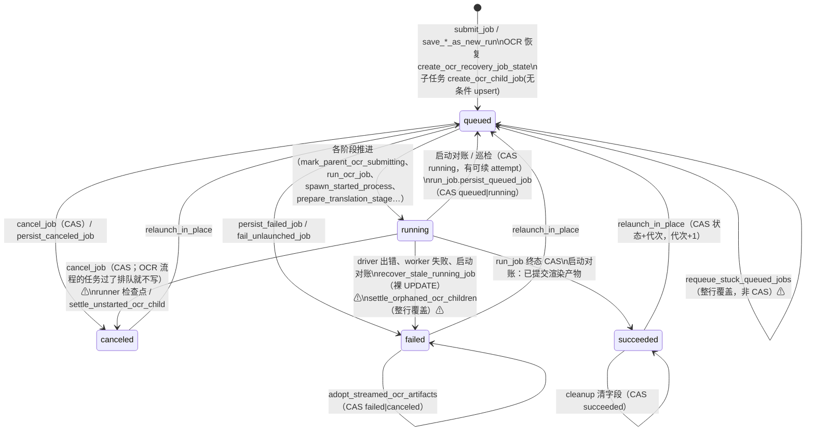
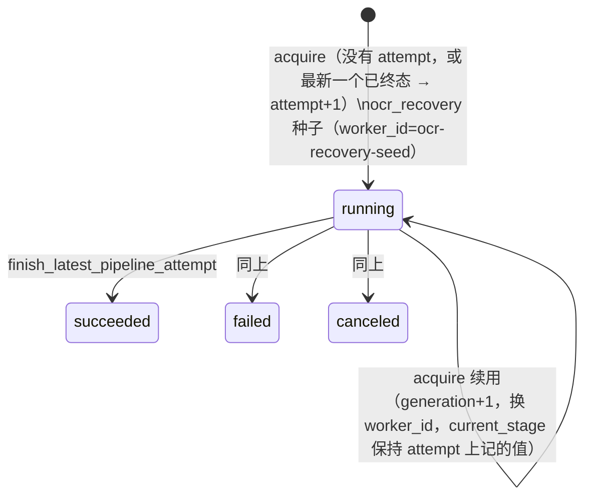

# 状态梳理：任务和数据库（2026-11-26）

> 附录，属于 [后端状态管理设计](./20261126-后端状态管理设计.md)。范围：Rust 侧：任务生命周期、`jobs` 行和 `pipeline_*` 表、事件、血缘、启动对账。
> 原文是 2026-11-26 一路子代理的只读梳理，快照 076ec527a；这里只删了本机路径、统一了标题，结论没改。
> **每条问题的核实状态、严重程度和归到路线图哪一步，以主文件的「问题清单」为准**；本文里的「复现 / 读码 / 推测」是梳理时的自评。
> 文中「上一份」指 [翻译状态审查](../translation-state/20261126-翻译状态审查.md)。

原标题：任务生命周期和数据库（Rust）的状态地图

- 快照：只读检出，detached 在 076ec527a。下文路径都相对于这个目录。
- 范围：`retainpdf-jobs`、`retainpdf-runner`、`retainpdf-core` 的 `models/job`、`database/retainpdf-db`、`backend/jobs`（jobsd）、`retainpdf-proc`。
- 只读。没有编译，也没有跑测试；结论都来自读码。
- 证据等级沿用上一份审查（`docs/ops/planning/translation-state/20261126-翻译状态审查.md`）：
  - **复现**：这次没有做复现。
  - **读码**：逐行对过代码，机理和触发路径都确定。
  - **推测**：机理成立，但触发条件或实际影响没有证实。
- 上一份审查已经说清的问题不再重复，包括：
  - Windows 取消；
  - 重试链丢断点；
  - 断点导入失败没有出路；
  - 启动对账重新排队时整行覆盖；
  - 流式续跑没补 OCR 产物；
  - 指纹、守卫、块状态的种种问题。
- 下文用到这些问题时，写作「上一份 #N」。

---

## 0. 一句话结论

这块代码对**并发**防得很细：行上 CAS、`run_generation`、attempt generation、driver 登记表，几乎每个写入点都有注释讲为什么用 CAS。

但**状态模型**本身缺三样东西：

1. **任务行是一个大快照，靠整行覆盖写。** 同一次运行里有多个写入方，它们之间是最后写的人赢；任务行、attempt、事件、书卡又分在不同事务里写。
2. **没有显式的状态机。**
   - `jobs.status` 在十几个文件里直接赋值。
   - `cas_save_job(expected_statuses)` 只检查「从哪个状态来」，不检查「到哪个状态去」。
   - 阶段、attempt、阶段行都可以无校验地回到 running。
3. **一次运行（run）不是一等公民。**
   - `run_generation` 只在 `jobs` 上有。
   - `pipeline_attempts`、`events`、`job_stage_history`、`event_feeds` 都不知道自己属于哪次运行。
   - 所以原地重跑以后，旧运行的东西会混进新运行。

---

## 1. 一个任务从提交到结束：每一步写了什么

下面按 book 任务（OCR→翻译→渲染）、进程内模式走一遍。jobsd 模式只是把「发射、取消标记、driver 登记表」换到 jobsd 进程里。

| # | 步骤 | 代码 | 写的表和列 | 写的文件 | 防并发 |
|---|---|---|---|---|---|
| 1 | 提交 | `retainpdf-jobs/src/lifecycle/creation/submit.rs:136` `submit_job` → `persist_and_launch:303` | `jobs` 整行（upsert）；`run_generation += 1`（`job_writes.rs:211`/`job_derivations.rs:69`）；触发器 `jobs_inherit_owner` 改 `owner_user_id`；多用户时 `job_page_charges`(reserved)+`page_ledger`；派生任务写 `job_derivations`；`events` 里派生 `job_created`（事务外） | 任务目录、`specs/`、凭据库；`logs/events.jsonl` 追加 | `BEGIN IMMEDIATE`；派生任务在同一事务里查 `job_derivations` 有没有在跑的（`job_derivations.rs:69-90`） |
| 2 | 归属 | `launcher.rs:168` `link_new_job_to_document` | `jobs.document_id`、书库 `documents.active_job_id`、`translation_versions`/`translation_version_jobs` | — | **无事务**，落库提交之后另写，失败只打日志 |
| 3 | 发射 | `runner/lifecycle.rs:50` `launch_job` → `spawn_job_with_workflow:71` | 无；内存里清掉取消标记，并在 `JobDriverRegistry` 登记 `job_id→run_generation` | — | 内存 Mutex；task-local `DRIVER_RUN` 钉住代次（`retainpdf-data/src/job_events.rs:30`） |
| 4 | 排队 | `lifecycle.rs:405` `run_job` → `persist_queued_job:257` | `jobs.status=queued`、`stage=queued`、`failure=NULL`（整行 CAS） | — | CAS（queued\|running）+ 钉住的代次 |
| 5 | 等槽位 | `execution_queue.rs` `wait_for_execution_slot` | 无 | — | 内存 Semaphore；命中取消标记就清掉它，由 `persist_canceled_job:364` 落终态 |
| 6 | 父任务进 OCR | `translation_flow_child.rs:36` `mark_parent_ocr_submitting`、`:70` `create_ocr_child_job` | 父任务行：`status=running`、`stage=ocr_submitting`、`artifacts.ocr_job_id`、`artifacts.ocr_status=queued`；**子任务 `{id}-ocr` 行无条件 upsert**（`:101`）；子任务 `document_id` | — | 父任务行用 CAS；子任务行**不用** CAS |
| 7 | OCR 子任务内联执行 | `ocr_flow/mod.rs:75` `run_ocr_job` | 子任务行（CAS）；每推进一个阶段就把父任务**整行**镜像一次（`ocr_flow/support.rs:55`）；子任务的 `pipeline_attempts/stages/dispatches`（`begin_pipeline_dispatch` 写 intent→receipted/ambiguous） | `ocr/`、provider 原始包、`ocr/stream/`（流式时） | 子任务行用 CAS；派发记录用 attempt generation 栅栏 |
| 8 | 起 worker | `process_runner/startup.rs:44-87` | `jobs.worker_identity`（单独 UPDATE），然后 `jobs.pid`（整行 CAS） | spec 文件、`logs/*.log` | CAS |
| 9 | 读 stdout | `process_runner/io_support.rs:140` `read_stdout` | 先 `acquire_pipeline_attempt`（`attempts.rs:15`，新建或续用 attempt，`generation += 1`），然后每读一行：①`apply_job_stdout_line` 改内存快照，由 `persist_key` 节流后**整行** CAS 写 `jobs`（stage/progress/artifacts/log_tail…）；②`pipeline_stage_observation_v1` → `observe_pipeline_stage`（`stages.rs:16`）写 `pipeline_stages`，同一事务追加 `events`；③`pipeline_checkpoint_v1` → `commit_pipeline_units`（`units.rs:28`）写 `pipeline_units`、`pipeline_stages.last_*`，同一事务追加 `events`；④`artifact_published(output_pdf)` → 写渲染单元，完成 render 阶段 | Python 写断点、页文件、`logs/pipeline_events.jsonl`；Rust 写 `logs/events.jsonl` | `jobs` 用状态 CAS；pipeline 表用 `(attempt, generation, worker_id, status='running')` 栅栏 |
| 10 | 阶段之间 | `process_runner/completion.rs:51` | 中间阶段成功时，**只在内存里**把 `status` 设成 `Succeeded`，靠它告诉调用方「这一阶段成了」 | — | 注释说不落库；靠下一阶段启动时写回 Running |
| 11 | 翻译阶段启动 | `translation_flow_stage.rs:142` `prepare_translation_stage` | `jobs.artifacts.translation_checkpoint_json`、`command`、`stage=translating`、清空 progress | — | CAS |
| 12 | 派生任务导入断点 | `translation_flow_artifacts.rs:13` → `translation_checkpoint_resume.rs:17` | 新任务行 `artifacts.*` 从源任务拷过来（CAS） | 从源任务 `translated/` 拷页文件、快照、`domain-context.json`、复核 memo、请求日志，最后拷断点 | 断点文件最后拷，当作「提交标记」 |
| 13 | 终态 | `lifecycle.rs:452` | 整行 CAS 写终态 → **另一个事务** `finish_latest_pipeline_attempt`（`attempts.rs:180`，attempt 和所有 running 阶段一起收尾）→ 再一个事务登记译文修订 → 书卡和全文索引（`lifecycle.rs:496`） | — | 行用 CAS；attempt 收尾**没有栅栏**（只找「最新一个 running attempt」） |
| 14 | 终态以后 | `app/cleanup.rs:229`、`retention.rs:37` | 清中间文件，再用 CAS(succeeded) 清字段；按天数删 `events`、`event_feed_items`，同时改 `event_source_versions`、`event_feeds` 的 epoch | 删 `rendered/` 缓存、中间文件 | CAS(succeeded)；保留期只删终态任务的 |

**读路径**（以 `GET /jobs/:id` 为例）：

- 读 `jobs` 行：`fill_derived_runtime`，并 join `job_stage_history`。
- 读事件投影：`event_feed/sync.rs:212` `synchronize`。它会合并三样东西：
  - `events` 表；
  - 子任务的 `events`（由 `artifacts.ocr_job_id` 找到）；
  - Python 的 `pipeline_events.jsonl`。
- 合并结果物化进 `event_feeds`/`event_feed_items`，从中选出 live stage。
- `build_job_stage_view`（`progress/stage_view.rs:18`）**优先用事件推出来的阶段**，没有才用 `jobs.stage`。

---

## 2. 状态清单

「真相/派生」一列：

- **真」**：没有别的来源可以重算；
- **派」**：能从别处算出来，括号里写来源和什么时候重算；
- **镜**：别处的复制品，靠写入方顺手同步。

### 2.1 任务行 `jobs`

| 状态 | 存在哪 | 真相/派生 | 谁写（文件:行） | 谁读 | 取值与转换 | 防并发 | 崩溃后 |
|---|---|---|---|---|---|---|---|
| 任务状态 | `jobs.status` | 真 | 整行写都经过 `job_writes.rs:58` `persist_prepared_job`。赋值散在 `completion.rs:79-119`、`lifecycle.rs:258/320/373`、`startup_recovery.rs:183/195/211/249/369`、`ocr_flow/support.rs`、`translation_flow_support.rs:17/27`、`translation_flow_child.rs:39/164/192`、`cancel.rs:60/83`、`rerun.rs:147`、`ocr_flow/mod.rs:89/201`；另有裸 SQL：`jobs.rs` 的 `recover_stale_running_job` | 几乎所有地方；触发器 `jobs_page_charge_*`；恢复查询 | queued/running/succeeded/failed/canceled，见 §3.1。**没有转换表** | `cas_save_job` 只核对旧状态是否属于给定集合，以及 `run_generation`（`job_writes.rs:283-316`） | 启动对账：`running` 改回 queued（有可续 attempt）或 failed；queued 重新发射 |
| 阶段、说明、进度 | `jobs.stage`、`stage_detail`、`progress_current/total` | 镜（stdout 文本行、pipeline 观测、OCR 子任务镜像） | stdout 规则 `stdout_parser/stage_rules.rs`；driver 推进各阶段；OCR 镜像 `support.rs:84-96`；终态 | 列表、详情（live stage 没有时才用）、事件派生 | 字符串，没有枚举约束；`stage` 也编码终态（`finished/failed/canceled`） | 跟着整行 CAS | 下一次写覆盖 |
| 运行代次 | `jobs.run_generation` | 真 | 只在 `bump_run_generation`（`job_writes.rs:182`）和 `cas_save_job_as_new_run`（`:255`）里改；upsert 不写这一列 | driver 发射（`lifecycle.rs:82`）、CAS 写 | 单调加一：建任务从 0 变 1；原地重跑加一；OCR 恢复任务**不加**（`ocr_recovery.rs:72` 走 `persist_prepared_job`，停在 0） | IMMEDIATE 事务 | 不需要恢复 |
| worker 进程 | `jobs.pid`、`jobs.worker_identity` | 真（易失） | identity 由 `jobs.rs:446` 单独 UPDATE；pid 跟整行写（`startup.rs:64-80`） | 启动对账、取消、jobsd 的 terminate（`worker_identity.rs`） | 两列各有写入方：清 pid 时 identity 留着（注释说是有意的） | identity 先写、pid 后写 | `classify_recorded_worker` 核对 |
| 运行信息 | `jobs.stage_entered_at`、`last_error_at`、`retry_count`、`last_retry_at`；其余由 `fill_derived_runtime`（`record.rs:126`）算 | 半派生 | `record.rs:46` `sync_runtime_info`（每次写前） | 视图 | `retry_count` 只在 OCR 包下载和 MinerU 重试时加一（`bundle_events.rs:30/56`、`mineru_retry.rs:76/109`） | 跟着整行 | — |
| 阶段历史 | `job_stage_history(job_id, seq)` | 派（由每次写前的 `stage` 变化推出来） | `job_writes.rs:140` `persist_stage_history`：**先 `DELETE seq >= len`，再 upsert** | 详情时间线 | 注释说是「只追加的表」，实际是用内存快照的长度截断 | 跟着整行；不同写入方的历史长度不同，会互相截断 | — |
| 失败 | `jobs.error`、`jobs.failure_json` | 派（`classify_job_failure` 按日志、stderr 分类） | `refresh_job_failure`、`replace_failure_info`、启动对账手写 | 视图、重试判断 | — | 跟着整行 | — |
| 日志尾、进程结果 | `log_tail_json`、`result_json` | 镜（完整日志在 `logs/`） | stdout 每一行；完成时写一次 | 失败诊断 | 尾部 64KB | 跟着整行 | — |
| 请求、命令、流程 | `request_json`、`command_json`、`workflow` | 真，**但会变** | 建任务时写；原地重渲染改写它们（`rerun.rs:121-180`：`workflow` 从 book 改成 render，`artifact_job_id` 指向自己） | 到处 | 创建后本该不变，实际按运行改写 | 跟着整行 | — |
| 产物路径 | `artifacts.artifacts_json` | 镜（文件在盘上） | stdout 标签行（`artifact_rules.rs`）、各阶段、OCR 镜像、清理 | 下载、渲染、续跑判断 | 路径存成相对 data_root（`normalize_job_paths_for_storage`） | 跟着整行 | — |
| 产物登记 | `job_artifact_entries` | 派（每次整行写时由 `collect_job_artifact_entries` **stat 文件**算出 ready/size） | `job_writes.rs:338-367`（整表先删后插） | `retainpdf-files/src/artifacts/registry.rs:8`（**库里的行优先**，现算的只补缺的键） | `ready` 是写那一刻的结果 | 跟着整行 | 下一次整行写重算 |
| 上一份译文 PDF | `artifacts.previous_output_pdf`、`previous_finished_at`；文件 `rendered/<名>.previous.pdf` | 真（指针和文件各一份） | 计划：`submit.rs:322`（落库前改快照）；挪文件：`:371`（落库后）；接回：`job_writes.rs:37` → `previous_output.rs:79` | 阅读、下载 | 见 §3.9 | 无 | 指针和文件可能对不上（§5 N9） |

### 2.2 运行、阶段、单元、派发（`pipeline_*`）

| 状态 | 存在哪 | 真/派 | 谁写 | 谁读 | 取值与转换 | 防并发 | 崩溃后 |
|---|---|---|---|---|---|---|---|
| attempt | `pipeline_attempts(job_id, attempt)`：`status`、`generation`、`worker_id`、`current_stage` | 真 | 认领：`attempts.rs:15`（每次 spawn worker 都认领）；收尾：`:180`（driver 终态、API 取消、启动对账、子任务收尾）；generation 加一：`stages.rs`、`units.rs`、`dispatches.rs`、`revisions.rs`（只推进非 running 的）；种子：`ocr_recovery.rs:94` | `dispatch_workflow`（`lifecycle.rs:281` 按 `current_stage` 选恢复路径）、恢复查询、自动续跑计数、修订登记 | running → succeeded/failed/canceled。**没有 run_generation 列**，和任务的哪次运行无关 | generation 栅栏 + `worker_id`；认领时 CAS `generation=?` | 任务回到 queued 时**续用**同一个 running attempt；终态任务的 running attempt **只有 `-ocr` 子任务有人扫** |
| 自动续跑计数 | `pipeline_attempts.auto_resume_count/progress` | 真 | `auto_resume.rs:61`（启动对账和巡检） | 熔断 `MAX_AUTO_RESUMES_WITHOUT_PROGRESS` | 有新进度就重新数 | 无（只在对账里写） | — |
| 阶段 | `pipeline_stages(job_id, attempt, stage_key)`：`status`、`stage_order`、`last_committed_unit_*`、`raw_stage/substage/stage_detail/progress_*`、`producer_seq`、`observation_payload_json` | 镜（worker 的观测）+ 真（last_committed） | 认领时 upsert 成 running（`attempts.rs:132-152`，**completed 也会被改回 running**）；观测（`stages.rs:16`，切换阶段时把上一阶段标 completed）；完成（`:236`）；终态（`attempts.rs:229`） | 启动对账（`committed_render_output_path`）、自动续跑进度 | running/completed/failed/canceled；**completed→running 没有校验** | 栅栏；`producer_seq` 要求单调；同一 lane 的进度取 max | 跟着 attempt |
| 单元 | `pipeline_units(..., unit_key)`：`page_hash`、`producer_generation`、`payload_json`、`status` | 镜（Python 断点的页哈希） | `units.rs:28`（stdout 断点行）；`revisions.rs:102`（PATCH、精修之后对账） | 实时译文（`latest_pipeline_unit_for_page`，按 `attempt DESC, generation DESC`）、渲染完成判断 | `status` **只有 'committed' 一个值**（死列） | 栅栏、`producer_generation` 单调、`unit_order` 唯一 | 文件是权威，读的时候自愈（`heal_live_translation_revisions`） |
| 外部派发 | `pipeline_dispatches`：`status`、`receipt_json`、`ambiguity_reason` | 真 | `dispatches.rs:17/126/163/200/241`、`ocr_recovery.rs:41` | 重试、重跑的闸门 `ambiguous_ocr_dispatch` | 见 §3.5 | 栅栏；恢复 CAS 用 `generation=?` 加四元组 | 启动时子任务的 intent 改成 ambiguous（`startup_recovery.rs:453`）；顶层任务只有同一个 attempt 被重新认领时才转 |
| 模型执行器 | `model_sessions`（`paused`、`expires_at`）、`model_operations`（status） | 真 | `model_requests.rs:95-310` | 执行器 | 见 §3.6。默认关着（`RETAIN_MODEL_EXECUTOR_ENABLED`） | 状态 CAS（`status IN (...)`） | `recover_model_operations`：running→ambiguous，queued→cancelled |

### 2.3 事件和投影

| 状态 | 存在哪 | 真/派 | 谁写 | 谁读 | 防并发 | 崩溃后 |
|---|---|---|---|---|---|---|
| 事件 | `events(job_id, seq)`、`event_uid` | 混合：pipeline 事件和状态变化同事务（真）；行 diff 派生的事件是 best-effort 的派 | ①`job_events.rs:230` `emit_job_events_best_effort`：先在事务外读出 `previous`，写完行以后再逐条 `append_event`（`events.rs:11`，每条一个事务）；②`pipeline/events.rs:8/68`，和状态写在同一事务 | 事件投影、实时译文的提交流（`events.rs:136` `list_translation_commit_events_after`） | `seq = MAX(seq)+1`，写在 IMMEDIATE 事务里；没有 run 或 attempt 列 | 行 diff 派生的事件可能丢；`seq` 在事件被保留期全删以后会从 1 重来 |
| 事件源版本 | `event_source_versions(job_id)` | 派（触发器维护） | `events_source_*` 触发器、保留期清理 | 投影判断要不要重建 | 触发器 | — |
| 事件投影 | `event_feeds`（`epoch`、`revision`、`context`、`checkpoints_json`）、`event_feed_items`、`event_feed_retention` | 派（来源：events、子任务 events、`pipeline_events.jsonl`；`context` 变了、来源 revision 变了、文件变了就整份重建） | `event_feed/sync.rs:212`（**读请求触发写**） | `/events`、live stage | 用 revision CAS 提交；重试 8 次 | 可以重建 |
| `logs/events.jsonl` | 任务目录 | 镜（只有行 diff 派生的那部分事件） | `job_events/jsonl.rs:13` | 只在下载链接里（`retainpdf-files/src/links.rs:21`）；投影不读它 | 无（O_APPEND） | — |

### 2.4 血缘和归属

| 状态 | 存在哪 | 真/派 | 谁写 | 谁读 | 备注 |
|---|---|---|---|---|---|
| 派生关系 | `job_derivations(job_id → source_job_id)` | 真 | `job_derivations.rs:69`、`ocr_recovery.rs:77` | 只用来挡「同一个源任务只能有一个在跑的派生任务」 | 断点续跑**不读它**，读的是 `request_json.source.artifact_job_id` |
| 复用来源 | `request_json.source.artifact_job_id` | 真 | 建任务时 | 断点导入、OCR 产物复用、`jobs_inherit_owner` 触发器、`job.source_job_id()` | 原地重渲染时指向**自己** |
| OCR 父子 | `jobs.parent_job_id`；编号约定 `{父}-ocr`；`artifacts.ocr_job_id`；`artifacts.ocr_status` | `parent_job_id` 是由编号派生的（`ocr_parent_job_id`）；`ocr_status` 是镜 | `parent_job_id` 跟整行写（`job_writes.rs:81,131`）；`ocr_*` 来自镜像（`support.rs:64-80`、`:246`）、`create_ocr_child_job:128-131` | 恢复查询用**拼字符串**（`queries.rs:77,118,144`）；巡检用 `strip_suffix("-ocr")`（`driverless_sweep.rs:87`）；投影用 `ocr_job_id`（`sync.rs:58`）；阶段视图用 `ocr_status`（`stage_view.rs:256`） | 一个事实四份，`parent_job_id` 列几乎没人读 |
| 书归属 | `jobs.document_id`、书库 `documents.active_job_id`、`translation_versions` + `translation_version_jobs` | `active_job_id` 是派（「该展示哪个任务」） | 提交（`launcher.rs:178`）、成功（`lifecycle.rs:528`）、失败或取消时退回（`lifecycle.rs:520`、`cancel.rs:137`）、启动 `backfill_active_jobs` | 书库 | 都在事务外，best-effort |
| 页数预扣 | `job_page_charges(job_id)`、`page_ledger` | 真（多用户，已停维护） | `reserve_for_job`；触发器跟着 `jobs.status` 改成 settled 或 refunded | 额度 | 状态由触发器隐式推进 |

### 2.5 内存和锁

| 状态 | 存在哪 | 谁写 | 谁读 | 崩溃后 |
|---|---|---|---|---|
| driver 登记 | `JobDriverRegistry`（`driver_registry.rs`），`job_id → run_generation` | `claim`、guard 的 Drop | 去重发射、巡检判断「没有 driver」 | 丢失；靠启动对账和巡检（120 秒宽限）兜底 |
| 取消意图 | `canceled_jobs: RwLock<HashSet>`（`cancel_registry.rs`；jobsd 模式在 jobsd 里） | API 取消，jobsd 的 `/cancel` | driver 的检查点、stdout 读循环、队列门 | **丢失**。取消 OCR 流程的任务时 API 不写库（`cancel.rs:58-80`），只留这个内存标记（§5 N12） |
| 执行槽位 | `Semaphore` | — | 队列门 | — |
| 本 driver 的代次 | task-local `DRIVER_RUN`（`job_events.rs:19`） | `with_driver_run` | `pinned_for_write` | — |
| 运行时独占 | `runtime_owner` 锁文件（`runtime_owner.rs`） | jobsd、进程内的壳 | — | 操作系统释放 |
| 断点页哈希缓存 | `stage_contract.rs:281` 进程级 `HashMap` | 判断断点能不能续时 | 同上 | — |

### 2.6 文件（Rust 读、写或拷贝的部分）

| 文件 | 属主 | Rust 怎么用 | 合同 |
|---|---|---|---|
| `translated/translation-checkpoint.v1.json` 以及页文件、`generation-N/` 快照 | Python 写 | ①判断能不能续：`stage_contract.rs:122`（要求 `fingerprint` 非空、页哈希对得上）；②导入：`translation_checkpoint_resume.rs:17`（**不要求** fingerprint）；③渲染前：`stage_contract.rs:403`（要求 `complete/committed`） | `schema=translation_checkpoint_v1`。`backend/contracts/` 里**没有**它的 schema，Rust 三处各写一份手工校验 |
| 请求日志（`TRANSLATION_REQUEST_JOURNAL_FILE_NAME`） | Python | 启动对账判断有没有结果不明的请求（`startup_recovery.rs:51`）；重试闸门 | 读不了就当作「要确认」 |
| `translated/` 下的 manifest | Python | 渲染前要求 `complete` | 同上 |
| `logs/pipeline_events.jsonl` | Python（`retainpdf_base/events.py:164`） | 事件投影的来源之一 | `seq` 靠**进程启动时数文件行数**接着往下数（`events.py:179-186`） |
| `ocr/stream/` 清单 | Python 写，Rust 补标 done/failed（`ocr_stream.rs`） | 流式翻译退出的信号 | — |
| `specs/refine-override.json` | Rust（API 写） | 渲染时一次性读 | — |
| 合并阅读目录 `reading.json`、`.last-used` | 书库 | `merged.rs:105` 拼出虚拟任务 | 内容寻址（指纹），只读 |

---

## 3. 状态机

### 3.1 任务状态 `jobs.status`



- **没有显式校验的转换**：
  - 所有 `cas_save_job(job, &["queued","running"])` 只看旧状态，目标状态由调用方随手赋值。
  - 「running 写成 queued」「queued 直接写成 succeeded」在类型上都允许。
  - 内存快照的 `status=Succeeded` 还被借来表示「这一阶段成了」（`completion.rs:65-80`）。它没落库，全靠每个调用方自觉不去写它（`translation_flow.rs` 里有大段注释讲为什么不能写）。
- **两方争同一个状态的地方**：
  - 取消（API）对 driver 终态：已经用 CAS 收住。
  - 启动对账、巡检对 driver：用 CAS(running) 收住。
  - `requeue_stuck_queued_jobs_matching`（`startup_recovery.rs:505`）对取消：非 CAS，见上一份审查。
  - OCR 子任务镜像对父任务 stdout 写：同一次运行，都是 queued|running 的 CAS，**互相覆盖**（§5 N3）。
- **可能卡住的状态**：
  - 子任务停在 queued 却带着 running attempt：巡检的 `settle_children=false`，只有下次启动才收拾（§5 N11）。
  - 终态任务带着 running attempt（§5 N1）。
- **代次**：
  - `run_generation` 只把「这一次运行」和「上一次运行」隔开；同一次运行里的多个写入方之间没有任何栅栏。
  - 唯一的行级比较只看 `status` 和 `run_generation` 两列，没有 `row_version`。

### 3.2 运行代次 `run_generation` 和 driver

| 事件 | 行上的代次 | driver 登记 |
|---|---|---|
| 建任务 | 0 → 1 | `launch_job` 先清取消标记，再 `claim(id, 1)` |
| OCR 恢复任务 | **0**（不加） | `claim(id, 0)` |
| 原地重跑 | n → n+1（CAS） | 新 driver 等旧 driver 释放，最多 120 秒（`lifecycle.rs:129`），等不到就交给巡检 |
| 自动续跑（启动对账、巡检） | 不变 | `spawn_job`（**不**清取消标记） |
| 删除任务 | 行没了 | CAS 返回 false，当作取消 |

### 3.3 attempt（`pipeline_attempts.status`）



- **没有显式校验**：
  - `finish_latest_pipeline_attempt` 收尾的是「这个任务最新一个 running attempt」，不核对它是不是当前这次运行的（没有 run_generation 列）。调用方只能事先用 `run_is_superseded` 自查，这是 TOCTOU。
  - `acquire` 续用 running attempt 时，阶段用的是 attempt 上记的 `current_stage`，而不是调用方要的（`attempts.rs:51-53`）。
- **会卡住**：任务终态写成了，attempt 收尾没写成（两个事务）。见 §5 N1。

### 3.4 阶段（`pipeline_stages.status`）和单元

- 阶段：
  - running → completed：观测切到下一阶段时自动完成（`stages.rs:125-142`），或者 `complete_pipeline_stage`。
  - running → failed/canceled：attempt 收尾时一起写。
  - **completed → running**：`acquire` 的 upsert（`attempts.rs:138-143`）和 `observe` 的 upsert（`stages.rs:153-166`）都无条件写 `status='running'`，等于没有校验地重新打开已完成的阶段。
  - 阶段顺序只靠 `stage_order` 防倒退（`stages.rs:51`）。`durable_stage_order` 把不认识的阶段（`pipeline`）也算成 0，和 ocr 一样。
- 单元：
  - 只有插入、更新两种动作，`status` 永远是 `committed`。
  - 「已提交」的判断其实是「有这一行」。
  - 新 attempt 从零开始，读模型按 `attempt DESC` 取。

### 3.5 外部派发（`pipeline_dispatches.status`）

```
(无) --begin--> intent --receipt--> receipted（终态，可回放）
                   |--mark_ambiguous / 再次 begin 时发现 intent / 启动时子任务--> ambiguous --create_ocr_recovery_job_state--> resolved
                   |--discard（确定没发出去）--> (删除)
```

- 转换在 `dispatches.rs` 里**有显式校验**，比如 `receipt` 要求当前是 intent。这是本范围内唯一一个写得像状态机的地方。
- 缺口：
  - **顶层**任务（OCR-only 流程）死在 intent 时，没人把它转成 ambiguous，要等下一次同一个 attempt 被认领。
  - 启动时只处理 `-ocr` 子任务（`startup_recovery.rs:446-459`）。

### 3.6 模型执行器（`model_operations.status`，默认关闭）

- queued → running：claim，要求会话没暂停、没过期。
- queued → cancelled：会话暂停、取消、重启。
- running → succeeded/failed/ambiguous/cancelled：finish。
- running → ambiguous：取消，或执行器重启。
- 校验：都写成 `WHERE status IN (...)` 的 CAS，有 from 集合。
- 缺口：按 `job_id` 不分运行，原地重跑会复用会话（`create_model_session` 用 `ON CONFLICT DO UPDATE`）。

### 3.7 事件投影（`event_feeds`）

- (无) → initializing（`checkpoints.initializing=true`）→ ready。
- 遇到下列任一情况就**换 epoch 整份重建**，客户端游标作废：
  - `context` 变了，它包含 `status`、`failure`、`error`、`request_payload`、`artifacts.job_root/ocr_job_id`（`sync.rs:97-107`）；
  - 来源 revision 变了；
  - 文件变了；
  - 保留期截止时间变了。
- 也就是说，任务每变一次状态，投影都会重建一次。

### 3.8 OCR 子任务（`{id}-ocr`）的特殊处理

- 建行：无条件 upsert。上一轮的终态行会被**原地盖掉**，但它的 `pipeline_attempts`、`pipeline_dispatches`、`events` 都留着（`translation_flow_child.rs:95-106`）。
- 执行：在父任务的 driver 里内联跑，没有自己的 driver 登记。巡检认它有没有 driver 时，看的是父任务的登记（`driverless_sweep.rs:84-90`）。
- 收尾：
  - 子任务行由 `persist_ocr_child_result` 用 CAS 写；
  - attempt 由 `finish_ocr_child_attempt`（`translation_flow_child.rs:220`）收尾；
  - 出错时由 `settle_ocr_child_after_error` 收尾；
  - 父任务已终态而子任务没收尾的，只在**启动时**由 `settle_orphaned_ocr_children` 收拾。
- 删除：原地重渲染开跑后，`discard_stale_ocr_child`（`rerun.rs:100`）删掉子任务行。外键级联会把它的 attempt、派发记录一起删掉。

### 3.9 上一份 PDF（原地重跑）

1. 原状态：`output_pdf=X`。
2. 原地重跑落库前（`prepare_in_place_render_job`、`plan_previous_output_pdf_move`）：`previous_output_pdf` 改成 `X.previous.pdf`，`output_pdf` 清空。这一步只改快照，不动文件。
3. 落库后（`apply`）：把文件 `X` 改名成 `X.previous.pdf`。
4. 结果：
   - 成功：新的 `output_pdf` 落进来，旧文件由清理回收。
   - 失败或取消：`restore_previous_output_pdf` 把 `output_pdf` 指回 `.previous.pdf`，前提是那个文件存在。

---

## 4. 一个事实存了多份

| # | 事实 | 各份（谁写） | 什么时候不一致 | 不一致时现在的结果 |
|---|---|---|---|---|
| D1 | 现在在哪个阶段、进度多少 | ①`jobs.stage/progress`（stdout 规则、driver、OCR 镜像）②`pipeline_stages`（观测）③`events` 的两套：行 diff 派生的 `stage_transition/stage_updated`，和 pipeline 观测出的 `stage_transition/stage_progress`（`raw_source_kind` 不同）④`event_feeds.checkpoints.stage_basis` ⑤`job_stage_history` ⑥Python 的 `pipeline_events.jsonl` | 流式时 OCR 镜像和翻译写入互相覆盖；观测被拒（seq 倒退）但行已经写了；行 diff 派生的事件丢了 | 视图优先用 ④，没有才用 ①（`stage_view.rs:22-34`）；②只给启动对账和自动续跑计数用。`checkpoint_commit.rs:79-90` 的注释记着 11 月因为两套进度来源打架，界面上「236/642 批」来回跳 |
| D2 | 结束了没有、怎么结束的 | `jobs.status`；`jobs.stage`（finished/failed/canceled）；`pipeline_attempts.status`；`pipeline_stages.status`；`job_stage_history.terminal_status`；`job_page_charges.status`（触发器）；`artifacts.ocr_status`（子任务的） | attempt 收尾和行终态在两个事务里写；`stage` 和 `status` 由不同的语句赋值 | 终态任务带着 running attempt（§5 N1）；`stage_view` 的 OCR 一站读的是镜像（§5 N3） |
| D3 | 有哪些产物、在哪、就绪没有 | `artifacts_json`；`job_artifact_entries`（写那一刻 stat 出的 ready/size）；读的时候现算的 fallback；文件本身；`pipeline_units` 里渲染产物那一单元（`path` 加 sha256） | 文件被清理、被挪开（`previous_output_pdf`）、被外部删掉 | 登记表的行优先于现算（`registry.rs:13-25`），`ready=1` 会一直留到下一次整行写；启动对账靠渲染单元的 `path` 改写 `output_pdf`（`startup_recovery.rs:550-559`） |
| D4 | OCR 子任务是谁、状态如何 | 编号约定 `{父}-ocr`；`jobs.parent_job_id`；`artifacts.ocr_job_id`；`artifacts.ocr_status`；子任务行的 `status` | 复用产物的任务会把 `ocr_job_id` 指向别的任务（`translation_flow_artifacts.rs:69-81` 有专门的修补）；镜像被覆盖 | 投影要靠 `workflow==Ocr` 再过滤一次（`sync.rs:52`）；恢复查询认的是编号，不认 `parent_job_id` |
| D5 | 这个任务是从哪个任务来的 | `request_json.source.artifact_job_id`；`job_derivations`；`translation_versions.base_version_id`；`jobs_inherit_owner` 触发器（从 `request_json` 里抽）；`artifacts.ocr_job_id` | 原地重渲染时 `artifact_job_id` 指向自己；OCR 重试只带 `upload_id`，归属靠 `derived_from` 另外传 | 断点续跑只看 `artifact_job_id` 指向的那一个任务（上一份 #5）；`job_derivations` 只用来挡并发 |
| D6 | 每页的译文是哪一版 | Python 断点里的 `page_hash`、`generation`（**权威**）；`pipeline_units.page_hash/producer_generation`；`events` 里的 `pipeline_unit_committed`；`generation-N/` 快照目录 | stdout 丢行；PATCH、精修绕过 stdout；派生任务继承了 `published_page_hash`（上一份 A 组） | 读的时候自愈，再加上终态后对账（`revision_publication.rs`）；attempt 停在 running 时自愈被跳过（§5 N1） |
| D7 | 事件 | `events` 表；`logs/events.jsonl`（只有行 diff 那部分）；Python 的 `pipeline_events.jsonl`；`event_feed_items` | 行 diff 派生在事务外；JSONL 追加失败只打日志 | 前端只读 ④；`logs/events.jsonl` 只能下载，内容是不全的 |
| D8 | 失败原因 | `error`；`failure_json`；`stage_detail`；`log_tail`；`result_json.stderr`；派生的 `runtime.final_failure_*` | 各写入点自己拼 | 启动对账有三套手写的 `JobFailureInfo`（`startup_recovery.rs:219/258/375` 起的三块），再加上 `jobs.rs` 裸 SQL 里的第四套 |
| D9 | 「第几次」 | 对外的 `attempt` = `runtime.retry_count + 1`（`files/downloads/catalog.rs:232-236`、`views/job_types.rs:595-598`）；`pipeline_attempts.attempt`；`auto_resume_count`；Python 断点的 `attempt_id`；`run_generation` | 四个计数器各数各的 | 见 §5 N6 |
| D10 | 代次和栅栏 | `run_generation`；attempt/stage/unit/dispatch 的 `generation`；`producer_generation`（Python）；`event_feeds.revision/epoch`；`event_source_versions.revision` | 互相没有关联，attempt 不知道自己属于哪个 run | 原地重跑以后，靠「新建 attempt」间接隔开，前提是上一个 attempt 收尾了 |
| D11 | 任务类型 | `jobs.workflow`；`request_json.workflow` | 原地重渲染把两者都从 book 改成 render | 书卡规则、版本规则、投影 context 都按「当前 workflow」判断；任务原来是 book 这一点只能从事件和版本里看出来 |
| D12 | worker 进程 | `jobs.pid`；`jobs.worker_identity`；driver 里的子进程句柄 | 两列各有写入方 | 有专门的核对逻辑兜住（`worker_identity.rs:47`），算是处理好了 |

---

## 5. 和其他方向的接缝

| 接缝 | 方向 | 协议 | 写在哪 | 版本 | 问题 |
|---|---|---|---|---|---|
| worker 的标签行（`output pdf: …`） | Python → Rust 的 `jobs.artifacts` | stdout 纯文本 | `backend/contracts/pipeline-stdout.v1.schema.json` 的 `artifact_labels`；有契约锁测试（`stdout_parser/contract_lock.rs`） | 文件名里的 v1 | 标签不认识就忽略 |
| 阶段观测 | Python → `pipeline_stages` + `events` | stdout JSON `pipeline_stage_observation_v1` | 同上 | `schema` + `schema_version` | **版本不对就悄悄丢掉**（`durable_rules.rs:84` 返回 None），没有握手；`seq` 单调靠数 `pipeline_events.jsonl` 的行数（`events.py:179`），文件被截断就会触发 `sequence regressed`，整个 stdout 读取任务报错 |
| 单元提交 | Python 断点 → `pipeline_units` | stdout `{"event_type":"pipeline_checkpoint","payload":{schema:pipeline_checkpoint_v1}}` | 同上 | 同上 | 同上，版本不对就悄悄丢掉（`durable_rules.rs:73`）。Python 有 outbox（`committed_pages`），崩溃后重放这一条 |
| 渲染完成 | Python → 渲染单元 → 启动对账判成功 | `artifact_published(output_pdf)` | 同上 | — | — |
| 断点文件 | Python 写，Rust 判断、拷贝、校验 | 文件 `translation_checkpoint_v1` | 只在 Python `workflow/checkpoint/contract.py` 里；Rust 三处手写 | `schema_version=1` | 「能续」和「导入」口径不同：前者要 fingerprint、看 `artifacts.translation_checkpoint_json`，后者不要 fingerprint、看约定路径（`translation_checkpoint_resume.rs:43-65`）。界面说「会复用断点」，实际可能什么都没拷，而且不提示（推测） |
| 请求日志 | Python 写，Rust 读来挡自动续跑和重试 | 文件 | `retainpdf_core::translation_request_journal` | ? | — |
| 子任务和父任务共用 `logs/` | 两个 Python 进程（OCR、翻译）同时追加同一个 `pipeline_events.jsonl` | 文件 | `attach_job_paths(&mut ocr_child, parent_job_paths)`（`translation_flow_child.rs:88`） | — | 两个进程各自从「启动时的行数」往下数 `seq`，文件里的 `seq` 不唯一（推测：投影按文件读事件时会不会去重错，没核实） |
| spec | Rust → Python | `--spec <json>` 加环境变量 | `retainpdf-data/src/worker_command` | ? | 不在本次范围 |
| 取消 | API → driver | 进程内存的标记；jobsd 模式走 HTTP `/internal/v1/jobs/:id/cancel` | `backend/jobs/src/main.rs:85` | 无 | 不落库 |
| 合并阅读 | 书库 → jobs 读路径 | 目录加 `reading.json` | `api-base/src/job_loading/merged.rs` | — | 内容寻址，只读，没问题 |

**总的看**：

- Rust 对 Python 的产出有三层：stdout（有 schema，有契约锁）、文件（没有共享 schema）、文件里的内容约定（指纹、`published_page_hash`）。
- 版本不匹配时，stdout 会**悄悄丢弃**，文件会**报错让整个任务失败**，两边策略相反。
- 没有「worker 启动时报出自己支持哪些协议版本」的握手。

---

## 6. 新发现的问题（上一份审查没提到的）

按严重程度排。

### N1. 任务终态和 attempt 收尾分在两个事务里，顶层任务没有对账；修订登记从此永远跳过，下次原地重跑会续用旧 attempt（读码）

- **位置**：
  - `runner/lifecycle.rs:452-480`：终态 CAS，然后 `finish_latest_pipeline_attempt`。
  - `:328-338`、`:381-391`：同样的两步。
  - `jobs/actions/cancel.rs:91-103` 加 `:113`：同上。
  - `startup_recovery.rs:289-307`：同上。
  - `startup_recovery.rs:329` 的裸 SQL 兜底 `recover_stale_running_job`：**根本不收尾 attempt**。
- **触发**：
  - 进程在两次提交之间退出，比如桌面版被关、崩溃；
  - 第二个事务写失败；
  - 读行失败，走了裸 SQL 兜底。
- **后果**：
  1. 修订登记 `publish_page` 看到这一页最新一行属于 running attempt，就返回 `RunningAttempt`（`pipeline/revisions.rs:197,237`）。
     - 之后用户手改的译文、渲染精修，都**永远**登记不进实时译文；
     - 读的时候自愈也走同一套逻辑，补不回来。
  2. 下一次原地重跑（重渲染、精修）时，`acquire_pipeline_attempt` 看到最新的是 running，就**续用**它（`attempts.rs:50-93`）：
     - 自动续跑计数 `auto_resume_count` 原样带进新的一次运行；
     - 阶段从 attempt 上记的 `current_stage` 开始；
     - `dispatch_workflow` 也按它选恢复路径（`lifecycle.rs:281`）。
  3. 只有 `-ocr` 子任务有「父任务已终态、attempt 还 running」的启动扫描（`queries.rs:136`、`startup_recovery.rs:411`）；顶层任务没有。
- **为什么不在上一份里**：上一份只看了断点和翻译，没看 attempt 的生命周期。
- **修法**：
  - 加 `Db::finish_run(job, expected_statuses, run_generation, attempt_status)`，把行终态和 attempt 收尾放进同一个 IMMEDIATE 事务；
  - 启动时再加一条「终态任务 + running attempt → 按行上的状态收尾」的扫描。

### N2. 事件不分运行。原地重跑之后，终态任务显示的「阶段」可能来自上一次运行；任务每变一次状态，事件投影都整份重建（显示问题是推测，机理是读码）

- **位置**：
  - `events` 表没有 run 或 attempt 列（schema.sql 里的 `TABLE events`）；
  - 原地重跑不清空、也不分隔旧事件；
  - `select_main_stage_event`（`progress/live_stage/snapshot.rs:134-158`）对终态任务取「rank 最大」的那条主线事件，渲染和完成的 rank 都是 3（`job/stage.rs:215`）；
  - `build_job_stage_view` 的 `stage` 优先用它（`stage_view.rs:22-24`）。
- **触发**：
  - 一本已经成功的书，原地重渲染；
  - 新一次运行在发出任何 rank≥1 的事件之前就失败了，比如起 worker 失败、渲染输入校验失败。
- **结果**：任务 `status=failed`，但 `stage` 是上一次运行留下的 `finished`/`rendering`。
  - `build_public_stage_snapshot` 对终态返回 None，所以影响限于顶层的 `stage` 字段和三站状态。
- **另外**：`event_feeds.context` 包含 `status/failure/error/request_payload`（`event_feed/sync.rs:97-107`），任务每变一次状态就会：
  - 换 epoch、整份重建；
  - 客户端拿着的游标全部 `event_cursor_expired`。
- 一本几万条事件的书，跑完那一刻要重建一次。这是设计如此，不算 bug，但和「事件只追加」的直觉相反，重新设计时要定下来。

### N3. 边识别边翻译时，父任务的 `artifacts.ocr_status` 被翻译阶段的内存快照一直盖回 `queued`（读码）

- **位置**：
  - `create_ocr_child_job` 把父任务快照的 `ocr_status` 设成 `Queued`（`translation_flow_child.rs:130`）；
  - 然后 `run_ocr_and_translation_together` 把这份快照 `clone()` 给翻译阶段（`translation_flow.rs:353`）；
  - 翻译 worker 的 stdout 读循环每 0.5 秒左右用这份内存快照**整行** CAS 写父任务（`io_support.rs:290`）；
  - OCR 子任务的镜像 `mirror_parent_ocr_status`（`ocr_flow/support.rs:55-117`）是先读库再整行写，两边都是同一次运行里合法的 queued|running CAS，谁后写谁赢。
- **结果**：
  - 在整个流式翻译期间（OCR 子任务早就成功了），父任务行的 `ocr_status` 停在 `queued`。
  - `stage_view.rs:256` 的 `ocr_child_state` 只看这个镜像，于是三站里 OCR 那一站显示「排队」，直到翻译结束、`sync_parent_with_ocr_child` 并回来（`translation_flow.rs:386/395`）。
  - 同一机制下，`job_stage_history` 会被不同长度的内存历史互相截断：`DELETE seq >= len`，见 `job_writes.rs:145`。
- **范围**：只影响能流式公布页的 OCR（GLM-OCR、Paddle 官方 HTTP）。
- **根因**：`cas_save_job` 只用 `status` 加 `run_generation` 做栅栏。同一次运行里有两个整行写入方，没有行版本号，也没有按列归属。

### N4. 启动对账中途一个写入报错，整轮对账就中止，jobsd 起不来（读码）

- **位置**：
  - `startup_recovery.rs:303-311`：`finish_latest_pipeline_attempt(...)?`、`record_auto_resume(...)?`；
  - `:329`：`recover_stale_running_job(...)?`；
  - `:442`：`persist_job_with_resources(...)?`；
  - `:460`：`finish_latest_pipeline_attempt(...)?`。
- 这些都用 `?` 直接返回。jobsd 在 `main.rs:260` 用 `.context(...)?` 包着，出错就让 jobsd 启动失败。
- **触发**：某一个任务的 attempt 行写失败，比如库忙超时、磁盘满。
- **结果**：
  - 前面已经 CAS 成 queued 或 failed 的任务，它们的 attempt 收尾、计数只做了一半（又回到 N1）；
  - 后面的任务完全没被对账；
  - jobsd 起不来。进程内模式下壳的行为没核实，推测类似。
- **修法**：逐个任务隔离错误、打日志、继续处理下一个。

### N5. 产物登记的 `ready` 是写行那一刻的 stat 结果，读的时候以它为准（推测）

- **位置**：
  - `job_writes.rs:44`：`collect_job_artifact_entries` 在 `prepare_job_write` 时 stat 文件；
  - `retainpdf-files/src/artifacts/registry.rs:13-25`：库里有行就用库里的，现算的只补缺的键。
- **触发**：`app/cleanup.rs:229` `prune_intermediates` 先删文件、再 `cas_save_job(&["succeeded"])` 清字段。如果这期间任务被原地重跑了，CAS 失败，「下一轮再说」。
  - 这段时间里：登记表说 `ready=1`，文件已经没了，`artifacts_json` 也还指着它；
  - 而重跑中的任务的 `busy` 集合是在函数一开头算的（`cleanup.rs:214`），也有窗口。
- **影响**：下载或预览拿到 ready 却打不开。等下一次整行写会自愈。

### N6. 对外的 `attempt` 不是「第几次执行」（读码）

- **位置**：
  - `JobListItemView.attempt` 写着 `One-based execution attempt (retry_count + 1)`（`views/job_types.rs:595-598`）；
  - `JobFilesView.attempt` 同样（`files/downloads/catalog.rs:232-236`）。
- **实际**：
  - `retry_count` 只在 OCR 结果包下载重试、MinerU 重试时加一（`ocr_flow/bundle_events.rs:30,56`、`ocr_flow/mineru_retry.rs:76,109`）；
  - 原地重跑时 `runtime=None`，它会清零（`rerun.rs:161`）。
- **和别的计数的关系**：
  - 真正的执行次数是 `pipeline_attempts.attempt`；
  - 运行次数是 `run_generation`。
- **影响**：前端如果用它显示「第 N 次尝试」，或者用它区分不同的运行，数字是错的。对外字段只能加不能改，新加一个 `run_generation` 或 `execution_attempt` 字段即可。

### N7. 行 diff 派生事件在事务外读 `previous`，和行写入也不在同一事务（读码；影响是展示）

- **位置**：`retainpdf-data/src/job_events.rs`。
  - `:140,155`：`db.get_job()` 读 `previous`；
  - 然后写行；
  - `:237-241`：逐条 `append_event`，每条一个事务，失败只打 `warn`，再追加 JSONL。
- **后果**：
  - 两个写入方交错时，比如 N3 的镜像和 stdout 写入，会派生出重复的 `stage_transition`，或者漏掉一条；
  - 进程在写行之后、追加事件之前退出，就丢一条 `status_changed/job_terminal`。
- **对比**：pipeline 的事件和状态写在同一事务里（`pipeline/mod.rs` 的注释）。两套事件来源的一致性保证不一样，而 live stage（N2）两套都用。

### N8. OCR 恢复任务的运行代次停在 0，和所有别的任务不一样（读码，目前无害）

- `create_ocr_recovery_job_state` 用 `persist_prepared_job` 落新行，不调用 `bump_run_generation`（`ocr_recovery.rs:72`）。
- 现在 driver 拿 0 也能工作。但「`run_generation >= 1` 才表示开始过运行」这种假设，以后谁写进去都会在这里出错。新设计里应当统一由「开始一次运行」这一个函数负责加代次。

### N9. 原地重跑时 `.previous.pdf` 的指针先提交，文件后挪；中间崩溃会失去旧 PDF（推测）

- **位置**：`submit.rs:321-323`（落库前改快照），`:369-377`（落库后 `rename`，失败只打日志）。
- **触发**：落库提交以后、`rename` 之前，进程退出，或者 rename 失败（比如 Windows 上文件被占用）。
- **结果**：
  - 库里的 `previous_output_pdf` 指向不存在的 `X.previous.pdf`；
  - 旧 PDF 还在 `X`，也就是渲染要写的位置。渲染不是原子写，会把它截断或覆盖；
  - 如果新一次渲染失败，`restore_previous_output_pdf` 发现 `.previous.pdf` 不存在，`output_pdf` 就留空。
- 用户本来能读的译文 PDF 没了。Windows 上 rename 被占用更常见，和上一份 #13 是同一类问题。

### N10. 原地重渲染改写任务的类型和来源，任务身份随运行变（读码，设计问题）

- `prepare_in_place_render_job`（`rerun.rs:121-180`）做了四件事：
  - 把 `workflow` 从 book 改成 render；
  - `artifact_job_id = 自己`；
  - `runtime = None`，于是 `job_stage_history` 从 seq 1 开始被删掉；
  - 清空 `ocr_*` 链接。
- 后果：
  - 「这个任务原本是翻译任务」只能从版本表、事件里间接看出来；
  - `job.source_job_id()` 返回自己，所以 `stage_view.rs` 把 OCR 一站判成 `Reused`；
  - 上一次运行的阶段历史被删了。
- 这正是「一次运行」不是一等实体的直接后果。

### N11. 巡检会把 `-ocr` 子任务改回 queued，然后没人管；结果不明的 OCR 派发不会被标成 ambiguous（推测）

- **位置**：`driverless_sweep.rs:97-101` 用 `settle_children=false` 调 `reconcile_running_jobs_matching`。
- **触发**：父任务的 driver panic 或者丢了。
  - 子任务行是 running、带着 running attempt，判定为可续，改回 queued；
  - 父任务如果还没进翻译阶段，就没有 attempt，落成 failed；
  - 子任务从此 queued 加 running attempt：
    - 两个恢复查询都按编号排除它；
    - `settle_orphaned_ocr_children` 只在启动时跑。
- **后果**：
  - 子任务还开着的 `intent` 派发不会被标成 ambiguous（这一步只在 `startup_recovery.rs:453`）；
  - 于是 `ambiguous_ocr_dispatch` 闸门认不出来，用户这时「重试 OCR」不会被要求确认重复计费。
  - 孤儿进程虽然已经被杀，请求可能已经发出去了。
- 直到下一次启动才收拾。

### N12. 取消意图只在内存里；取消 OCR 流程任务时，API 不写库（推测）

- **位置**：`cancel.rs:58-80`。OCR 流程的任务过了排队阶段时：
  - 只登记内存标记、杀 worker，不写 Canceled；
  - 等 driver 的检查点自己落终态。
- **触发**：标记登记之后、driver 消费之前，进程退出：
  - 桌面版被关；
  - 或者 jobsd 模式下 jobsd 重启（标记在 jobsd 的内存里）。
- **结果**：启动对账看到 running 加可续的 attempt，就改回 queued，然后自动续跑，**用户的取消丢了**，OCR 接着花钱。
- 进程内模式下，巡检路径用的是 `spawn_job`（不清标记），同一进程里没问题；只有跨进程重启才丢。

### N13. `events.seq` 是 `MAX+1`，保留期删光一个终态任务的事件后会从 1 重来（推测）

- **位置**：`events.rs:36`、`pipeline/events.rs:16`。保留期只删终态任务的旧事件（`retention.rs:87`）。
- **触发**：
  - 一个老任务的所有事件都过了保留期；
  - 然后原地重跑，新事件的 `seq` 从 1 开始；
  - 实时译文的提交流按 `after_seq` 分页（`events.rs:136`），客户端手里还拿着旧游标，就会漏掉新事件。
- 事件投影那边有 `event_source_versions.revision` 兜住，这条提交流没有。

---

## 7. 设计建议

### 7.1 理想的状态模型（只讲这一块）

**一、把「一次运行」立成实体，任务行只放身份**

- `jobs`：放创建后不变的东西。
  - `job_id`、建任务时的请求、`owner`、`document_id`；
  - 加一个 `kind`，取值 book/translate/ocr/render，**不再被原地重跑改写**。
- 新表 `job_runs(job_id, run_generation, workflow, status, started_at, finished_at, failure_json, error, pid, worker_identity, cancel_requested_at, row_version)`：
  - 当前运行是 `MAX(run_generation)`；
  - 原地重跑插一行新的，旧运行原样保留：它的阶段历史、失败原因、PDF 指针都留着。
- `pipeline_attempts`、`events`、`job_stage_history` 都加 `run_generation` 列。
  - live stage、event feed 只看当前运行，旧运行的事件只在时间线上分组显示。
  - 这一条直接解决 N2、N6、N10，也给 N1 的对账一个判断依据。

**二、每个状态只有一个属主，按列写，不再整行覆盖**

| 状态 | 唯一属主 | 写法 |
|---|---|---|
| `job_runs.status` | 新模块 `retainpdf-jobs/src/lifecycle/transitions.rs` 里唯一的 `transition_run()` | `UPDATE ... WHERE run_generation=? AND status IN (from集合) AND row_version=?`；SQL 里加 `CHECK(status IN (...))` |
| 阶段和进度 | `pipeline_stages`（来自 worker 观测） | `jobs.stage/progress_*` 降级成投影，或者干脆删掉；对外字段保留，由视图从 `pipeline_stages` 算 |
| 产物 | `job_artifact_entries` 成为唯一的登记处 | `artifacts_json` 只读兼容；`ready` 在读的时候核对（mtime、size 缓存），不在写的时候固化 |
| OCR 子任务关系 | 新表 `job_lineage(job_id, source_job_id, kind ∈ {ocr_child, retry, continue, ocr_recovery, rerender}, resume_from_job_id)` | 恢复查询、巡检、投影都 join 这张表；`-ocr` 后缀只是编号，不再承载语义；`parent_job_id`、`job_derivations` 并进来 |
| 子任务状态在父任务上的镜像 | 不要镜像 | 视图读的时候 join 子任务行 |
| 取消意图 | `job_runs.cancel_requested_at` | 内存标记只作快速通知；driver 和启动对账都读这一列（N12） |
| 页的译文版本 | Python 断点（权威） | `pipeline_units` 明确标成投影，有统一的「对账」入口；attempt 状态不再挡对账（N1） |

- runner 不再手里拿着一份 `JobRuntimeState`，在 0.5 秒一次的节流里整行写回。改成几个窄写入：
  - `update_progress(run, stage, detail, cur, total)`；
  - `set_artifact(run, key, path)`；
  - `append_log_tail(run, lines)`；
  - `set_pid(run, pid, identity)`。
- 这些写入各自只碰属于自己的列，所以 N3 这种覆盖不会再发生，`job_stage_history` 也不会被截断。

**三、显式的状态机加转换表**

- 每个状态枚举一张表，写成 Rust 的 `const TRANSITIONS: &[(From, To, Writer)]`，加单测和架构检查。
- 写法照抄现在的 `check_job_entry_ownership`：禁止在 `transitions.rs` 以外写 `.status = JobStatusKind::`。
- 要覆盖的状态：
  - run：queued → running → {succeeded, failed, canceled}；终态之后不能再动，原地重跑改为新建一个 run。
  - attempt：running → 终态；**和 run 的终态在同一个事务里写**。
  - stage：running → completed/failed/canceled；completed 不能回到 running（现在 `acquire` 和 `observe` 的 upsert 都会这样做）。
  - dispatch：已经接近这个形态，补上「顶层任务死在 intent 时，启动就标成 ambiguous」。
- 内存里的「阶段结果」和「任务状态」分开：`execute_process_job_stage` 返回 `StageOutcome::{Done, Failed, Canceled}`，不再借用 `JobStatusKind::Succeeded`（`completion.rs:65-80`）。

**四、事件和快照怎么分工**

- **快照**，也就是状态表，是真相：`job_runs`、`pipeline_*`、`job_lineage`。
- **事件**只能在改快照的同一个事务里写，相当于 outbox。
  - 每一个状态转换函数都顺手 `append_state_event`，现在 pipeline 表就是这么做的；
  - **废掉**「事务外读 previous → 拿内存快照做 diff → 派生事件」这条路（`job_events.rs:230`）。
- **投影**（`event_feeds`、live stage、书卡 `active_job_id`、FTS）只从快照和事件重建，并且带 `run_generation`。
  - `event_feeds.context` 不再包含 `status`，状态变化走事件，不用重建整份投影。
- `logs/events.jsonl` 要么写全，要么不写。现在它只有一半，只能下载。

**五、和 Python 的协议**

- worker 一启动先打一行 `{"event_type":"hello","protocols":{"pipeline_stage_observation":1,"pipeline_checkpoint":1,"translation_checkpoint_file":1}}`。
  - Rust 发现不认识的版本，直接让这次运行失败，并说清原因，不再悄悄丢弃（`durable_rules.rs:73,84`）。
- 断点文件的 schema 放进 `backend/contracts/translation-checkpoint.v1.schema.json`。
  - Rust 只保留一个 `CheckpointView::load(path) -> Result<CheckpointView>`，三处调用方共用；
  - 「能不能续」和「实际导入」用同一个判定。
- `producer_seq` 不再靠数文件行数，改由 Rust 在 spawn 时通过 spec 传一个起始值（取 `pipeline_stages.producer_seq` 的当前值），或者干脆按 `(attempt, worker_id)` 隔开。

### 7.2 迁移步骤

按「收益 ÷ 风险」排。每一步都要守仓库的规矩：

- 对前端只增不改；
- 有迁移就更新 `schema.sql` 快照，并用 `retainpdf db-snapshot diff` 在真实库副本上比对；
- 改了 `routes.txt`、`file-responses.txt`、`submissions.txt` 快照，要看 diff。

| 步 | 内容 | 动到哪 | 为什么排在这 |
|---|---|---|---|
| **1（先做，收益最大）** | **把运行收尾做成一个事务，并加对账**：`Db::finish_run`（行终态 CAS 加 attempt 收尾加 `append_state_event`，同一个 IMMEDIATE 事务），替换 `lifecycle.rs`、`cancel.rs`、`startup_recovery.rs` 里所有「先 CAS 再 finish」的写法；启动时扫「终态任务 + running attempt」，按行上的状态收尾；启动对账逐个任务隔离错误（N4）；顶层任务也把开着的 intent 标成 ambiguous | `job_writes.rs`、`pipeline/attempts.rs`、`lifecycle.rs`、`cancel.rs`、`startup_recovery.rs`、`queries.rs` | 改动小，不改表结构；直接修好 N1、N4，以及 N11 的一半；修订登记永远跳过这件事是静默坏的，越早修越少脏数据 |
| 2 | **按列写，不再整行覆盖**：给 `jobs` 加 `row_version`；runner 的进度、产物、日志尾改成窄 UPDATE；OCR 镜像只写 `artifacts.ocr_*`，或者干脆不写，视图去读子任务；`persist_stage_history` 改成只追加（按 `enter_at` 去重） | `io_support.rs`、`ocr_flow/support.rs`、`job_writes.rs` | 修好 N3，消掉一类 lost update；以后加任何写入方都不用再逐处推敲谁会覆盖谁 |
| 3 | **持久化取消意图**：加列 `jobs.cancel_requested_at`，API 取消时一律写它；driver 和启动对账都读它；内存标记只做通知 | `cancel.rs`、`cancel_registry.rs`、`startup_recovery.rs` | 修好 N12；也是第 5 步 `job_runs` 的一部分，可以先放在 `jobs` 上 |
| 4 | **事件带上运行**：`events`、`pipeline_attempts`、`job_stage_history` 加可空列 `run_generation`（老数据为 NULL，当作第 0 次运行）；live stage、event feed 按当前运行筛；`context` 去掉 `status` | `pipeline/events.rs`、`events.rs`、`live_stage/snapshot.rs`、`event_feed/sync.rs` | 修好 N2；顺带在接口上**新加**一个 `run_generation` 字段，`attempt` 字段保留（N6） |
| 5 | **集中状态转换**：`transitions.rs` 加转换表；架构检查禁止在别处直接给 status 赋值；中间阶段的结果改成 `StageOutcome`；stage 加 completed 不能回 running 的守卫 | runner 全部写 status 的地方、`check_architecture.py` | 把隐式状态机写成显式的；前面几步都做完以后，这一步主要是搬代码 |
| 6 | **血缘表**：`job_lineage` 取代 `job_derivations`、`parent_job_id`、编号约定；加 `resume_from_job_id`，和上一份审查的「续跑协议（Rust）」合成一件事 | 新迁移，加上 `queries.rs`、`driverless_sweep.rs`、`translation_checkpoint_resume.rs` | 和上一份 #5、#6 一起做，一次理清 |
| 7 | **拆出 `job_runs`**：原地重跑插新的 run，不再改写 `workflow`；`prepare_in_place_render_job` 只构造新 run 的参数 | 大改；`submit.rs`、`rerun.rs`、`stage_retry*.rs`、视图 | 最大的一步，放在最后；前面几步已经把 run_generation 放进了各个表，这一步主要是把列从 `jobs` 挪到 `job_runs` |
| 8 | **协议握手和断点 schema** | `durable_rules.rs`、`stage_contract.rs`、`translation_checkpoint_resume.rs`、`backend/contracts/` 和 Python 侧 | 和翻译方向的设计（块状态、冻结决定）一起做；Rust 这边先把三处手写校验收成一处，不依赖 Python 改动，可以提前做 |

**测试**：每一步都配上「两个写入方交错」的测试，现在只有取消对 driver 的那一类。比如：

- 镜像写和 stdout 写交错（N3）；
- 终态 CAS 成功、finish 失败（N1）；
- 对账时某一个任务的 attempt 写失败（N4）。

仓库里已经有 `events_concurrency_tests.rs`、`lifecycle_tests.rs` 可以照着写。
