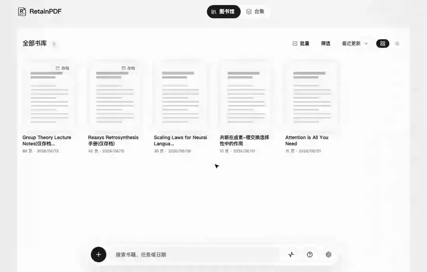

# RetainPDF 使用说明书

RetainPDF 把 PDF 翻译成中文，尽量保留原来的版面：公式、图表、页眉页脚、分栏都留在原位。翻好的书放在自己的图书馆里，可以原文和译文对照着读，也可以直接改译文。

这份说明书写给使用软件的人。第一次用，按下面「快速上手」走一遍；之后要查哪个功能，看「按功能查」。

## 快速上手

1. [安装](install.md) 桌面版，打开。
2. 第一次打开会弹出接口设置，[填好 Key](credentials.md)，点「保存并启动」。
3. 点 ，把 PDF 拖进去，点  **直接翻译**。
4. 在 [书的详情](book-detail.md) 里看它一步步做完，跑完会 [通知](notify.md) 你。
5. 点  **对照阅读**，原文译文并排 [读](reader.md)。

底部这几个按钮： 添加 PDF ·  任务中心 ·  使用说明 ·  设置。

## 按功能查

每一页对应软件里的一个功能。设置里每一栏标题旁的 **?** 直接打开讲这一栏的那一页。

| 功能 | 在哪里 |
| --- | --- |
| [安装和第一次打开](install.md) | |
| [图书馆](library.md) | 打开软件的首页：书架、筛选、排序、搜索 |
| [合集](collections.md) | 顶部「合集」 |
| [添加 PDF](ingest.md) | 底部 **＋** |
| [任务中心](task-center.md) | 底部脉冲图标 |
| [书的详情](book-detail.md) | 点书架上的书：进度、文件、质量、术语、出错处理、重新翻译 |
| [阅读和修改译文](reader.md) | 书的详情里「对照阅读」 |
| [接口设置](credentials.md) | 设置 → 接口设置 |
| [术语表](glossaries.md) | 设置 → 术语表 |
| [用量和花费](usage.md) | 设置 → 总用量 |
| [同步](sync.md) | 设置 → 同步 |
| [备份](backup.md) | 设置 → 备份 |
| [通知](notify.md) | 设置 → 通知 |
| [局域网共享](lan-share.md) | 设置 → 局域网共享（桌面版） |
| [外观和命令行](settings.md) | 设置 → 外观；命令行工具在 设置 → 更新（桌面版） |
| [更新](app-update.md) | 设置 → 更新（桌面版） |

<!--
给写说明书的人（这段是注释，软件里和 GitHub 上都不显示）：
- 一个前端模块（frontend/web/src/features/<模块>）一页，文件名就是模块名。一个功能只在自己模块那页写，别的页链过去。
- 软件里底部「使用说明」打开的就是这些文件：上面这张表就是左边的目录，页面之间的链接、图片都写相对路径。
- 设置分区登记里的 guide 写模块名，标题旁的「?」打开说明书的那一页。
- frontend/web/tests/architecture/user-guide-coverage.test.mjs 查每个模块都有说明页、每个 guide 都有对应的页、每页都列在上面的表里。
- 截图、操作动画（images/<模块>/*.jpg、*.webp）用演示数据自动生成，不含真实的书和 Key；正文里的小图标（icons/*.svg）
  从软件用的同一套图标生成。界面改了先 npm --prefix frontend/web run build，再 npm --prefix frontend/web run guide:media。
- 每页先放操作动画和三五行带图标的步骤，再放一张「想要 → 点哪里」的表；细节收进 
（默认收起）。
-->
