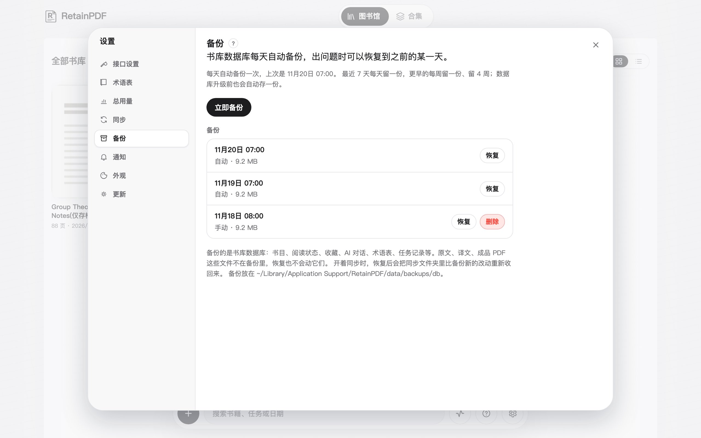

# 备份

书库每天自动备份一次，留最近 7 天每天一份、更早的每周一份。

| 想要 | 点哪里 |
| --- | --- |
| 马上备份一份 |  →  **备份** → **立即备份** |
| 回到之前某一天 | 那一份旁边的 **恢复**（恢复前会先自动备份当前的） |

备份的是书库数据（书目、阅读状态、合集、术语表等），**PDF 文件本身不在备份里**。

详细说明

书库的数据库每天自动备份一次。误删了书、数据出了问题，可以恢复到之前的某一天。

## 备份了什么

书目、阅读状态、合集、术语表、任务记录等书库里的数据。

**原文、译文 PDF 这些文件不在备份里**，恢复时也不会动它们。要保住文件，用 [同步](sync.md) 放到另一台电脑或网盘上。

## 自动备份留多久

最近 7 天每天留一份，更早的每周留一份、留 4 周。软件升级、数据库要变结构之前，也会先自动存一份。

## 设置 → 备份

- 顶部写着上次自动备份是什么时候。
- **立即备份**：马上手动备份一份。
- **打开备份文件夹**：桌面版才有，在文件管理器里打开存备份的地方。页面最下面也写着备份放在哪里。
- 列表里每份备份写着时间、类型（自动 / 手动 / 恢复前 / 升级前）和大小。

## 恢复

1. 在要恢复到的那份旁边点「恢复」。
2. 确认「书库会回到这个时刻」。恢复前，当前的书库会先自动备份一份，恢复错了还能再恢复回来。
3. 恢复完页面会自动刷新。

有任务在跑时不能恢复，等任务跑完或取消。开着同步时，恢复后会把同步里比这份备份新的改动再收回来。

## 删除

只有手动备份能删，自动备份会按上面的规则自己清理。

