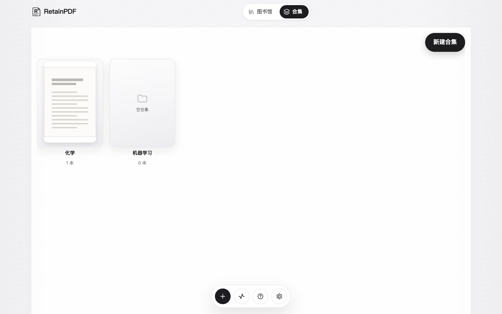

# 合集

把书分组，比如「化学」「本学期教材」。一本书可以放进好几个合集。

1. 顶部切到  **合集**，点 **新建合集**
2. 填名字，勾上要放进来的书
3. 点 **保存**

| 想要 | 点哪里 |
| --- | --- |
| 往合集里加书 | 合集卡片上的 **管理**；或书的详情「概览」里点合集名；或书架  → 加入合集 |
| 改名、删除合集 | 合集卡片上的 **管理**（删合集不会删书） |

详细说明

把书分组，比如「化学」「机器学习」「本学期教材」。一本书可以放进好几个合集。

## 新建

1. 书架顶部切到「合集」，点「新建合集」。
2. 填名称，从书库里勾选要放进来的书。
3. 点「保存」。

## 把书放进合集

三个地方都可以：

- 合集卡片上点「管理」，勾选或取消勾选书。
- [书的详情](book-detail.md#概览) 的「概览」里，「合集」一行点合集名，就加入或移出。
- [图书馆](library.md#工具栏) 点「批量」，选好书后点「加入合集」。

## 看合集里的书

点合集卡片打开，里面的书和书架上一样能点开、阅读。点「← 返回合集」回到合集列表。

## 改名和删除

合集卡片上点「管理」，可以改名，也可以「删除合集」。删除合集不会删掉里面的书。

