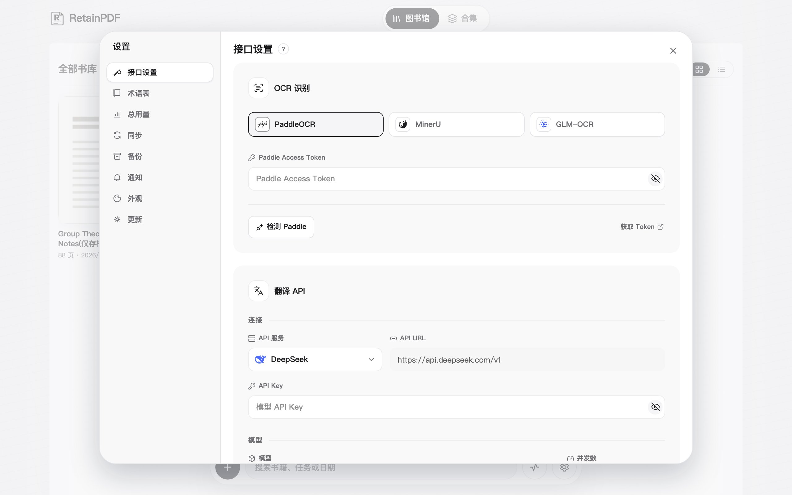

# 接口设置：填 OCR 和翻译的 Key

底部  → **接口设置**。要填两样 Key，费用由服务商按用量收：

1. **OCR 识别**：选一家，填它的 Token，点「检测」
2. **翻译 API**：选服务商，填  API Key，点「检测接口」
3. 点 **保存接口**

| 不知道选哪家 | 建议 |
| --- | --- |
| 只想办一个账号 | OCR 选 **GLM-OCR**，翻译选 **智谱**，共用一个智谱 Key |
| 分开办 | OCR 选 **PaddleOCR**，翻译选 **DeepSeek** 或 **Qwen** |

每张卡片下面有「获取 Token / Key」链接，点了直接去申请。桌面版的 Key 只存在这台电脑上。

详细说明

RetainPDF 本身不收费，翻译一本书要用到两家外部服务，费用由它们按用量收：

- **OCR 识别**：把 PDF 每一页的文字、公式、表格、图片位置识别出来。
- **翻译 API**：调用大模型，把识别出来的文字翻成中文。

两样都要在 **设置 → 接口设置** 里填好 Key。第一次打开软件时会自动弹出这一页；以后要改，点底部栏最右边的齿轮。

桌面版的 Key 只保存在你这台电脑上；Docker 网页版的 Key 保存在装它的那台服务器上。

## 推荐的搭配

不知道选哪家，可以先用下面两种之一：

- **只办一个账号**：OCR 选 **GLM-OCR**，翻译选 **智谱**。两样共用同一个智谱 API Key，OCR 那一栏可以不填。
- **分开办**：OCR 选 **PaddleOCR**（百度飞桨），翻译选 **DeepSeek** 或 **Qwen**（阿里云百炼）。

以后随时可以换，换了只影响之后提交的任务。

## OCR 识别

三家任选一家，点卡片选中，再把 Token 或 Key 填进下面的框：

| 服务 | 去哪里拿 | 一本书最多 | 特点 |
| --- | --- | --- | --- |
| PaddleOCR | [百度 AI Studio 访问令牌](https://aistudio.baidu.com/account/accessToken) | 999 页 | 默认选项 |
| MinerU | [MinerU API 管理](https://mineru.net/apiManage/docs) | 600 页，单个文件最大 200MB | |
| GLM-OCR | [智谱开放平台 API Key](https://open.bigmodel.cn/apikey/platform) | 不限 | 公式、表格识别好；翻译也用智谱时不用另填 |

每张卡片下面都有「获取 Token」或「获取 Key」链接，点了直接打开对应的申请页面。

填好后点「检测 Paddle」（或「检测 MinerU」「检测 GLM-OCR」），确认 Token 能用。

这里选的是默认的 OCR。每次添加 PDF 时还可以临时换一家，见 [添加 PDF](ingest.md)。

## 翻译 API

### 连接

1. **API 服务**：从下拉框里选服务商，地址会自动填好。

   | 服务商 | 默认模型 | 去哪里拿 Key |
   | --- | --- | --- |
   | Qwen | qwen3.8-flash | 阿里云百炼控制台 |
   | DeepSeek | deepseek-flash | [DeepSeek 开放平台](https://platform.deepseek.com/api_keys) |
   | Anthropic | claude-sonnet-5 | Anthropic 控制台 |
   | OpenAI | gpt-5.6-luna | OpenAI 控制台 |
   | 智谱 | GLM-5.3-Flash | [智谱开放平台](https://bigmodel.cn/usercenter/proj-mgmt/apikeys) |
   | OpenCode Go | deepseek-v4.1-flash | [OpenCode Go 文档](https://opencode.ai/docs/go/) |
   | 自定义 API | 自己填 | 其他兼容 OpenAI 或 Anthropic 格式的服务，自己填地址和模型 |

2. **API Key**：把服务商给的 Key 粘进来。

### 模型

- **模型**：用哪个模型翻译，选了服务商会带上默认模型。
- **从服务商拉取模型**：用上面填的地址和 Key 去问服务商有哪些模型，从列表里挑一个点「设为默认」；还可以多勾几个当「其他模型」。拉取时 Key 不会被保存。
- **其他模型（可不填）**：这把 Key 还能用的其他模型，用逗号隔开。以后在 [书的详情](book-detail.md#重新翻译) 里「重新翻译」时，可以换成这些模型，旁边会写估价。
- **并发数**：同时发多少个翻译请求。越大越快，但服务商有频率限制，报错太多就调小。不懂就保持默认。

### 高级（一般不用动）

- **接口协议**：Anthropic 官方选「Anthropic 格式」，其余都用「OpenAI Responses 格式」。
- **思考深度**：默认「关闭」，翻译一般用不着模型思考。调深会更慢、更贵。

### 检测并保存

1. 点「检测接口」：软件会用你填的地址、Key、模型发一次很小的请求。显示可用就没问题；DeepSeek 还会顺便显示余额，余额不足时有「去充值」链接。
2. 点「保存接口」（第一次打开时这个按钮叫「保存并启动」）。

## 检测不通过怎么办

| 提示 | 原因和办法 |
| --- | --- |
| Key 不对或没有权限，服务商拒绝了 | Key 复制错了、过期了或被作废了。回服务商网站重新复制一个。 |
| 连不上这个地址 | 检查 API URL 有没有填错、网络能不能打开这个服务商的网站。 |
| 服务商出错了，稍后再试 | 服务商自己那边出问题，等一会儿再检测。 |
| 余额不足 | 去服务商网站充值。 |

