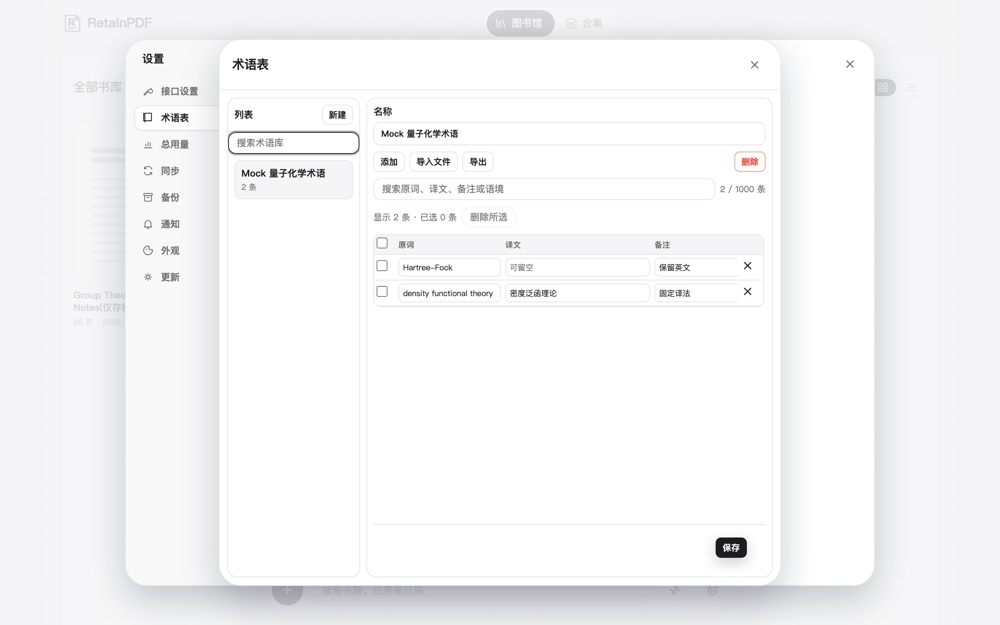

# 术语表

让专有名词按你定的译法翻。

1.  →  **术语表** → **打开术语表**
2. **新建**，填名字，**添加** 一行行填原词和译文（或 **导入文件**）
3. 点 **保存**
4. [添加 PDF](ingest.md) 时在左下  里选这张术语表

| 想要 | 怎么做 |
| --- | --- |
| 从 Excel / CSV 导入 | **导入文件**，先点「下载 CSV 模板」看格式 |
| 这个词不翻 | 类型选「保留原词」 |
| 用一本书里认出的术语 | 书的详情「术语」页 → **存为我的术语表** |

详细说明

让专有名词按你定的译法翻。可以建好几张表，比如「量子化学术语」「公司产品名」，翻译时选一张用。

## 打开

**设置 → 术语表**，点「打开术语表」。左边是所有术语表，右边编辑选中的那张。

## 建一张表

1. 左边点「新建」，填「名称」。
2. 点「添加」加一行，填好每条词条。
3. 点「保存」。没保存就离开会提醒你。

每条词条：

| 字段 | 填什么 |
| --- | --- |
| 原词 | 原文里的词，最多 200 字 |
| 译文 | 要翻成什么，最多 200 字。类型是「保留原词」时可以不填 |
| 备注 | 给自己看的说明，可以不填 |
| 语境 | 这个词在什么情况下这样翻，可以不填。同一个原词在不同语境下可以有不同译法 |
| 类型 | 保留原词：不翻，原样留着；固定译法：必须这样翻；优先译法：尽量这样翻 |
| 匹配 | 忽略大小写 / 精确 / 正则 |

一张表最多 1000 条。勾选多行可以「删除所选」；「删除」整张表要确认，删了不能恢复。

## 从文件导入

已经有现成的词表，点「导入文件」：

- 支持 CSV、TSV、TXT、XLSX，最大 2MB。老的 `.xls` 要先另存为 XLSX 或 CSV。
- 点「下载 CSV 模板」看格式。列是 `source,target,note,level,match_mode,context`，也可以用中文表头：原词、译文、备注、类型、匹配、语境。
- 没有表头时，第 1 列当原词，第 2 列当译文，第 3 列当备注。
- 「类型」列写「不翻译」或「保留」算保留原词，写「固定翻译」或「标准译法」算固定译法，其他都算优先译法。
- 导入前能预览前 5 条，也能手动指定哪一列是什么。
- 「导入方式」选「追加合并」或「替换当前词条」。原词和语境都相同的算重复，后面的为准。
- 点「解析并导入」，再点「保存」才真正存进表里。

文件乱码时，把「文件编码」从「自动识别」换成 GBK/GB18030 或 UTF-8 试试。

## 导出

点「导出」，把这张表下载成 CSV，文件名就是表名。

## 翻译时用

[添加 PDF](ingest.md#更多选项) 时展开「更多选项」，在「术语表」里选一张。默认不用。

## 从一本书里存

翻译过的书，在 [书的详情](book-detail.md#术语) 的「术语」页点「存为我的术语表」，就把这本书认出的术语存成一张新表，之后可以在这里增删改。

