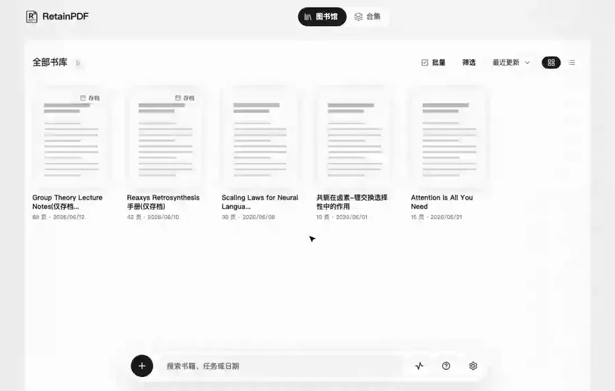
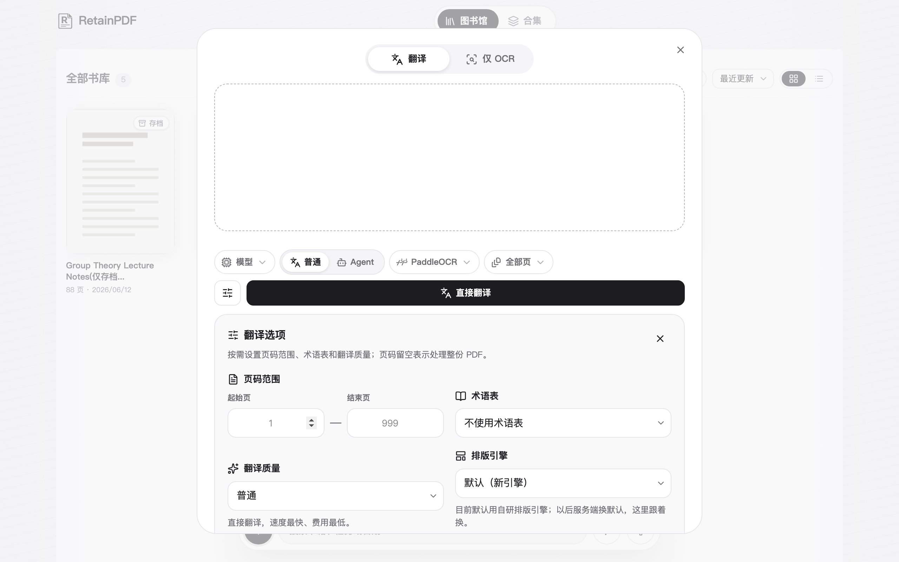

# 添加 PDF

1. 点 
2. 把 PDF 拖进框里（可以一次好几本）
3. 点  **直接翻译**

先在 [接口设置](credentials.md) 填好 Key。没填也能放进书架，只是不能翻译。

| 想要 | 点哪里 |
| --- | --- |
| 只识别，不翻译 | 顶部  **仅 OCR** |
| 先放着，以后再翻 | **仅收藏**（书架上标「存档」） |
| 翻得更好（更慢、更贵） |  **Agent** |
| 只翻几页试试 | **全部页** → 填页码 |
| 术语表、排版引擎、翻表格 | 左下角  |

每个选项的意思

## 这次用什么翻译

框下面一排按钮只管这一次，不动就用设置里的默认值：

- **模型**：这次用哪个模型。可选的是 [接口设置](credentials.md#模型) 里存的模型。
- **普通**：直接翻译，最快、最省钱。
- **Agent**：先通读全文定好术语，再逐页翻译并审校。质量明显更好，但慢很多，花费也高得多。开头通读要一会儿，进度会先停在 0。
- **OCR**：这次用哪家 OCR。一本书最多：PaddleOCR 999 页，MinerU 600 页，GLM-OCR 不限。
- **页码**：默认全部页，也可以只翻其中几页。

## 更多选项

左下角  展开 **翻译选项**：

- **页码范围**：起始页和结束页，留空就是整本。
- **术语表**：选一份 [术语表](glossaries.md)，专有名词按你定的译法翻。
- **翻译质量**：普通；统一术语（先通读定好术语再翻，费用多约 0.4 倍）；精翻（和「Agent」是同一个设置）。
- **排版引擎**：默认新引擎，一般不用改，排不好时自动退回旧的 Typst。
- **翻译表格（试验）**：正文翻完再逐张翻表格。只在阅读页能看到，译文 PDF 里的表格还是原文；[用量](usage.md) 里记在「表格翻译」。

一次选了好几本时，每本都整本处理，这些选项对每本都一样。

## 提交以后

- 一本：自动打开它的 [详情](book-detail.md)，停在「进度」页。
- 好几本：在书架上看进度，或打开  [任务中心](task-center.md)。

关掉窗口也没关系，任务在后台接着跑，跑完会 [通知](notify.md) 你。

