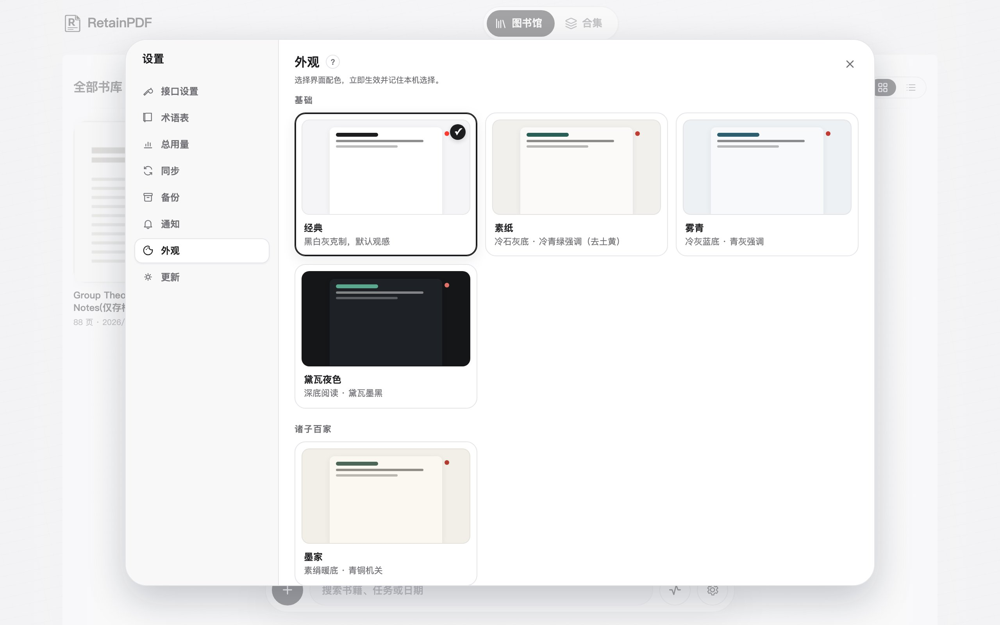

# 外观和命令行

| 想要 | 点哪里 |
| --- | --- |
| 换配色（含深色） |  →  **外观** |
| 换译文 PDF 的字体 | 设置 → 外观 → **渲染字体**（一般别改） |
| 在终端里用 `retainpdf` 命令 | 设置 → 更新 →  **安装命令行工具**（桌面版） |

详细说明

## 外观

**设置 → 外观**，改完立即生效，只影响这台电脑。

### 配色

- 基础：经典（默认，黑白灰）、素纸、雾青、黛瓦夜色（深色，适合晚上读）。
- 诸子百家：墨家。

阅读页也跟着这里选的配色。

### 渲染字体

译文 PDF 正文用什么字体，下次新建任务时生效。

只有默认的思源宋体能用新的排版引擎；选了别的字体会退回旧的 Typst 排版，页面上会有黄色提示。没有特别需要就别改。

## 命令行工具

只有桌面版有（Windows 暂不支持一键安装），在 **设置 → 更新** 下面。

装好后可以在终端里用 `retainpdf` 查看状态、备份、同步，或者配置接口 Key、模型和并发。命令行和软件用的是同一份配置（在 `~/.retainpdf/` 里），在哪边改都一样。

1. 点「安装命令行工具」。装好后会显示装在哪里。
2. 打开终端，试试 `retainpdf status`。

终端说找不到命令时，按提示把那一行 `export PATH=…` 加到 `~/.zshrc`，再开一个新终端。

