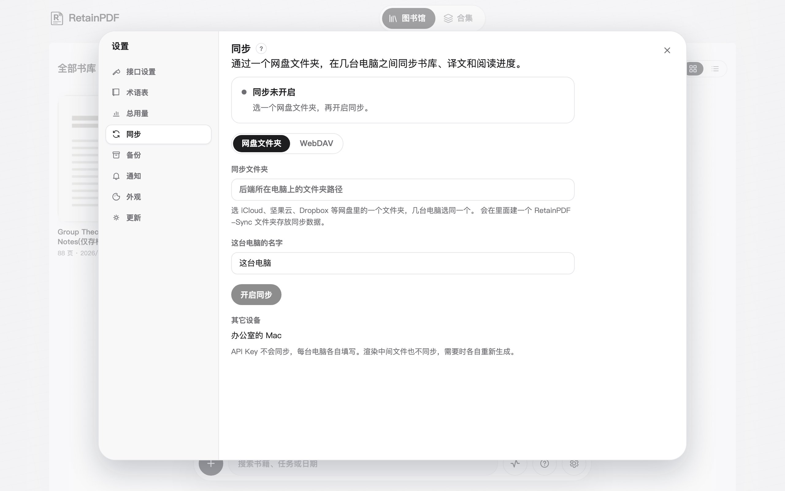

# 同步

在几台电脑之间同步书库、译文和阅读进度。

1.  →  **同步**
2. 选 **网盘文件夹**（iCloud、坚果云、Dropbox）或 **WebDAV**（群晖、Nextcloud、坚果云）
3. 几台电脑都选**同一个**位置，点 **开启同步**

之后每分钟自动同步一次。**API Key 不同步**，每台电脑各自填。

详细说明

在几台电脑之间同步书库、译文和阅读进度。比如家里和办公室各装一份，在一台上翻好的书，另一台也能读。

## 选同步方式

**设置 → 同步**，「同步方式」二选一：

### 网盘文件夹

借现成的网盘同步：iCloud、坚果云、Dropbox 等。

1. 「同步文件夹」选网盘里的一个文件夹。桌面版点「选择…」挑；网页版要手填后端所在那台电脑上的路径。
2. 几台电脑都选网盘里的**同一个**文件夹。软件会在里面建一个 `RetainPDF-Sync` 子文件夹。

### WebDAV

群晖、威联通、Nextcloud、坚果云都支持 WebDAV。

1. 填「WebDAV 地址」「账号」「密码」。坚果云要用它的「应用密码」，不是登录密码。
2. 点「测试连接」，确认能读能写。
3. 点「保存」。

密码只存在这台电脑上，不会同步出去。

## 开启

1. 给「这台电脑的名字」起个好认的名字，比如「家里的 Mac」。
2. 点「开启同步」。
3. 开启后每分钟自动同步一轮；想马上同步，点「立即同步」。

「其它设备」里会列出同一个同步位置上的其他电脑。

## 状态

- 「已同步 · 3 分钟前」：正常，后面写着这一轮收到、发出了几项。
- 「正在同步…」：正在跑。
- 在等网盘把文件下载到这台电脑：用网盘文件夹时，网盘自己还没同步完，等一会儿。
- 「同步出错」：看下面写的原因，多半是网盘文件夹不在了，或者 WebDAV 账号密码变了。

## 两台电脑改了同一本书

不会弹窗问你。两台改了同一本书的不同地方，两处都保留；改了同一处，以后改的为准。

## 不同步的东西

- **API Key**：每台电脑各自在 [接口设置](credentials.md) 里填。
- 还在跑的任务，等跑完再同步。
- 排版用的中间文件。

切换同步方式后，书库会重新全部放进新的位置，第一次会比较久。

