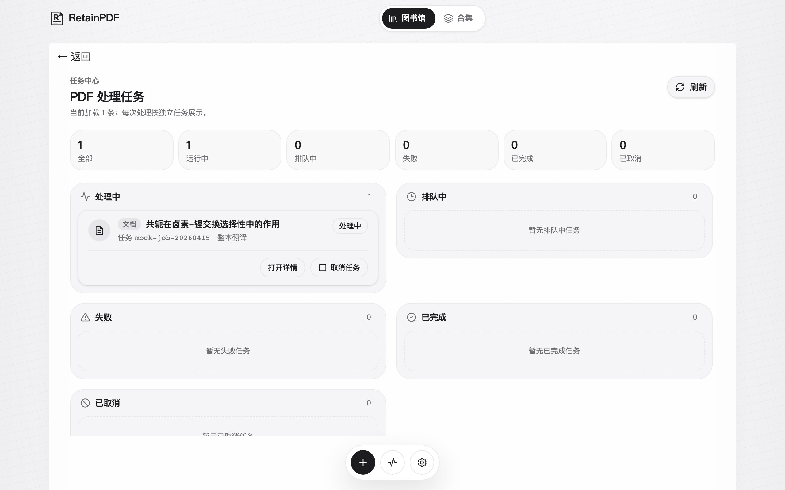

# 任务中心

底部  打开，所有处理中、排队、失败、完成的任务都在这里。

| 想要 | 点哪里 |
| --- | --- |
| 看某本书的进度 | **打开详情** |
| 停掉正在跑的任务 | **取消任务**（做完的步骤会留着） |
| 失败了接着做 | **重试** |

详细说明

底部栏的脉冲图标是 **任务中心**，列出所有 PDF 处理任务：处理中、排队中、失败、已完成、已取消，顶部有各类的数量。

每条任务可以：

- **打开详情**：打开这本书的 [详情](book-detail.md)，停在「进度」页。
- **取消任务**：任务还在跑时才有。已经完成的步骤会保留，之后可以接着做。
- **重试**：任务失败时才有，从断点接着做。重试不了时，打开详情看「出错了怎么办」。

右上角「刷新」重新读一遍列表，列表底部「加载更多任务」看更早的任务。

