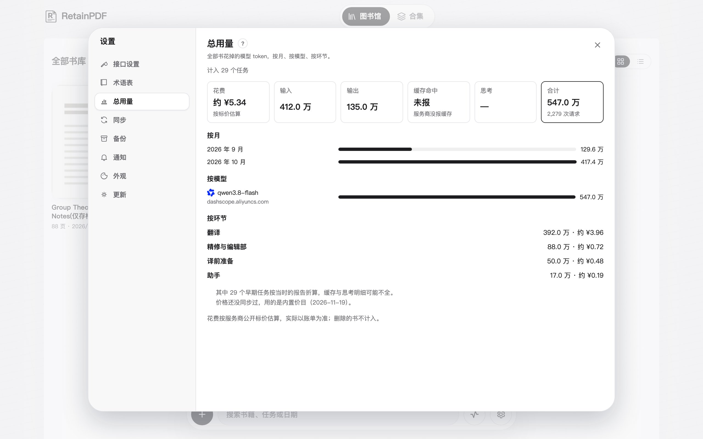

# 用量和花费

 →  **总用量**：所有书一共用了多少 token、大概花了多少钱，按月、按模型、按环节分开列。

花费是按服务商公开标价估的（1 美元按 7.16 元算），**实际扣费以服务商账单为准**。

| 想看 | 在哪 |
| --- | --- |
| 一本书花了多少 | 书的详情「概览」的 **花费** |
| 这一次任务用了多少 | 书的详情「进度」→ **本次用量** |
| 翻译前大概多少钱 | 添加 PDF 时文件下面的「预计」 |

详细说明

**设置 → 总用量**：全部书用了多少模型 token、大概花了多少钱。

## 这一页有什么

- 顶部「计入 N 个任务」。
- 一排总数：花费、输入、输出、缓存命中（和命中率）、思考、合计（和请求次数）。
- **按月**：每个月用了多少。
- **按模型**：每个模型用了多少。
- **按环节**：翻译、译前准备、精修与编辑部等各花了多少。勾了「翻译表格」的书，表格那部分单独记在「表格翻译」。

删掉的书不计入。数字读得慢时，会先显示上次的数字，标着「正在更新…」。

## 花费怎么估的

- 按 [models.dev](https://models.dev) 上各家模型的公开标价，乘以实际用掉的 token。
- 美元按 1 美元 = 7.16 元换成人民币。鼠标停在金额上能看到精确值。
- 不算折扣、包月和代金券，**实际扣费以服务商账单为准**。
- 查不到价的模型不计入，旁边会有提示。

## 单本书的花费

- [书的详情](book-detail.md#概览) 的「概览」里有这本书的累计花费。
- 「进度」页的「本次用量」是这一次任务的用量。
- [添加 PDF](ingest.md) 时，文件下面会写预计花费。
- [重新翻译](book-detail.md#重新翻译) 选模型时，旁边会写每个模型的估价。

