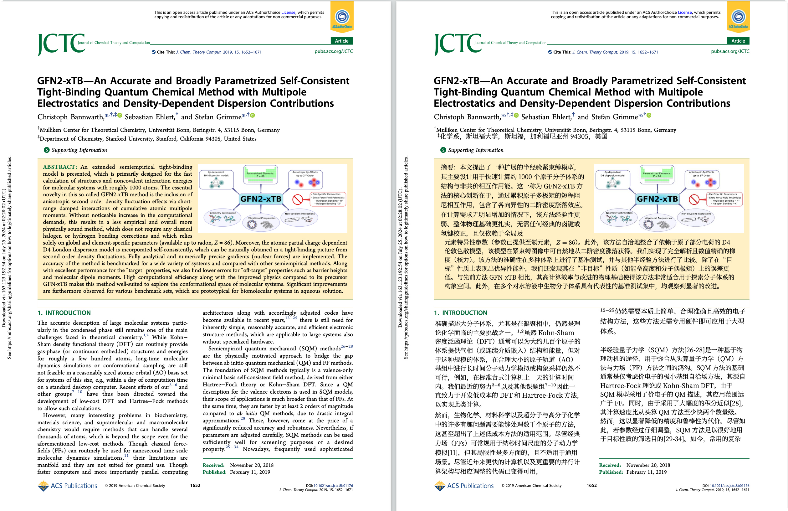

**痛点**

外文论文、教材、技术文档信息密度高，但读起来费劲：

- 原文阅读门槛高，效率低
- 普通翻译工具只吐纯文本，公式、图片、排版基本全崩
- 译后结果难整理、难分享、难归档

**RetainPDF 做的事**

上传 PDF，一键拿到保留原始排版的中文译文。

- 输出译文 PDF、Markdown、ZIP 打包，按需取用
- 网页端直接操作，也支持命令行和 API 接入
- 图片型 PDF（扫描件、截图版）同样能处理，不只限于可编辑 PDF

**翻译效果示意**

普通 SCI 论文翻译效果：



图片型 PDF 翻译对比效果：


**和同类方案比，好在哪**

- 对比 [PDFMathTranslate](https://github.com/PDFMathTranslate/PDFMathTranslate)：补上了图片型 PDF 的短板，行内公式与正文的衔接更自然，排版崩掉的概率明显低
- 对比 Doc2X 等闭源方案：可自主部署、自己掌控接口和结果文件；实测整体效果也更好
- 实测产出接近直接可用，不需要再手工修排版


# 小白用户

如果你只是想把服务跑起来，按下面步骤做就够了。

## 1. 先确认机器环境

建议环境：

- 系统：`Linux` 优先，推荐 `Ubuntu 22.04 / 24.04`
- CPU 架构：发布工作流提供 `linux/amd64` 和 `linux/arm64` 镜像
- CPU：至少 `4 核`
- 内存：至少 `8GB`，推荐 `16GB` 或更高
- 磁盘：至少预留 `10GB` 可用空间
- 网络：需要能访问 Docker Hub、MinerU 和你的模型 API

说明：

- 这个项目主要吃 CPU、内存和网络，不依赖独立显卡
- `Mac M`、树莓派和 ARM 服务器应使用镜像中的 `linux/arm64` 变体
- 如果只是轻量自用，`4 核 + 8GB` 可以起服务
- 如果你要多人同时用，建议从 `8 核 + 16GB` 起步

## 2. 安装 Docker

先确认系统里已经安装：

- `docker`
- `docker compose`

安装完成后，先自检：

```bash
docker --version
docker compose version
```

## 3. 拉取 GitHub 项目

```bash
git clone https://github.com/wxyhgk/retain-pdf.git
cd retain-pdf/ops/deployment/docker/delivery
```

## 4. 启动服务

```bash
docker compose up -d
```

启动完成后，默认访问地址：

```text
http://127.0.0.1:40001
```

# 专业用户

## 文件作用

- `docker-compose.yml`
  Docker 编排入口。默认直接拉取 Docker Hub 镜像并启动 `app` + `web`。
- `docker/app.env`
  后端运行参数。控制容器内路径、字体、端口、并发和上传限制。
- `docker/web.env`
  Docker 公共版 web 容器运行参数。控制 NGINX 后端 key 注入、
  前端 provider 和模型默认值等。
- `docker/auth.local.json`
  Rust API 鉴权白名单。前端和 CLI 都需要用这里配置的后端 key 才能访问接口。
  仓库里带的是公开的占位 key `replace-with-your-backend-key`，不改也能用：app 容器第一次启动时
  会生成一把随机 key 代替它（见下面「后端 key」）。

## 常见修改项

### 后端 key

- **不改**：`auth.local.json` 和 `web.env` 里还是占位 key 时，app 容器第一次启动生成一把随机 key
  （64 位十六进制），存在共享卷 `api_key`（容器里的 `/run/retainpdf-key/backend-api-key`），
  后端改用它；web 容器从同一个卷读，NGINX 替浏览器补的也是它。之后每次启动沿用同一把，
  `docker compose down -v` 删了卷才会重新生成。占位 key 本身不再能用。
  要自己拿 key 调接口（CLI、直连 `41000`）：

  ```bash
  docker compose exec app cat /run/retainpdf-key/backend-api-key
  ```

- **自己定**：把 `auth.local.json` 的 `api_keys` 和 `web.env` 的 `RETAINPDF_PROXY_API_KEY` 换成同一个随机长串
  （例如 `openssl rand -hex 32`），就不会再生成。也可以在 `app.env` 里设 `RUST_API_KEYS`，它优先于文件。
- **旧的 compose 文件**（没有 `api_key` 卷）拉新镜像：照旧用占位 key，启动日志里打一条警告。
- 容器里后端监听 `0.0.0.0`，所以 key 至少要 16 个字符，开发默认的 `dev-local-key` 不能用，否则后端拒绝启动。

### docker/auth.local.json

- `api_keys`
  Rust API 允许访问的后端 key 列表。前端请求头里的 `X-API-Key` 必须命中这里的某一个值。
- `max_running_jobs`
  后端允许同时运行的任务数上限。
- `simple_port`
  只提供 `/health`、`/ready` 的第二个端口，在容器内监听的端口，默认 `42000`。对外通常不直接暴露。

### docker/web.env

- `FRONT_API_BASE`
  前端内部使用的 API 基地址。通常留空，让前端自动走同源代理。
- `RETAINPDF_PROXY_API_KEY`
  web 容器内的 NGINX 在 `/api/` 请求缺少 `X-API-Key` 时注入的后端
  key。必须与 `docker/auth.local.json` 中的一个值一致；两边都还是占位 key 时自动换成生成的那把。
- `FRONT_X_API_KEY`
  只为旧的非同源客户端保留的兼容字段。标准 Docker/NGINX 部署应留空，
  避免后端 key 出现在浏览器可读的 `runtime-config.js`。
- `FRONT_OCR_PROVIDER`
  前端默认 OCR provider。当前建议填 `paddle`，也可以切成 `mineru`。
- `FRONT_PADDLE_TOKEN`
  前端默认带出的 Paddle token。留空时，最终用户自己在页面弹窗里填写。
- `FRONT_MINERU_TOKEN`
  前端默认带出的 MinerU token。留空时，最终用户自己在页面弹窗里填写。
- `FRONT_MODEL_API_KEY`
  前端默认带出的模型 API key。留空时由最终用户自己填写。
- `FRONT_MODEL`
  前端默认模型名，例如 `deepseek-flash`。
- `FRONT_BASE_URL`
  前端默认模型服务地址，例如 `https://api.deepseek.com/v1`。

### docker/app.env

- `PROJECT_ROOT`
  容器内项目根目录。
- `RUST_API_ROOT`
  容器内 Rust API 目录。
- `RUST_API_DATA_ROOT`
  Rust API 运行时数据根目录，主要放上传文件、任务目录、下载缓存和数据库。`RUST_API_DATA_DIR` 仅作为旧别名兼容。
- `OUTPUT_ROOT`
  任务输出目录。
- `PYTHON_BIN`
  后端调用 Python 脚本使用的解释器。
- `TYPST_BIN`
  Typst 可执行文件路径。
- `RETAIN_PDF_FONT_PATH`
  默认中文字体文件路径。
- `RETAIN_PDF_TYPST_FONT_FAMILY`
  Typst 默认字体族名称。
- `RUST_API_PORT`
  完整 API 在容器内监听的端口，默认 `41000`。
- `RUST_API_SIMPLE_PORT`
  只提供 `/health`、`/ready` 的第二个端口，在容器内监听的端口，默认 `42000`。
- `RUST_API_MAX_RUNNING_JOBS`
  最大并发运行任务数。
- `RUST_API_UPLOAD_MAX_BYTES`
  后端普通上传大小限制，`0` 表示不限制；当前交付包建议写成 `209715200`。
- `RUST_API_UPLOAD_MAX_PAGES`
  后端普通上传页数限制，`0` 表示不限制；当前交付包建议写成 `300`。
- `RUST_API_MIN_FREE_DISK_MB`（默认 `1024`，不写就是它）
  数据卷所在磁盘剩余空间低于它时，新上传、新任务会被拒绝（提示磁盘空间不够），正在跑的任务不受影响；`0` 关掉检查。
  磁盘满了 SQLite 写不进去，任务会成批失败，所以宁可先拒。腾空间：在页面里删掉不要的任务。
- `RUST_API_DERIVED_CACHE_RETENTION_DAYS`（默认 `14`；`0` 不清，2026-11-02 以前默认就是 `0`）
  已结束任务和书的派生缓存（Word、对照 PDF、线性化 PDF、页预览、渲染的准备缓存和预热）生成后超过这么多天就删，6 小时检查一次。
  删了下次下载、原地重渲染时重新生成（整本书的 Word 要几分钟），译文 PDF、原文和翻译结果不删。磁盘紧张时可以设成 `30`。
  另外不用设置：成功任务里重复存的 OCR 原始压缩包、解包副本、上一份译文和旧的打包 zip 每轮都会删。
- `RUST_API_ALLOWED_ORIGINS`（默认不写）
  额外放行跨域的网页来源，逗号分隔，写全 `https://pdf.example.com`。标准部署走 web 容器同源代理，
  用域名访问也不用配；只有页面挂在别的主机、直接跨域调后端时才要写。
- `RUST_API_ALLOWED_HOSTS`（默认不写）
  允许的 `Host` 主机名，逗号分隔，例如 `pdf.example.com`。容器里后端监听 `0.0.0.0`，不写就不校验 `Host`，
  用域名访问照常；写了就只认这些主机名、`localhost` 和 IP 字面量（防 DNS rebinding），注意把 NGINX
  转发过来的域名都写上。规则见 `docs/core/api/index.md` 的「1.1 单机模式的来源和主机」。

## 说明

- 当前 compose 默认暴露：
  - `127.0.0.1:40001`：前端页面和同源 API 代理
  - `127.0.0.1:41000`：完整 Rust API，仅供本机调试
  - `127.0.0.1:42000`：第二个端口，只提供 `/health` 和 `/ready`（旧的一步提交接口 `POST /api/v1/translate/bundle` 已于 2026-10-19 删除）
- `HOST_BIND_ADDRESS` 默认是 `127.0.0.1`。只有在另外配置了可靠的网络边界鉴权时，
  才应显式改为 `0.0.0.0`。**`40001` 端口能被谁访问，谁就有全部权限**：NGINX 会给没带 key 的请求
  补上后端 key，后端 key 换得再长也拦不住经过 `40001` 的请求（包括能在服务器上执行命令的助手终端、
  读出已保存的模型和 OCR 凭据）。要让别的机器访问，在前面加一层带登录的反向代理（例如
  [宿主机 NGINX 示例](../../nginx/retainpdf.example.conf) 的 `auth_basic`），不要直接改成 `0.0.0.0`。
  后端 key 只保护直连的 `41000`。
- 前端通过同源代理访问后端；普通用户通常不需要手工理解 `API Base`
- `RETAINPDF_PROXY_API_KEY` 由 web 容器内的 NGINX 注入，不会输出到浏览器
  `runtime-config.js`。它必须与 `docker/auth.local.json` 中的一个 key 一致。
- 当前主线前端默认 OCR provider 是 `paddle`
- 页面里显示的大小 / 页数限制来自当前后端运行配置，不应再按旧的 MinerU 固定上游限制理解

# 使用域名和 NGINX 反向代理

宿主机 NGINX 只需代理到 `127.0.0.1:40001`，不要直接把域名指向
`41000` 或 `42000`。完整示例位于：

```text
ops/deployment/nginx/retainpdf.example.conf
```

以 Ubuntu 为例：

```bash
sudo apt-get update
sudo apt-get install -y nginx apache2-utils certbot

# RetainPDF 目前是单工作区服务，公网部署至少增加独立访问门禁。
sudo htpasswd -c /etc/nginx/retainpdf.htpasswd retainpdf

# 获取证书时需先确保 80 端口可从公网访问；standalone
# 需要暂时停止占用 80 端口的 NGINX。
sudo systemctl stop nginx
sudo certbot certonly --standalone -d pdf.example.com
sudo systemctl start nginx

sudo cp ops/deployment/nginx/retainpdf.example.conf /etc/nginx/sites-available/retainpdf.conf
# 把配置中的 pdf.example.com 替换为真实域名。
sudo ln -sfn /etc/nginx/sites-available/retainpdf.conf /etc/nginx/sites-enabled/retainpdf.conf
sudo nginx -t
sudo systemctl reload nginx
```

宿主机代理必须同时保留：

- `client_max_body_size 256m`；
- `/api/v1/ai/ask` 和 `/api/v1/jobs/:job_id/progress/stream` 的 SSE 禁止缓冲（后者 Rust API 自己也带
  `X-Accel-Buffering: no`，代理没配也不会被缓冲）；
- 长请求超时；
- `Host` / `X-Forwarded-*` 头；
- Basic Auth、OAuth2 Proxy 或 Cloudflare Access 之一。

如果不需要宿主机直接调试 Rust API，可以将 compose 中 app 的
`41000` / `42000` 两个 `ports` 删除；web 容器通过 Docker 内部网络访问
`app:41000`，不依赖这两个宿主机映射。

## 可选默认值

如果你想让前端默认带出下游配置，可以继续填写：

- `FRONT_OCR_PROVIDER`
- `FRONT_PADDLE_TOKEN`
- `FRONT_MINERU_TOKEN`
- `FRONT_MODEL_API_KEY`
- `FRONT_MODEL`
- `FRONT_BASE_URL`

如果留空，最终用户需要在页面右上角的“API 配置”弹窗中自己填写。

## 如果要换成你自己的镜像版本

也可以这样启动：

```bash
APP_IMAGE=wxyhgk/retainpdf-app:<version> \
WEB_IMAGE=wxyhgk/retainpdf-web:<version> \
docker compose up -d
```

# 多用户模式（商业版）

默认的 Docker 部署是**单工作区**：所有人共用一份数据，靠 NGINX 前面的 Basic Auth 之类挡外人。
多用户模式下每个人用自己的账号登录，数据按账号隔离，翻译统一用平台配置的模型和 OCR（平台出钱），
并按页数扣额度。

| | 单机 / 单工作区（默认） | 多用户 |
| --- | --- | --- |
| 访问方式 | 页面直接用，NGINX 替浏览器补后端 key | 用户名 + 密码登录（会话 Cookie） |
| 数据 | 所有人共用 | 每个账号只看得到自己的 |
| 模型和 OCR | 每个用户在页面里填自己的 key | 统一用平台的，管理员在管理后台「平台设置」页配置 |
| 用量 | 不限 | 按页扣额度，管理员发放；管理员不限额 |
| 账号 | 无 | 管理员在管理后台建号，或者发邀请码让对方自己注册 |

## 部署步骤

在 `ops/deployment/docker/delivery` 目录下操作。

1. **改后端 key（只给内部服务用）。** `docker/auth.local.json` 的 `api_keys` 换成一个随机的长字符串，
   例如 `openssl rand -hex 32` 的输出。多用户模式下浏览器不再用这个 key；AI 服务、任务服务等内部
   组件之间还要用它。**拿到这个 key 就等于拥有全部数据的权限**，不要外泄。

2. **填多用户配置** `docker/multi-user.env`（每一项的说明写在文件里）：
   - `RETAIN_BOOTSTRAP_ADMIN_PASSWORD`：第一个管理员的密码，至少 8 位；
   - `RETAIN_ALLOWED_ORIGINS`：用户在浏览器里访问的地址，例如 `https://pdf.example.com`；
   - 其余保持默认即可。

3. **用叠加配置启动：**

   ```bash
   docker compose -f docker-compose.yml -f docker-compose.multi-user.yml up -d
   ```

   之后的 `pull`、`up -d`、`down` 都要带上这两个 `-f`。

   `docker-compose.multi-user.yml` 会**强制把 web 容器的 `RETAINPDF_PROXY_API_KEY` 设为空**——这一项
   不能自己改回去。单机部署里 NGINX 替浏览器补后端 key；多用户模式下要是还补，后端会把每个请求都
   当成「内部服务」，不用登录就能看到所有人的数据，已登录的用户也会越过数据隔离。

4. **配 HTTPS 和域名**，按上面「使用域名和 NGINX 反向代理」一节。区别只有一点：多用户模式自带登录，
   宿主机 NGINX 上的 Basic Auth 可以去掉（留着也行，只是用户要登录两次）。登录 Cookie 默认只走
   HTTPS（`RETAIN_SESSION_COOKIE_SECURE=1`），**不配 HTTPS 用户登录不上**。

5. **上线前检查**（把域名换成你的）：

   ```bash
   # 必须是 401：没登录就访问接口要被拒绝。
   # 如果是 200，说明 NGINX 还在替浏览器补后端 key——立刻停服排查第 3 步。
   curl -s -o /dev/null -w '%{http_code}\n' https://pdf.example.com/api/v1/jobs

   # 必须是 "multi"。
   curl -s https://pdf.example.com/api/v1/auth/session
   ```

6. **管理员登录、改密码。** 打开网站，用 `admin` 和第 2 步的密码登录，在账户页改掉密码。然后把
   `docker/multi-user.env` 里 `RETAIN_BOOTSTRAP_ADMIN_USERNAME` 和 `RETAIN_BOOTSTRAP_ADMIN_PASSWORD`
   **两行都删掉**，再执行一次第 3 步的命令，别让明文密码留在服务器上（只清空密码会导致启动失败）。

7. **配平台模型和 OCR。** 打开 `/admin.html` →「平台设置」，填翻译模型（模型名、接口地址、协议、
   API Key）和 OCR（MinerU 或 Paddle 加 token），先点「检测」再保存。保存即生效，不用重启。
   没配好之前，用户提交翻译会提示「平台还没配置……」。

8. **请用户进来、发页数。** 两种方式，可以混用：
   - **邀请码**（推荐）：`/admin.html` →「邀请码」生成邀请码发给对方，对方在登录页选「用邀请码注册」，
     自己设用户名和密码，注册完直接登录。生成时可以定能用几次（默认 1 次）、注册送几页（默认 0）、
     几天后过期（默认不过期）；不想再用了随时作废，已经注册的账号不受影响。
   - **管理员建号**：`/admin.html` →「账号管理」新建账号，系统生成初始密码交给对方，首次登录要改。

   新账号默认 0 页（邀请码设了赠送页数的除外），在「账号管理」里给账号发放页数。

## 上线后

- **计费规则**：按一次提交实际选中的页数预扣；任务失败、取消、被删全额退回；纯 OCR 和翻译各算一次；
  重新排版不计费。余额不够时提交会被拒绝并提示剩余页数。
- **上传限制**：沿用 `docker/app.env` 的 `RUST_API_UPLOAD_MAX_BYTES`（默认 200 MB）和
  `RUST_API_UPLOAD_MAX_PAGES`（默认 300 页），对所有账号生效。
- **并发**：全站同时运行的任务数由 `docker/app.env` 的 `RUST_API_MAX_RUNNING_JOBS` 控制（它会覆盖
  `docker/auth.local.json` 里的 `max_running_jobs`）；单个任务的翻译并发上限在「平台设置」里配，
  防止把平台的 key 打到限流。
- **数据和备份**：账号、额度账本、任务都在 `app_data` 卷的数据库里；平台的密钥在同一个卷的
  `secrets/credentials.json`。备份要包含整个卷。
- **端口**：app 映射到宿主机的 `41000` / `42000` 只用于本机调试，用后端 key 访问等于内部服务。
  不需要时可以把 `docker-compose.yml` 里 app 的 `ports` 删掉，web 容器走 Docker 内部网络，不受影响。
- **暂不开放给网站账号的功能**：AI 问答、附件，。

## 从单机部署切换过来

可以直接切，原有数据不会丢，但**原来的书和任务归在「本机用户」名下，网站账号（包括管理员账号）
都看不到**。如果需要保留原来的使用方式，建议另起一个数据卷部署多用户版。

## 常见问题

- **app 起不来，日志里是 `RETAIN_BOOTSTRAP_ADMIN_USERNAME and RETAIN_BOOTSTRAP_ADMIN_PASSWORD must be set together`**：
  第 2 步的管理员密码没填，或者第 6 步只清空了密码、没删用户名。
- **登录后一刷新就掉线**：浏览器没存下 Cookie，通常是没走 HTTPS。正式部署请配 HTTPS；只在本机用
  `http://127.0.0.1` 试用时，可以临时把 `RETAIN_SESSION_COOKIE_SECURE` 改成 `0`。
- **保存、提交时提示 `request origin is not allowed`**：`RETAIN_ALLOWED_ORIGINS` 没写对，要和浏览器
  地址栏里的协议、域名、端口完全一致。
- **提交翻译提示「平台还没配置翻译模型 / OCR」**：去「平台设置」配好并保存。
- **提交提示「页数额度不够」**：管理员在「账号管理」里给这个账号发放页数。

# 开发者

如果你想直接用 CLI 调接口，而不是走前端页面，可以按下面方式调用。

先约定几个变量：

```bash
export HOST="http://127.0.0.1:40001"
# 经过 40001 时可以不带 key（NGINX 会补）；直连 41000 或要显式带 key 时，用自动生成的那把
# （自己换过 key 就填自己的）。
export X_API_KEY="$(docker compose exec -T app cat /run/retainpdf-key/backend-api-key)"
export OCR_PROVIDER="paddle"
export PADDLE_TOKEN="your-paddle-token"
export MINERU_TOKEN="your-mineru-token"
export MODEL_API_KEY="your-model-api-key"
export MODEL="deepseek-flash"
export BASE_URL="https://api.deepseek.com/v1"
```

## 健康检查

```bash
curl "$HOST/health"
```

## 上传 PDF

```bash
curl -X POST "$HOST/api/v1/uploads" \
  -H "X-API-Key: $X_API_KEY" \
  -F "file=@/absolute/path/to/your.pdf"
```

返回里会拿到：

- `upload_id`
- `filename`
- `page_count`

## 创建异步任务

先把上一步返回的 `upload_id` 填进去：

```bash
curl -X POST "$HOST/api/v1/jobs" \
  -H "X-API-Key: $X_API_KEY" \
  -H "Content-Type: application/json" \
  -d '{
    "workflow": "book",
    "source": {
      "upload_id": "your-upload-id"
    },
    "ocr": {
      "provider": "'"$OCR_PROVIDER"'",
      "paddle_token": "'"$PADDLE_TOKEN"'",
      "mineru_token": "'"$MINERU_TOKEN"'"
    },
    "translation": {
      "api_key": "'"$MODEL_API_KEY"'",
      "model": "'"$MODEL"'",
      "base_url": "'"$BASE_URL"'",
      "mode": "sci"
    },
    "render": {
      "render_mode": "auto"
    },
    "runtime": {
      "workers": 100,
      "batch_size": 1,
      "classify_batch_size": 12,
      "compile_workers": 8,
      "timeout_seconds": 1800
    }
  }'
```

返回里会拿到：

- `job_id`
- `status`

## 查询任务状态

```bash
curl -H "X-API-Key: $X_API_KEY" \
  "$HOST/api/v1/jobs/your-job-id"
```

重点看这些字段：

- `status`
- `stage`
- `stage_detail`
- `progress`
- `actions`

任务终态通常是：

- `succeeded`
- `failed`
- `canceled`

## 下载结果

下载 PDF：

```bash
curl -L -H "X-API-Key: $X_API_KEY" \
  "$HOST/api/v1/jobs/your-job-id/files/output/translated.pdf" \
  -o translated.pdf
```

下载原文 Markdown（OCR 识别结果，不是译文）：

```bash
curl -L -H "X-API-Key: $X_API_KEY" \
  "$HOST/api/v1/jobs/your-job-id/files/output/ocr.md" \
  -o ocr.md
```

下载全部成品 ZIP（任务成功后才能下）：

```bash
curl -L -H "X-API-Key: $X_API_KEY" \
  "$HOST/api/v1/jobs/your-job-id/files/output/all.zip" \
  -o result.zip
```

## 取消任务

```bash
curl -X POST -H "X-API-Key: $X_API_KEY" \
  "$HOST/api/v1/jobs/your-job-id/actions/cancel"
```
